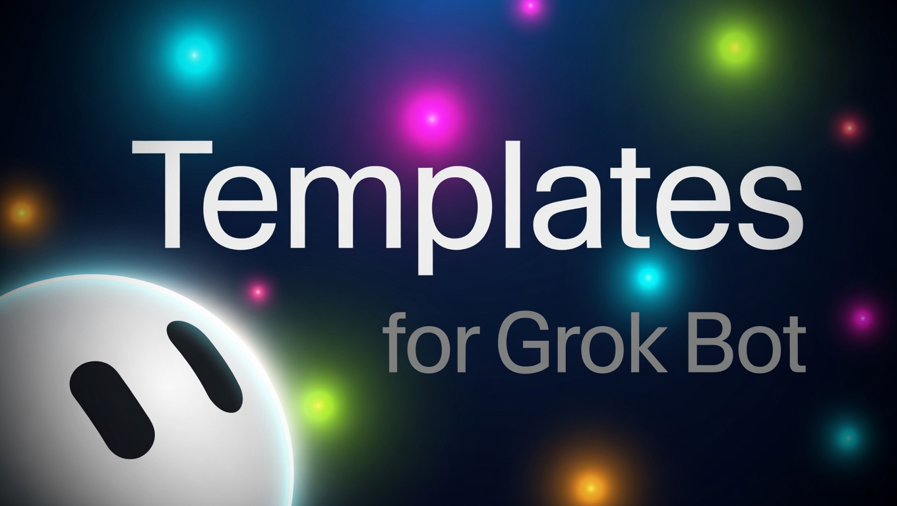

<p align="center">
  
</p>

# Templates for Grok Bot Evolved

<p align="center">
  <strong><a href="https://aicyberguardian.github.io/grok-bot-templates-evolved/">Browse the template catalog →</a></strong><br/>
  Pick a card. Copy PROFILE. Paste it into Edit Profile. No clone, no Node.
</p>

[](https://github.com/AICyberGuardian/grok-bot-templates-evolved/actions/workflows/ci.yml)
[](LICENSE)
[](https://aicyberguardian.github.io/grok-bot-templates-evolved/)
[](https://aicyberguardian.github.io/grok-bot-templates-evolved/)

**Stop pasting vibes. Design the Bot. Get a score.**

Operating contracts for [Grok Bot](https://x.ai/bot) — xAI's durable AI teammate. Spec, Bot Ready score, teams, skills, routines, FastMCP daemons, and dual-format JSON compilation. Paste one URL. Tap a team.

Companion in spirit to [loop-engineering](https://github.com/cobusgreyling/loop-engineering) (inner loops) and [outerloop](https://github.com/cobusgreyling/outerloop) (evidence → verdict). Originally created by [Cobus Greyling](https://github.com/cobusgreyling/grok-bot-templates) and evolved by [AICyberGuardian](https://github.com/AICyberGuardian/grok-bot-templates-evolved).

> Not affiliated with xAI. Grok Bot is a product of xAI / Cursor. Templates here are contracts you paste into **your** account.

## Install in 60 seconds — no Node

1. In Grok Bot: **New → Create new agent**. Name it **Setup**.
2. Paste this URL and send:

```
https://raw.githubusercontent.com/AICyberGuardian/grok-bot-templates-evolved/main/START.md
```

3. Tap a team. Try **Eng** (Bug Reproduction + Issue Drafter + PR Reviewer) or **Agora Career** (Career Engineer + Jenny Ops Lead + Haggle Bot Procurement).
4. Connect the plugins it lists. Stay at **L1** for a week — drafts, not sends.

Setup fetches each Bot's `PROFILE.md`. It does not invent prompts.

→ [Pages catalog](https://aicyberguardian.github.io/grok-bot-templates-evolved/) (copy PROFILE per card) · [Quickstart](./QUICKSTART.md) · [What do you want to do?](./docs/jobs.md) · [32-Chapter Canonical Manual](./docs/grok-bot-canonical.llm.md)

## Or copy one PROFILE

Paste the raw `PROFILE.md` into **Bot actions → Edit Profile**. Connect the plugins it names. Send the first task. Do not enable a routine until two runs look right.

| Bot | Why | Raw PROFILE |
|-----|-----|-------------|
| [PR Reviewer](templates/engineering/pr-reviewer/) | Review starts at the scary diff | [PROFILE.md](https://raw.githubusercontent.com/AICyberGuardian/grok-bot-templates-evolved/main/templates/engineering/pr-reviewer/PROFILE.md) |
| [Jenny Ops Lead](templates/ops/jenny-ops-lead/) | Fleet alignment, blockers, 5 AM 1:1 standups | [PROFILE.md](https://raw.githubusercontent.com/AICyberGuardian/grok-bot-templates-evolved/main/templates/ops/jenny-ops-lead/PROFILE.md) |
| [Haggle Bot Procurement](templates/ops/haggle-bot-procurement/) | Negotiation dials, vendor rate defense | [PROFILE.md](https://raw.githubusercontent.com/AICyberGuardian/grok-bot-templates-evolved/main/templates/ops/haggle-bot-procurement/PROFILE.md) |
| [Chief of Staff](templates/ops/chief-of-staff/) | Only items that map to the priority list | [PROFILE.md](https://raw.githubusercontent.com/AICyberGuardian/grok-bot-templates-evolved/main/templates/ops/chief-of-staff/PROFILE.md) |
| [Quill Harness](templates/engineering/quill-harness/) | Claude-to-Grok bridge, multi-engine pipelines | [PROFILE.md](https://raw.githubusercontent.com/AICyberGuardian/grok-bot-templates-evolved/main/templates/engineering/quill-harness/PROFILE.md) |

Full catalog: **59 templates · 13 teams · 56 skills · 11 routines · 22 patterns**. All stable templates score **100/100** Bot Ready.

## CLI (optional)

```bash
npx --yes github:AICyberGuardian/grok-bot-templates-evolved list
npx --yes github:AICyberGuardian/grok-bot-templates-evolved init pr-reviewer --print
npx --yes github:AICyberGuardian/grok-bot-templates-evolved score pr-reviewer --badge
npx --yes github:AICyberGuardian/grok-bot-templates-evolved init --team agora-career --out ./career-bots
```

Dual-format compilation and MCP daemon commands:

```bash
npx --yes github:AICyberGuardian/grok-bot-templates-evolved export-json jenny-ops-lead
npx --yes github:AICyberGuardian/grok-bot-templates-evolved mcp-init fleet-ops
```

## Choose a door

| Persona | Start |
|---------|--------|
| **I have Grok Bot open** | Paste [START.md](https://raw.githubusercontent.com/AICyberGuardian/grok-bot-templates-evolved/main/START.md) |
| **I want a team** | Tap Agora Career / Eng / Ops / Meta in Setup · [teams/](./teams/) |
| **I want to write a Bot** | `npx --yes github:AICyberGuardian/grok-bot-templates-evolved new my-job --category ops` · [authoring](./docs/authoring.md) |
| **I want to convert one** | [convert/](./convert/) (Claude, Hermes, Gemini, Cursor) |
| **I want FastMCP daemons** | [mcp-servers/](./mcp-servers/) (FleetOps, KnowledgeBrain, SeomaticGSC) |
| **I want to share one** | [sanitizer](./templates/meta/sanitizer/) · [sharing](./docs/sharing.md) |
| **My Bot should read this catalog** | [docs/agent.md](./docs/agent.md) |

## Autonomy

| Level | Name | Week one |
|-------|------|----------|
| **L0** | Observe | Read, report |
| **L1** | Draft | **Default.** Review-ready artifacts |
| **L2** | Approved action | Named writes after in-chat approval |
| **L3** | Scheduled | Routine + missing-source policy + test run |

→ [docs/autonomy.md](./docs/autonomy.md)

## Bot Ready score

`grokbot score <id>` is 100 points: job, sources, never-list, deliverable, first task, skill, no-data, autonomy, example, routine discipline, share-safe, working style.

**Ready** means ≥ 80. CI fails a stable template under that line.

```bash
npx --yes github:AICyberGuardian/grok-bot-templates-evolved score --badge --md
# 
```

## The loop in 60 seconds

```
Job → Boundary → Skill → Routine → Team
who   never      how     when      handoff
```

A Bot is a durable teammate with a name, a job, a conversation, and working context. Official docs: [Get started](https://docs.x.ai/grok-bot/get-started) · [Bots](https://docs.x.ai/grok-bot/bots) · [Use cases](https://docs.x.ai/grok-bot/use-cases).

Week one is **L1 Draft** — review-ready artifacts, no send/post/pay/merge/production. Same discipline as loop-engineering's report-only week.

→ [SPEC.md](./SPEC.md) (binding) · [vs alternatives](./docs/vs-alternatives.md) · [Canonical Manual](./docs/grok-bot-canonical.llm.md)

## CLI essentials

| Command | Purpose |
|---------|---------|
| `start` | Print START.md |
| `list` | Catalog |
| `show <id>` | One contract |
| `init <id> --print` | Paste-ready PROFILE |
| `init --team <id>` | Roster + kickoff |
| `score [--badge]` | Bot Ready, optional SVG / shields.md |
| `validate` / `doctor` | Schema, secrets, drift |
| `export-json <id>` | Compile to official xAI template.v1.json |
| `mcp-init <server>` | Scaffold FastMCP daemon configuration |
| `catalog` | JSON for other Bots |
| `new` | Scaffold a stub |

## Progressive adoption

| Level | What you get | Docs |
|-------|--------------|------|
| **1 — One Bot** | PROFILE + first task | [anatomy](./docs/anatomy.md) |
| **2 — Skill** | Six official fields | [SPEC](./SPEC.md) |
| **3 — Team** | 2–4 Bots, visible handoffs | [chat docs](https://docs.x.ai/grok-bot/chat-and-collaboration) |
| **4 — Routine** | After two good runs + test run | [skills & routines](https://docs.x.ai/grok-bot/skills-routines-and-automations) |
| **5 — FastMCP** | High-throughput local runtime tools | [mcp-servers/](./mcp-servers/) |

## Safety

Shared computer. Shared plugins. Share links are public. This catalog is share-safe by construction and scanned in CI.

→ [docs/safety.md](./docs/safety.md) · [SECURITY.md](./SECURITY.md)

## Machine API

Public, no auth. Point a Bot at [docs/agent.md](./docs/agent.md).

| URL | Contents |
|-----|----------|
| https://aicyberguardian.github.io/grok-bot-templates-evolved/api/v1/status.json | version, capabilities |
| https://aicyberguardian.github.io/grok-bot-templates-evolved/catalog.json | full catalog |
| https://aicyberguardian.github.io/grok-bot-templates-evolved/catalog/templates-v1.json | bundled xAI JSON templates |
| https://aicyberguardian.github.io/grok-bot-templates-evolved/api/v1/teams.json | teams |
| https://aicyberguardian.github.io/grok-bot-templates-evolved/llms.txt | short machine summary |

## Status

**v1.2.0** — canonical corpus ingestion (32 chapters), dual-format JSON compilation, FastMCP self-healing daemons, Grok plugin marketplace manifests, and 10 production templates.

→ [CHANGELOG.md](./CHANGELOG.md) · [ROADMAP.md](./ROADMAP.md)

## Development

```bash
git clone https://github.com/AICyberGuardian/grok-bot-templates-evolved.git
cd grok-bot-templates-evolved
npm install
npm run ci
```

Upstream synchronization:

```bash
npm run sync:upstream
```

→ [CONTRIBUTING.md](./CONTRIBUTING.md) · [Good first issues](./docs/good-first-issues.md) · [Code of Conduct](./CODE_OF_CONDUCT.md)

## Sources

- [Grok Bot docs](https://docs.x.ai/grok-bot/get-started)
- [Official use cases](https://docs.x.ai/grok-bot/use-cases)
- [Canonical architecture manual](./docs/grok-bot-canonical.llm.md)
- [Research notes](./docs/research.md)
- [loop-engineering](https://github.com/cobusgreyling/loop-engineering) (quality bar)
- [cobusgreyling/grok-bot-templates](https://github.com/cobusgreyling/grok-bot-templates) (upstream foundation)

## License

MIT © 2026 Cobus Greyling & AICyberGuardian Contributors
