<!-- SHA256: 9633f06e1c3d1835b569a73e41367f87de98189381892ca0b75e9d6324fbe9c9 -->
# Grok Bot Canonical Corpus & Engineering Playbook
> Monolithic LLM Context Bundle | Compiled: 2026-10-20T02:39:43.928338+00:00
> Authorities: xAI Grok Bot Guides (https://x.ai/bot/guides) & Cursor Grok Bot Docs (https://cursor.com/docs/grok-bot)

---

## 📑 Table of Contents

### Part I: Canonical Architecture & Operations Manual

- [Foundations: Architecture & Cloud Sandboxing](#chapter-1)
- [Foundations: Human-in-the-Loop Handover Protocols](#chapter-2)
- [Foundations: Anatomy of a Bot & Profile Definition](#chapter-3)
- [Foundations: Enterprise Security, Firecracker MicroVMs & Isolation](#chapter-4)
- [Foundations: Failure Modes, Edge-Cases & Operational Gotchas](#chapter-5)
- [Foundations: Fleet Economics, Pricing & Quota Engineering](#chapter-6)
- [Workflows: Messaging & Multimodal Interaction](#chapter-7)
- [Workflows: Routines, Scheduling & Autonomous Runs](#chapter-8)
- [Workflows: Skills & Recorded Playbooks](#chapter-9)
- [Workflows: Plugins, Connectors & Model Context Protocol (MCP)](#chapter-10)
- [Workflows: Walkthrough Video Analysis & Field Notes](#chapter-11)
- [Workflows: Custom FastMCP Server Developer Playbook](#chapter-12)
- [Templates: Philosophy: Recipe vs. Meal](#chapter-13)
- [Templates: Packaging & Publishing Lifecycle](#chapter-14)
- [Templates: Installing & Bootstrapping Templates](#chapter-15)
- [Templates: Bot Marketplace Catalog & Ecosystem Categories](#chapter-16)
- [Templates: Deep Deconstruction of Top Marketplace Recipes](#chapter-17)
- [Multi-Bot Teams: Team Topologies & Roster Patterns](#chapter-18)
- [Multi-Bot Teams: Channel Coordination & Asynchronous Handoffs](#chapter-19)
- [Multi-Bot Teams: External State Boards: Notion & Linear](#chapter-20)
- [Multi-Bot Teams: Operations Management & Incident Postmortems](#chapter-21)
- [Engineering: Cursor Cloud Agents Orchestration](#chapter-22)
- [Engineering: Private Workers & Hardware Extensions](#chapter-23)
- [Engineering: Automated CI/CD, PR Reviews & Nightly Sweeps](#chapter-24)
- [Engineering: Community Stacks, The Harness Era & Model Routing](#chapter-25)
- [Domain Playbooks: Mobile App Development (Rank'em Studio)](#chapter-26)
- [Domain Playbooks: Support Triage & Customer Operations](#chapter-27)
- [Domain Playbooks: Product Management & Spec Generation](#chapter-28)
- [Domain Playbooks: GTM, Sales & Growth Engineering](#chapter-29)
- [Domain Playbooks: Design Systems & Figma Automation](#chapter-30)
- [Domain Playbooks: Enterprise Procurement & Vendor Negotiation (Haggle Bot)](#chapter-31)
- [Reference & Glossary: Master Terminology & Concept Graph](#chapter-32)

### Part II: Standardized Bot Templates (Recipes)

- [Software Engineer Bot Template](#software-engineer-bot-template)
- [Projects Manager Bot Template](#projects-manager-bot-template)
- [Support Triage Bot Template](#support-triage-bot-template)
- [GTM Tech Scout Template](#gtm-scout-bot-template)
- [Operations Lead (Jenny) Template](#operations-lead-jenny-template)
- [Haggle Bot Procurement Template](#haggle-bot-procurement-template)
- [Firstmate Grok Ship Template](#grok-ship-engineer-template)
- [SEO & AEO Desk Template](#seo-aeo-desk-template)
- [Alfred Org Governance Bot Template](#alfred-operations-bot-template)

### Part III: Production Companion Skills

- [Grok Bot Operations Skill](#grok-bot-ops)
- [Grok Template Packager Skill](#grok-template-packager)
- [Grok Team Orchestrator Skill](#grok-team-orchestrator)
- [Grok Bot Knowledge Base Skill](#grok-bot-kb)

---


<a id="chapter-1"></a>

# Chapter 1.1: Architecture & Cloud Sandboxing

> **Source Authorities**: `https://x.ai/bot`, `https://x.ai/bot/guides/grok-bot-101`, `https://docs.x.ai/grok-bot/overview`, `https://cursor.com/docs/grok-bot/work` [SRC-XAI-00, SRC-XAI-02, SRC-XAI-18, SRC-CUR-03]

---

## 1. The Autonomous Cloud Computer Model

Grok Bot diverges from conventional LLM chat assistants by providing each user with a dedicated, persistent Ubuntu Linux machine hosted in the cloud. The agent does not merely execute code snippets in a restricted sandbox; it has direct operational control over a virtual desktop environment, complete with display server, web browser, terminal emulator, persistent filesystem, and desktop applications.

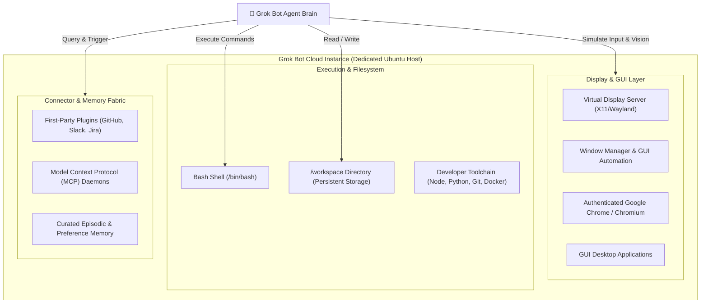

### Key Architectural Invariants

1. **Persistent Cloud Lifecycle**: The cloud computer runs continuously regardless of whether the user’s local laptop is open, sleeping, or disconnected. Tasks started on desktop continue uninterrupted when inspected on mobile iOS.
2. **Unified Filesystem (`/workspace`)**: Persistent files, downloads, cloned Git repositories, and scratch outputs reside primarily under `/workspace`. Data written by an overnight routine remains available the following morning.
3. **Dual Vision & DOM Automation**: When interacting with the web browser, Grok Bot leverages both programmatic DOM extraction and high-resolution screen vision. This allows the bot to navigate complex Single Page Applications (SPAs), canvas-based tools (Figma), and ad platforms (Meta Ads, AppLovin) where DOM-only scrapers fail.

---

## 2. The Shared Computer Model Across Bots

A critical architectural insight documented in official xAI engineering practices is that **all bots within a single user account share the same cloud computer, filesystem, and browser sessions**.

| Architectural Layer | Isolation Model | Practical Implications |
|---|---|---|
| **Virtual Machine** | Account-level shared | All bots run within the same Ubuntu VM instance. |
| **Filesystem (`/workspace`)** | Shared namespace | Bots can collaborate on files (e.g., Coder creates a PR proof, Writer drafts notes on the same file). |
| **Browser Sessions** | Shared cookies & logins | Once an account (e.g., Facebook Marketplace, GitHub, Figma) is authenticated, all bots leverage the active session. |
| **Screen Surface** | Dedicated virtual viewport | Each bot receives its own virtual screen surface for concurrent tasks. **Computer-Use Invariant**: Only one computer-use automation task (keystrokes/clicks) can execute on a single screen at a time to prevent cursor conflicts. |
| **Conversation & Context** | Strict bot isolation | Each bot maintains its own isolated system prompt, conversation history, and curated memory profile. |

> [!IMPORTANT]
> Because browser sessions and files are shared across the account VM, deleting an individual bot **does not** automatically purge the files in `/workspace` or log out authenticated browser sessions. VM cleanup must be performed deliberately if sensitive files or sessions need decommissioning.

---

## 3. Network Egress, Security & Local Tooling

The cloud computer operates with standard outbound internet connectivity, enabling:
- Package installation via `apt`, `npm`, `pip`, and `cargo`.
- Git cloning, pushing, and pulling against GitHub, GitLab, and private enterprise repositories.
- HTTP/WebSocket connections to Model Context Protocol (MCP) servers and internal corporate VPNs (via user-configured bridges or private workers).

```
+-------------------------------------------------------------+
|                      Security Boundary                      |
|                                                             |
|  [User Desktop / iOS]                                       |
|          │                                                  |
|   Encrypted WebSocket / WebRTC                              |
|          ▼                                                  |
|  [Grok Cloud Computer] ──(Remote Desktop Handover)─────────┐ |
|          │                                                 │ |
|          ├─► Outbound Web (Chrome / TLS 1.3)               │ |
|          ├─► Git Repositories (SSH Keys / OAuth)           ▼ |
|          └─► Cursor Cloud Agents (200+ parallel)    [Human Check]
+-------------------------------------------------------------+
```

When sensitive boundaries (e.g., banking credentials, production deployment tokens, CAPTCHA challenges) are encountered, execution halts and invokes the **Human Handover Protocol**, preventing unintended autonomous escalation.

---

## 4. Architectural Disambiguation: Bot vs. Automations vs. Build

A foundational architectural distinction within the 2026 xAI ecosystem is differentiating between xAI's three complementary agent paradigms:

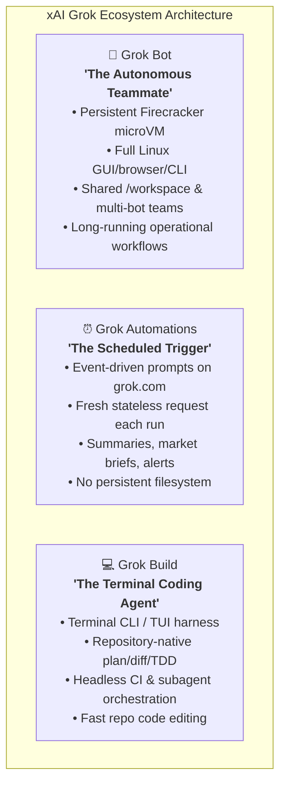

### Comparative Capabilities Matrix

| Architectural Dimension | Grok Bot (xAI × Cursor) | Grok Automations (grok.com) | Grok Build (Terminal CLI) |
|---|---|---|---|
| **Primary Role** | Digital coworker / multi-app operator | Recurring prompt runner & alert generator | Local repository coding & testing harness |
| **Virtualization Runtime** | Persistent AWS Firecracker microVM (Ubuntu) | Serverless stateless cloud execution | Local workstation shell or CI runner |
| **Filesystem & State** | Durable `/workspace` surviving restarts | Ephemeral (zero persistent disk) | Local Git working tree & worktrees |
| **GUI & Browser Access** | Full authenticated Chrome & X11 display | Headless web search only | None (CLI / code text only) |
| **Multi-Agent Teams** | Multi-bot rosters with Notion/Linear sync | Single prompt isolated runs | Subagent task delegation |
| **Primary Use Cases** | Procurement, support triage, GTM, fleet ops | Morning news briefs, tracking alerts | TDD loops, refactoring, PR generation |


---


<a id="chapter-2"></a>

# Chapter 1.2: Human-in-the-Loop Handover Protocols

> **Source Authorities**: `https://x.ai/bot/guides/grok-bot-101`, `https://cursor.com/docs/grok-bot/work` [SRC-XAI-02, SRC-CUR-03]

---

## 1. Remote Desktop Handover Architecture

A foundational principle of Grok Bot is that **humans and agents share the same physical computer control primitives**. Unlike traditional API-based agents that crash or hallucinate when confronted with anti-bot verification or multi-factor authentication, Grok Bot initiates an instant desktop handover.

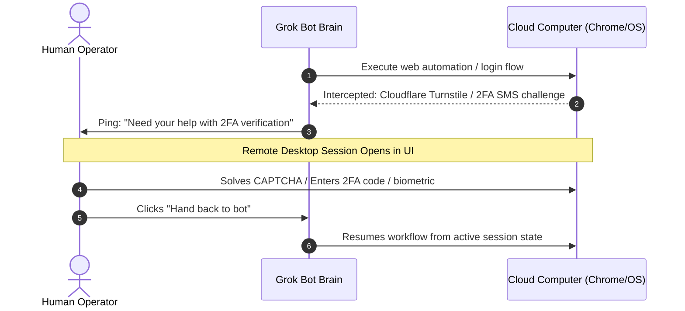

### Handover Trigger Classifications

| Trigger Category | Trigger Event | Mechanism Employed |
|---|---|---|
| **Anti-Bot Defense** | Cloudflare Turnstile, reCAPTCHA v2/v3, Arkose Labs puzzle | Interactive Remote Desktop window streaming via WebRTC. |
| **Identity & 2FA** | SMS verification codes, TOTP Authenticator prompts, Passkeys | Remote desktop interaction or mobile push notification. |
| **Sensitive Secret Entry** | Passwords, Stripe payment details, high-privilege API tokens | In-chat Secure Input Modal (masked entry, non-logged). |
| **High Blast-Radius Action** | Deploying to production, emailing external customers, merging PR | Explicit conversational approval gate with diff proof. |

---

## 2. In-Chat Secure Input Modals vs. Plaintext Credentials

> [!CAUTION]
> **Never paste plaintext API keys, passwords, or personal credentials directly into the conversational chat stream.**
> Chat messages may be preserved across transcripts and model context histories.

Grok Bot provides specialized modal inputs for credential ingestion:
1. **Masked Ephemeral Fields**: When a bot requires an API key (e.g., Anthropic, OpenAI, Stripe) or a login password, it generates a secure prompt card.
2. **Direct Environment Injection**: The entered value is injected directly into the cloud computer’s process environment (`export SECRET_KEY=...`) or secure vault without being rendered into the visible chat transcript or long-term episodic memory.
3. **Session Re-use**: Once an app (such as Facebook Marketplace, GitHub, or AWS Console) is authenticated via the browser, the session cookie persists across all subsequent bot runs in that VM until revoked.

---

## 3. Designing Robust Decision Boundaries

A durable bot must have explicitly codified decision boundaries. Without these, agents will either over-escalate (halting on trivial decisions) or under-escalate (taking irreversible actions without permission).

### The Golden Rule of Description Configuration
- **The Conversation** is for immediate, task-specific parameters ("Find 5 laptop models under $1,000").
- **The Bot Profile Description** is for inviolable, operational boundary rules ("Never purchase, submit orders, or message external parties without explicit user approval").

```
┌─────────────────────────────────────────────────────────────┐
│                   Decision Boundary Matrix                  │
├──────────────────────────┬──────────────────────────────────┤
│ Autonomous Allowed       │ Requires Handover / Approval     │
├──────────────────────────┼──────────────────────────────────┤
│ • Read-only scraping     │ • Submitting orders / payments   │
│ • Running unit tests     │ • Deleting cloud resources / git │
│ • Generating PR drafts   │ • Pushing directly to 'main'     │
│ • Triaging issue labels  │ • Contacting external customers  │
│ • Writing /workspace files│ • Modifying billing/credit cards │
└──────────────────────────┴──────────────────────────────────┘
```

### Prompting for Autonomous Persistence
When tasking an engineer bot, configure its persistence tolerance explicitly:
```markdown
"Work aggressively to unblock environment errors and compiler failures. 
Push through up to 10 automated remediation cycles before halting. 
Only request human handover if you encounter missing external permissions, 
two-factor authentication gates, or explicit business ambiguities."
```


---


<a id="chapter-3"></a>

# Chapter 1.3: Anatomy of a Bot & Profile Definition

> **Source Authorities**: `https://x.ai/bot/guides/grok-bot-101`, `https://cursor.com/docs/grok-bot/work` [SRC-XAI-02, SRC-CUR-03]

---

## 1. Bot Anatomy: The Three Core Fields

Every Grok Bot is defined by three fundamental fields in its profile settings:

```yaml
Name: "Tech Demos"
Title: "Daily X tech scout"
Description: >
  Look at my bookmarks each weekday, pick one technology worth demoing, 
  draft a prompt in my style, wait for approve or deny, then kick a Cursor cloud agent. 
  Never publish tweets or kick cloud agents without explicit approval.
```

```
+-------------------------------------------------------------+
|                     Grok Bot Identity                       |
+-------------------------------------------------------------+
|  [Avatar]  Name:        Quill                               |
|            Title:       Harness Engineer                    |
|            Description: Owns the Grok Bot test harness.     |
|                         Triages CI failures, validates test |
|                         fixtures, and updates mock daemons. |
|                         Never merges PRs directly.          |
+-------------------------------------------------------------+
|  Attached Skills:   /harness-verify, /ci-audit              |
|  Active Routines:   Nightly 03:00 UTC regression sweep      |
|  Integrations:      GitHub, Slack, Cursor Cloud             |
+-------------------------------------------------------------+
```

### Profile Field Guidelines

1. **Name**: A distinct, memorable moniker (e.g., `Quill`, `Hogan`, `Jenny`, `Mobile Orchestrator`). Distinct names prevent confusion during multi-bot group chats and `@mentions`.
2. **Title**: The functional role title (e.g., `Desktop CI/CD Lead`, `Growth & Ads Specialist`).
3. **Description**: The operational charter. It must detail:
   - **Domain Ownership**: What systems, repositories, or channels this bot governs.
   - **Standard Operating Procedure**: The sequence of actions it takes when assigned a task.
   - **Inviolable Constraints**: Actions strictly forbidden without human intervention.

---

## 2. The Episodic & Curated Memory Architecture

A Grok Bot continuously develops context over time through its memory engine. Understanding how memory interacts with prompt execution is essential for building stable agents.

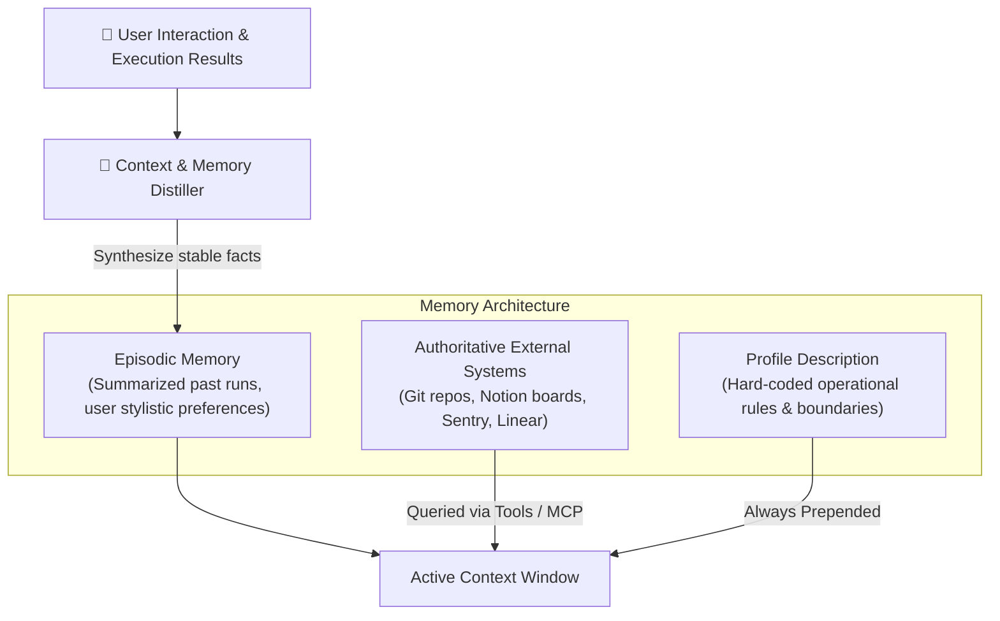

### Memory Rules & Anti-Patterns

- **Memory is NOT a substitute for authoritative source systems**: Never rely on a bot's memory for dynamic data such as current git branch status, database schemas, customer email addresses, or account balances. The bot must query the source system directly via CLI, browser, or API.
- **Safety boundaries belong in the Description**: Learned memory can decay or be superseded by subsequent chat turns. Critical security invariants ("Never send external emails") must always reside in the immutable Description field.
- **Memory Curation**: Users can inspect and edit the bot’s stored memories from the Settings drawer, deleting obsolete assumptions or correcting misremembered preferences.

---

## 3. Roster Lifecycle & Workspace Organization

Managing dozens of bots across teams requires systematic organization within the Grok Bot desktop and iOS clients:

### Lifecycle Actions

| Action | Retained Elements | Cleared Elements | Typical Use Case |
|---|---|---|---|
| **Pin to Top** | Entire state intact | None | Keeping daily companions (PM bot, Coder bot) easily accessible. |
| **Sidebar Sections** | Entire state intact | None | Grouping bots by client project, business unit, or department. Syncs across desktop and iOS. |
| **Hide from Sidebar** | Profile, memory, chat history, routines | Hidden from view | De-cluttering sidebar without stopping background cron routines or losing history. Accessible via "Show hidden chats". |
| **Duplicate Bot** | Profile, enabled skills, routines, settings, avatar | Chat history, memory, attachments, files | Creating regional variants (e.g., US Sales Scout vs. EU Sales Scout). |
| **Delete Bot** | None | Profile, conversation, scheduled routines | Permanent decommissioning of a bot role. (Note: shared VM files in `/workspace` must be wiped separately). |


---


<a id="chapter-4"></a>

# Chapter 1.4: Enterprise Security, Firecracker MicroVMs & Isolation

> **Source Authorities**: `https://cursor.com/docs/grok-bot/security`, `https://cursor.com/docs/grok-bot/proxies`, `https://docs.x.ai/grok-bot/security` [SRC-CUR-04, SRC-CUR-05]

---

## 1. The Per-User Firecracker MicroVM Architecture

Enterprise security reviews frequently question how Grok Bot isolates tenant workloads and prevents lateral privilege escalation.

Grok Bot executes all user computer sessions inside **isolated, per-user AWS Firecracker microVMs**:

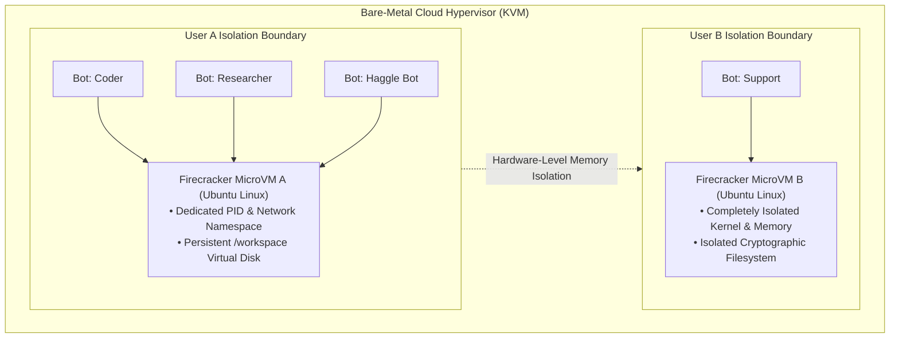

### Critical Architectural Invariant: Isolation is Per-User, NOT Per-Bot
As documented in official security disclosures and corroborated by technical researchers [SRC-CUR-04]:
> **"Do not use separate Bots as a security boundary."**

1. **Shared VM Context**: Every bot configured on User A's account shares the *exact same* Firecracker microVM, filesystem (`/workspace`), terminal environment, and browser session state.
2. **Session Bleed Risk**: If a user signs into their corporate banking portal or AWS Console for a "Finance Bot", that active browser session cookie is technically accessible to an "Untrusted Web Scraper Bot" on the same account.
3. **Defense-in-Depth**: Sensitive secrets should be stored in external vaults (such as **1Password** or masked secret cards), rather than relying on bot profile separation.

---

## 2. Enterprise Network Controls & Destination Allowlists

For organizations operating under strict data exfiltration and regulatory compliance policies (SOC 2, ISO 27001, HIPAA), enterprise administrators configure **Network Controls**:

| Policy Mode | Behavior | Use Case |
|---|---|---|
| **No Policy (Default)** | Unrestricted outbound internet connectivity. | General developer & personal accounts. |
| **Allow All Network Access** | Explicit outbound allow-all rule. | Self-serve team workspaces. |
| **Defaults Plus Team Allowlist** | Standard operational endpoints (x.ai, cursor.com, GitHub) plus enterprise-defined domains/CIDRs. | Typical corporate enterprise deployments. |
| **Team Allowlist Only** | Complete lockdown; only destinations explicitly defined by enterprise infosec are reachable. | Financial institutions, healthcare, defense contractors. |

*Note: Destination policies govern both domain hostnames (`*.internal.corp.com`) and raw IP/CIDR ranges (`10.0.0.0/8:443`).*

---

## 3. Proxy Configuration for TLS-Inspecting Gateways (Zscaler / SWG)

When deploying Grok Bot across enterprise networks with deep packet inspection (DPI) or Secure Web Gateways (SWG) like Zscaler [SRC-CUR-05]:

```
+-------------------------------------------------------------+
|               TLS Proxy Exemption Checklist                 |
+-------------------------------------------------------------+
|  1. Domain Allowlist:                                       |
|     Allow both '*.cursorvm.com' and '_._.cursorvm.com'      |
|                                                             |
|  2. SSL Inspection Bypass:                                  |
|     Exempt '*.cursorvm.com' from SSL/TLS Decryption.        |
|     Grok Bot utilizes mutual TLS and encrypted WebSockets;  |
|     interception causes instant disconnection.              |
|                                                             |
|  3. Response Buffering:                                     |
|     Disable HTTP response buffering for streaming endpoints |
|     to ensure real-time terminal output delivery.           |
|                                                             |
|  4. Verification Probe:                                     |
|     Execute: `nslookup test.us9.cursorvm.com` and           |
|     verify Amazon RSA issuer status.                        |
+-------------------------------------------------------------+
```

---

## 4. 1Password Integration: Hardware-Secured Secret Isolation

Announced officially on September 16, 2026, Grok Bot integrates natively with **1Password** to resolve the shared-browser credential vulnerability:

1. **Vault Sharing**: Rather than storing plaintext passwords or long-lived cookies in Chromium, the bot links to a dedicated 1Password service vault.
2. **Per-Fill Operator Approval**: Whenever a bot needs to authenticate to an external vendor (e.g. Ramp, Salesforce, Stripe), an approval prompt displays the exact domain and username.
3. **Zero Plaintext Chat Exposure**: Secrets never appear in chat transcripts, memory distillation logs, or prompt histories.

---

## 5. Enterprise Administration, Telemetry & Fleet Governance

According to official SpaceXAI enterprise specifications [SRC-XAI-DOC-14, SRC-XAI-DOC-18], enterprise administrators enforce fleet-wide compliance, identity governance, and real-time observability:

### 1. Identity & Access Governance (SCIM 2.0)
* **Automated Provisioning**: Synchronizes corporate directory groups (Okta, Microsoft Entra ID, PingFederate) via standard SCIM 2.0.
* **Deprovisioning & Immediate Revocation**: Disabling an employee in the identity provider instantly halts active cloud microVM sessions, revokes session cookies, and archives `/workspace` storage.

### 2. Observability & Audit Logging (OpenTelemetry)
* **OpenTelemetry (OTLP) Export**: Grok Bot natively streams audit events, tool executions, and security anomalies over OTLP (`otlp/http` or `otlp/grpc`) directly into enterprise SIEM and observability backends (Splunk, Datadog, AWS CloudWatch, Elastic).
* **Action Recording**: Enables recording of virtual desktop interactions, tool calls, and shell outputs. Security officers can replay recorded incident sessions to verify whether an agent executed unintended bash commands or accessed unauthorized domains.
* **Conversation Content Export**: Comprehensive compliance archive of all prompt histories, agent reasoning chains, and reviewable artifact deliverables.

### 3. Fleet Computer Governance (`Manage Bot Computers`)
Enterprise administrators manage the pool of Firecracker cloud computers across their organization [SRC-XAI-DOC-18]:

| Administrative Action | Execution Mechanism | Data Preservation |
|---|---|---|
| **Recreate Computer** | Re-provisions a fresh Ubuntu Firecracker microVM from the latest xAI base image. | `/workspace` data can be preserved or wiped depending on admin flag. |
| **Terminate Computer** | Shuts down and de-allocates the cloud microVM instance. | Storage retained in cold snapshot for 30 days before permanent deletion. |
| **Auto-Terminate Inactive Computers** | Daemon monitors idle time; automatically terminates computers inactive for $N$ days. | Eliminates ghost infrastructure costs across large enterprise teams. |
| **Enforce Cloud-Only Execution** | Blocks the bot from triggering actions on the user's local physical desktop. | Guarantees all untrusted code remains strictly within the Firecracker perimeter. |


---


<a id="chapter-5"></a>

# Chapter 1.5: Failure Modes, Edge-Cases & Operational Gotchas

> **Source Authorities**: `https://cursor.com/help/grok-bot/computer-recovery`, `https://cursor.com/help/grok-bot/routines`, `https://cursor.com/help/grok-bot/connect-plugins` [SRC-CUR-07, SRC-CUR-08, SRC-CUR-09]

---

## 1. The Cloud Computer Lifecycle & Tri-State Recovery Matrix

Grok Bot provides each account with a dedicated cloud Ubuntu Linux environment. Because all bots within an account share this underlying virtual machine, filesystem, and browser session, operational issues with the environment can manifest across the entire bot fleet. 

Crucially, **agent conversations are decoupled from the cloud computer filesystem**. A corrupted container, an aggressive `rm -rf`, or a locked package manager does not destroy chat histories. However, understanding the exact boundaries between the three recovery actions in **Settings > Updates** is essential to avoid irreversible loss of un-synced work.

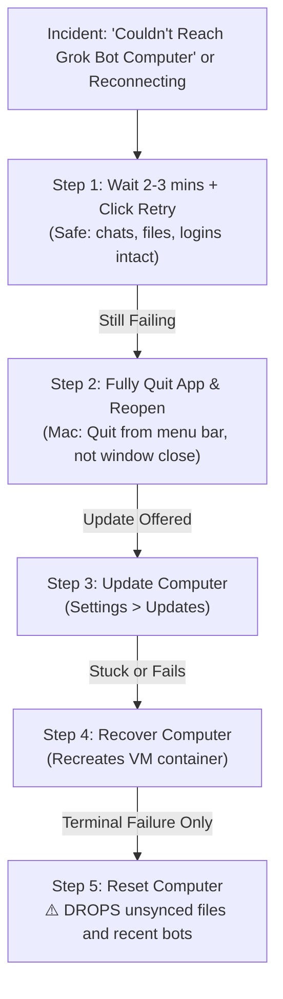

### The Tri-State Action Matrix

| Operational Action | Mechanism & Scope | What It Preserves | What It Destroys / Resets | Risk Profile |
|---|---|---|---|---|
| **Update** | Upgrades the underlying operating system and Grok Bot runner to the latest version. | Bots, `/workspace` files, synced browser logins, and chat history. | Installed `apt` packages, npm global binaries, pip packages outside virtual environments. Active turn discarded if unable to pause cleanly. | **Low**: Recommended maintenance path. |
| **Recover** | Recreates the cloud container and re-establishes the connection daemon. | Bots, `/workspace` files, synced browser logins, and chat history. | Installed OS packages, system daemons, non-synced volatile caches (`/tmp`, `/var/run`). | **Medium**: Safe repair for connection freezes. |
| **Reset** | Destroys the active virtual machine and restores the latest clean cloud snapshot. | Only files, bots, and configurations present in the last completed snapshot. | **All recent bots, unsynced `/workspace` files, new browser sessions**, and installed packages created since the last snapshot. | **HIGH**: Irreversible loss of unsynced work. |

> [!CAUTION]
> **Reset** is the only recovery mechanism that drops recent bots and newly created files. Never trigger a **Reset** while a computer is reconnecting or while an **Update** is downloading images. Repeated resets interrupt in-flight restores and risk database corruption.

---

## 2. Filesystem Durability & Disk Pressure Dynamics

### The `rm -rf` Resilience Invariant
Because Grok Bot maintains durable, asynchronous object-store backups of synced workspace data, executing destructive shell commands inside the VM (such as `rm -rf /workspace/project` or accidental root wipes) does not affect conversation history.
- Re-opening or recovering the computer initiates a restore from the durable copy.
- If files on your local physical machine (Mac or Windows) are modified via synced bridges, Grok Bot cloud recovery cannot restore them; local backups remain mandatory.

| Data Layer | Recoverable After VM Wipe / rm -rf? | Storage Topology |
|---|---|---|
| **Agent Conversation History** | **Yes** (100% durable) | External cloud database; independent of VM state. |
| **Synced `/workspace` Files** | **Yes** (Restored on reopen/recover) | Cloud object store sync daemon. |
| **Unsynced Scratch Files** | **No** (Lost on Reset) | Volatile local Firecracker root filesystem. |
| **Apt / Pip / Npm Packages** | **No** (Wiped on all 3 actions) | Ephemeral root filesystem layers. |
| **Host Machine Files** | **No** (Local user responsibility) | User workstation storage. |

### Disk Pressure & The "Disk Saver" Agent
When storage consumption exceeds warning thresholds, Grok Bot surfaces explicit warnings:
- `Computer is low on disk space`
- `Computer is critically low on disk space`

These warnings do not indicate immediate data loss. Instead, Grok Bot activates a dedicated system agent named **Disk Saver** in the sidebar.
1. **Audit & Proposal**: Disk Saver scans `/workspace`, Docker cache layers, npm caches, and downloaded artifacts, preparing a structured proposal of deletable assets.
2. **Mandatory Human Sign-Off**: No files are purged autonomously. The user must review and click **Confirm** inside Disk Saver.
3. **Declining Cleanup**: If declined, all files remain intact, but long-running routines may fail if disk write calls return `ENOSPC`.

---

## 3. Routine Burn Traps & Execution Semantics

Routines execute autonomously on cloud infrastructure while the user's laptop is closed. However, misconfigured triggers frequently lead to complete exhaustion of weekly quota allowances.

```
+-------------------------------------------------------------------------+
|                       Weekly Quota Burn Traps                           |
|                                                                         |
|  [Slack Channel Listener]                                               |
|      │                                                                  |
|      ├── Containing: "deploy"  ──► Fires only on keyword [SAFE]        |
|      │                                                                  |
|      └── Containing: "" (EMPTY) ──► Fires on EVERY channel message!     |
|                                     Burn: ~168 runs/day [QUOTA EXHAUSTED]
|                                                                         |
|  [Webhook Trigger]                                                      |
|      │                                                                  |
|      └── HTTP POST ──► Status 200 OK (Accepted by Queue)                |
|                        ⚠️ Does NOT mean routine succeeded!              |
|                        Check Run History (keeps last 20 runs)           |
+-------------------------------------------------------------------------+
```

### The Slack Listener "Empty Phrase" Trap
When configuring a routine trigger on Slack:
- Specifying a phrase in the **containing** field checks message text case-insensitively (`deploy` matches `Deploy` and `ready to deploy`), including thread replies.
- **The Trap**: Leaving **containing** empty causes the routine to trigger on **every single top-level message posted in the channel**. In an active team channel, this can fire hundreds of compute runs per day, burning through a multi-seat team's entire weekly Grok Bot allowance in under 24 hours.
- **Best Practice**: Always restrict Slack listeners to dedicated agent intake channels (e.g., `#bot-triage`) or require a specific command prefix (e.g., `!run-audit` or `@GrokBot`).

### Schedule Interval Constraints
- **The 5-Minute Floor**: Grok Bot strictly enforces a 5-minute minimum interval between scheduled routine executions. Attempting to schedule sub-5-minute intervals triggers the validation error: `Routine schedules must be at least 5 minutes apart`.
- **Clock Drift & Timezones**: Schedules execute against the timezone configured under **Settings > Bot > Timezone** (or system auto-detected), *not* the timezone of the external website, Slack channel, or GitHub repository being inspected.
- **Missed Slot Invariant**: Saving a scheduled routine (e.g., "Daily at 08:00 AM" at 08:05 AM) will *not* backfill or trigger today's run. The first execution will occur at 08:00 AM the following morning.
- **Test Run Billing**: Clicking **Test run** in the routine panel initiates a genuine execution pass using live compute, calling connected tools and modifying files. It is not an unbilled dry-run mockup.

### Webhook 200 vs Execution Completion
When invoking routines via external webhooks (`POST to` URL with `Authorization: Bearer <key>`):
- A response of **HTTP 200 OK** confirms only that the Grok Bot queue accepted the request. It does **not** signify that the agent has finished executing the instructions.
- The webhook caller receives no synchronous return payload from the agent's work. Downstream systems must inspect the conversation output, poll external state boards (Notion/Linear), or subscribe to completed notifications.
- **Run History Ceiling**: Grok Bot retains only the **20 most recent runs** in the routine drawer. For incident auditing, operators should immediately copy the `Request ID` by right-clicking the specific run before it rotates out.

---

## 4. Enterprise SSO, Connectors & Connector Gotchas

### Google Workspace Enterprise Review Barrier
Connecting Google Workspace tools (Gmail, Google Drive, Google Sheets, Google Calendar) frequently halts at an administrative barrier:

```
[Google Sign-in] ──► "Your admin needs to review Grok" / "Access blocked"
```

1. **Identity Distinction**: Grok Bot authenticates to Google APIs under the application name **Grok** (registered with xAI/Cursor OAuth client IDs), *not* under "Cursor".
2. **IT Admin Resolution Path**:
   - Google Admin Console -> **Security** -> **Access and data control** -> **API controls**.
   - Select **Manage third-party app access** under *App access control*.
   - Search for **Grok** (or query the Client ID displayed on the blocked authorization screen).
   - Set app access policy to **Trusted** for the targeted organizational unit (OU).
3. **Cursor Team Admin vs Google Admin**: If an error states `Disabled by team admin`, this is controlled inside the Cursor organization settings, distinct from the Google Workspace tenant allowlist. Both must be enabled for enterprise bots.

### Single-Account Mailbox Invariant
Each plugin connector supports strictly **one active account per user**:
- You cannot connect a personal `@gmail.com` and a corporate `@enterprise.com` simultaneously to the Gmail plugin.
- Authorizing a new account overwrites the existing token across all bots within that user profile.
- If different bots require distinct identities, team members must deploy separate Grok Bot user seats.

### The Zoom OAuth Error 4700 Block
- **Known Failure Mode**: Attempting to authenticate the native Zoom plugin from the Grok Bot desktop application frequently fails with:
  `Error 4700: Invalid redirect URI`
- **Root Cause**: The redirect callback URI registered in the Zoom App Marketplace mismatches the internal desktop deep-link handler schema.
- **Status**: Officially acknowledged engineering defect. There is zero client-side workaround or configuration fix. Do not attempt manual token hacking; workflows requiring Zoom meetings must inject meeting links via calendar descriptions or webhook parameters directly.

### Calendar Add-on Boundaries
- The **Google Calendar** plugin can read events, query availability, create meetings, and edit invites.
- It **cannot** modify Google Meet room administration settings (host controls, waiting rooms) and **cannot invoke Google Calendar's native Zoom add-on**. Meeting URLs must be populated directly in event location or description fields.


---


<a id="chapter-6"></a>

# Chapter 1.6: Fleet Economics, Pricing & Quota Engineering

> **Source Authorities**: `https://cursor.com/help/grok-bot/plans`, `https://cursor.com/help/grok-bot/routines`, `https://cursor.com/help/grok-bot/supergrok`, `https://docs.x.ai/x-subscription/overview`, `https://docs.x.ai/x-subscription/pricing`, `https://docs.x.ai/x-subscription/grok-bot`, `https://docs.x.ai/x-subscription/usage-limits`, `https://docs.x.ai/x-subscription/prepaid-balance`, `https://docs.x.ai/x-subscription/unify-accounts`, `https://cursor.com/help/the-x-subscription/overview` [SRC-CUR-10, SRC-CUR-11, SRC-CUR-12, SRC-XAI-SUB-01, SRC-XAI-SUB-02, SRC-XAI-SUB-03, SRC-XAI-SUB-04, SRC-XAI-SUB-05, SRC-XAI-SUB-06]

---

## 1. Commercial Models: The X Subscription vs. Legacy Account Linking

Operating autonomous multi-bot fleets requires understanding how compute resources, virtual machines, and billing models scale across organizational tiers. In October 2026, SpaceXAI and Cursor unified commercial operations under **The X Subscription**, fundamentally replacing isolated subscriptions with a unified, cross-product compute paradigm.

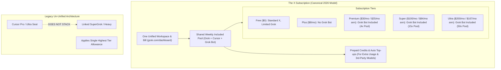

### The X Subscription Tier Entitlements

| Plan Tier | Monthly Price | Annual Price | Included Weekly Pool | Grok Bot Access | Target Persona / Roster |
|---|---|---|---|---|---|
| **Free** | $0 | $0 | Limited | ❌ Excluded | Casual browsing & standard X |
| **Plus** | $8/mo | $80/yr ($7/mo) | Base (1x) | ❌ **Excluded** | Individual X Premium & basic chat |
| **Premium** | **$30/mo** | **$300/yr ($25/mo)** | **4x Pool** | ✅ **Included** | Standard engineering seats, single standing bot |
| **Super** | **$100/mo** | **$1,000/yr ($84/mo)** | **15x Pool** | ✅ **Included** | Multi-bot fleets (5–6 bots, routines, Notion sync) |
| **Ultra** | **$200/mo** | **$2,000/yr ($167/mo)** | **50x Pool** | ✅ **Included** | Enterprise fleet orchestration, 200+ Cursor cloud agents |

### Teams on The X Subscription
Teams can purchase seats across mixed tiers under centralized organization administration:
- **Premium Seat**: $30/month per seat.
- **Super Seat**: $100/month per seat.
- **Ultra Seat**: $200/month per seat.
- **Seat Independence**: On self-serve team plans, each paid seat has its own dedicated weekly pool for eligible first-party usage. Seats do not share included weekly pools, preventing a single runaway bot routine from starving teammates' seats.
- **Shared Team Pool for Additional Usage**: Teams share a centralized prepaid credit balance for third-party models and extra overage.

### Permanent Account Unification Protocol
Existing customers holding separate Cursor, SuperGrok, or X Premium accounts can permanently combine their identities at `cursor.com/unify` or `accounts.x.ai/unify` [SRC-XAI-SUB-06, SRC-CUR-12]:
1. **Prorated Cancellation**: Legacy subscriptions selected during unification are cancelled automatically at checkout, triggering an automated prorated refund for unused time.
2. **App Store Exceptions**: Subscriptions purchased through Apple App Store must be cancelled directly in iOS Settings.
3. **Irreversibility Invariant**: Completed unification is permanent and cannot be undone by support staff.

### The Legacy Non-Stacking Invariant (Un-Unified Accounts)
For legacy accounts that have not switched to The X Subscription:
- Holding both a Cursor Ultra subscription and a linked SuperGrok Heavy account does **not** grant double compute.
- Grok Bot evaluates all authenticated entitlements and grants the single highest applicable allowance.
- Corporate SuperGrok Team/Enterprise accounts cannot be linked to individual Cursor seats.

---

## 2. Weekly Compute Meter Mechanics

Grok Bot accounts operate on a **Weekly Usage Bucket**. Unlike traditional API endpoints billed strictly per input/output token, Grok Bot's compute meter factors in virtual machine CPU cycles, browser automation runtime, optical character recognition (OCR), and model reasoning passes.

```
+--------------------------------------------------------------------------+
|                      Weekly Usage Meter Consumption                      |
|                                                                          |
|  [Interactive Chat Turn] ──► Low Burn (Only active during prompt turn)   |
|                                                                          |
|  [Test Run Execution]    ──► Standard Burn (Executes live tools/code)    |
|                                                                          |
|  [Scheduled Routines]    ──► High Continuous Burn                        |
|     ├── Daily 08:00 AM   ──► 7 runs/week   [Sustainable: ~4% bucket]     |
|     ├── Hourly Cadence   ──► 168 runs/week [Dangerous: ~80% bucket]     |
|     └── Slack Listener   ──► Unbounded     [CRITICAL: 100% in 24 hrs]   |
|         (Empty filter)                                                   |
+--------------------------------------------------------------------------+
```

### Consumption Classification
1. **Interactive Conversations**: Turns execute on-demand when the user submits a message. System resources scale down to idle when waiting for human input.
2. **Scheduled Cloud Routines**: Each autonomous execution fires the Firecracker microVM, activates headless Chrome, loads context, and executes instructions. Hourly schedules accumulate 168 runs weekly, which can consume over 80% of a standard weekly allowance.
3. **Test Runs**: Clicking **Test run** inside the routine configuration drawer is **not** a dry-run mock; it triggers a full, billable compute execution pass.
4. **The Slack Listener Vulnerability**: As established in Chapter 1.5, leaving the `containing` filter empty on a busy Slack intake channel triggers a run on every message, depleting an entire weekly bucket within 24 hours.

### Quota Reset Dynamics & Exhaustion Recovery
- **Reset Cadence**: The weekly allowance operates on a rolling 7-day window. Consumed compute units replenish exactly 168 hours after they were spent.
- **Quota Exhaustion Behavior**: When weekly usage hits 100%, background routines enter a **Paused / Queued** state. Interactive chat prompts surface an advisory warning prompting the user to either wait for replenishment or enable **On-Demand Overages**.
- **Refill Behavior**: The moment older turns age past the 7-day threshold, queued routines automatically resume in priority order.
- **Free Trial Credit Expiration**: Free trials are structured as a finite compute credit measured in step and token operations (not a fixed message count). Trial credits strictly expire **7 days** after issuance, regardless of whether the credits were fully utilized.

---

## 3. Overage Architectures: Prepaid Balances (2026) vs. On-Demand Billing

Managing excess usage differs based on whether an account has unified under **The X Subscription** or operates on legacy Cursor infrastructure:

```
+--------------------------------------------------------------------------+
|            The X Subscription: Prepaid Credit & Auto Top-Up              |
|                                                                          |
|  [Included Weekly Pool: 100% Depleted]                                   |
|          │                                                               |
|          ▼                                                               |
|  [Prepaid Credit Balance Available?]                                     |
|     ├── NO  ──► Auto Top-Up Enabled?                                     |
|     │           ├── NO  ──► Fleet Halts; Extra Usage Pauses              |
|     │           └── YES ──► Card Charged (e.g. $20/top-up) ──► Resumes   |
|     │                                                                    |
|     └── YES ──► Additional Usage Meter Draws Against Prepaid Balance     |
|                   │                                                      |
|                   ├── Monthly Additional Spend < Spending Cap ($50)      |
|                   │   └── Smooth uninterrupted execution                 |
|                   │                                                      |
|                   └── Monthly Additional Spend >= Spending Cap ($100)    |
|                       └── Hard Pause on Extra Usage until Month Rollover |
+--------------------------------------------------------------------------+
```

### Key Differences Between Billing Eras

| Dimension | The X Subscription Paradigm (2026) | Legacy Cursor / SuperGrok Architecture |
|---|---|---|
| **Billing Model** | **Prepaid Credit & Top-Ups** | Post-hoc On-Demand Invoicing |
| **Third-Party Models** | Claude/GPT billed to prepaid credit from first request | Billed at end of month via Stripe invoice |
| **Refill Trigger** | Auto top-up fires when prepaid credit hits minimum floor | Continuous billing until hard monthly cap |
| **Overage Safety** | Monthly spend caps halt extra usage while preserving base plan | Hard stop cuts both interactive & routine work |
| **Dashboard** | `grok.com/dashboard/billing` | `cursor.com/dashboard` |

### Best Practices for Spend Protection
1. **Always Set a Monthly Additional Usage Limit**: On `grok.com/dashboard/billing`, configure "Monthly additional usage limit" (e.g., \$50 or \$100/seat). Once reached, paid extra usage pauses automatically, preventing runaway loops from misconfigured Slack or routine triggers.
2. **Audit Routine Run Histories Weekly**: If weekly usage falls unexpectedly, inspect the 20-run history panel across all active bots. Sort by execution frequency before raising the spend cap.
3. **Decommission Redundant Bots**: Deploy `Alfred` (Chapter 3.5) to audit active rosters and merge duplicate scheduled jobs.

---

## 4. The Compute Arbitrage Formula

High-scale engineering teams avoid burning Grok Bot's compute allowance on heavy compilation, continuous linting, or multi-thousand-file refactors. Instead, they enforce **Compute Meter Decoupling**.

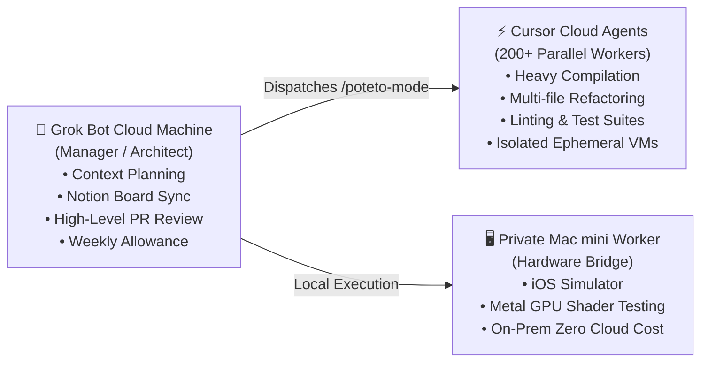

### The Arbitrage Cost Equation
To determine whether a task should run inside Grok Bot's persistent microVM or be delegated to an external compute layer, apply the **Compute Efficiency Metric ($E_c$)**:

$$\text{Decision Rule:} \quad \text{If } \tau_{\text{exec}} > 5 \text{ min} \quad \text{or} \quad N_{\text{files}} > 20 \implies \text{Delegate to Cursor Cloud Agents}$$

Where:
- $\tau_{\text{exec}}$ is the continuous wall-clock runtime required for compilation/testing.
- $N_{\text{files}}$ is the number of files touched by the refactoring pass.

### Economic Comparison Table

| Operational Workload | Recommended Compute Host | Economic Rationale | Cost Profile |
|---|---|---|---|
| **Fleet Coordination & 1:1 Sync** | Grok Bot Persistent VM | Maintains shared cookies, persistent `/workspace`, and memory. | Negligible (Included in base subscription) |
| **Notion & Linear 30m Sweeps** | Grok Bot Routine | Lightweight HTTP polling against REST APIs. | Minimal weekly bucket drain |
| **Full Repo Lint & TypeScript Build** | Cursor Cloud Agent | Ephemeral VM; preserves Grok Bot weekly quota for interactive management. | Decoupled agent compute credits |
| **Multi-Repo Dependency Migration** | 50+ Cloud Agents in Parallel | Massive concurrency impossible on a single Firecracker microVM. | High speed / low manager burn |
| **Native iOS Simulator & Audio I/O** | Private Mac mini Worker | Eliminates cloud spend entirely; accesses physical hardware. | \$0 cloud compute cost |

By enforcing compute decoupling, an engineering organization can run a fleet of 10+ Grok Bots continuously without ever exceeding standard tier allowances.


---


<a id="chapter-7"></a>

# Chapter 2.1: Messaging & Multimodal Interaction

> **Source Authorities**: `https://x.ai/bot/guides/grok-bot-101`, `https://cursor.com/docs/grok-bot/work` [SRC-XAI-02, SRC-CUR-03]

---

## 1. The Conversational Interface

Communicating with a Grok Bot is designed to emulate messaging a remote colleague over Slack or iMessage. However, behind the conversational thread is a full multimodal engine capable of processing text, images, files, voice recordings, and live desktop interactions.

```
+-------------------------------------------------------------+
|               Grok Bot Conversational Surface               |
+-------------------------------------------------------------+
|  [Voice Note]  "Hey Quill, check the latest iOS build crash |
|                 on Sentry, trace the symbol, and fix it."   |
|                                                             |
|  [Transcribing audio...] Done (0.8s)                        |
|                                                             |
|  [Quill] Started automated investigation                    |
|          ├─► Opened Chrome: sentry.io/organizations/spacexai|
|          ├─► Located crash issue #8492: EXC_BAD_ACCESS      |
|          ├─► Ran: git checkout -b fix/bad-access-8492       |
|          └─► Created diff in /workspace/src/renderer.cpp    |
|                                                             |
|  [Quill] "I've diagnosed the null pointer dereference.      |
|           Here is the before/after screenshot of the fix:   |
|           [before.png] [after.png]                          |
|           Ready to kick a cloud agent build?"               |
+-------------------------------------------------------------+
```

### Core Conversational Capabilities

1. **Voice Note Ingestion**: Users can speak naturally on mobile iOS or desktop. The speech is transcribed and parsed into actionable intent, preserving tone, technical jargon, and domain entities.
2. **File & Image Attachments**: Users can drag and drop crash logs, UI mockups, Figma screenshots, CSV datasets, or PDF specs directly into the chat window.
3. **Queueing vs. Interrupting**:
   - **Queueing**: If a bot is actively running a command or browsing a page, sending a new message appends it to the execution queue, processing after the current step completes.
   - **Interrupting**: Clicking the Stop button or explicitly choosing "Interrupt" halts the active bash command or browser session, freeing the bot for an immediate redirect.
4. **Referencing Primitives**:
   - `/skill-name`: Explicitly invokes a specific stored skill or recorded playbook.
   - `@bot-name`: In a group or project channel, addresses a specific specialist bot to take over or comment.
   - `@plugin` or `@routine`: Refers to an installed tool integration or scheduled routine.

---

## 2. Multimodal Verification & Computer Vision

Grok Bot does not guess what is rendered on screen—it observes the actual pixels of its virtual display:

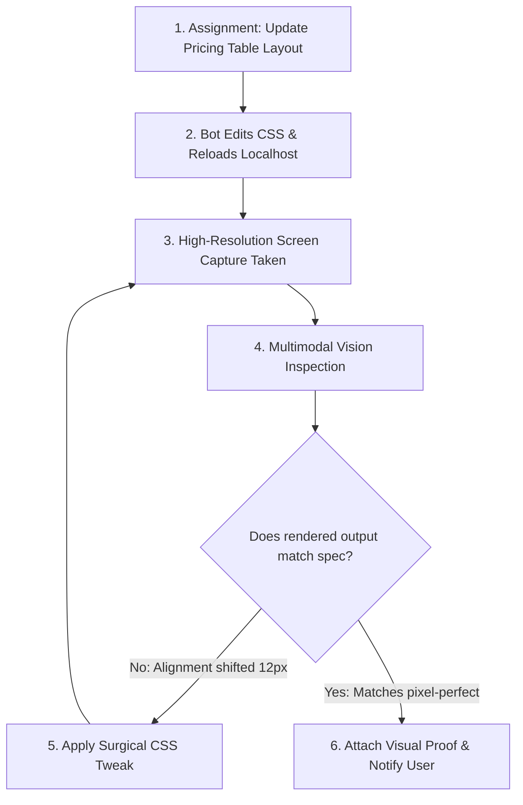

### Production Applications of Multimodal Vision

1. **Before/After Verification Proofs**: For every front-end or UI change, bots capture screenshots before and after applying changes. PRs and ready-for-review notices include linked visual proof.
2. **Dynamic Web Scraping**: On modern web apps where DOM tags are obfuscated (e.g., heavily minimized React/Tailwind code, canvas elements), vision allows the bot to locate buttons, forms, and price tags visually.
3. **Audio I/O Loop Testing**: In advanced setups, bots integrate directly into the cloud computer's virtual audio devices (PulseAudio/ALSA). They can trigger text-to-speech, capture virtual microphone inputs, and verify speech-to-speech latency and transcription accuracy.

---

## 3. The Tag @bot on X Protocol

Grok Bot provides native integration with X (formerly Twitter) via the **Tag @bot on X** protocol [SRC-XAI-DOC-08]. Users can dispatch autonomous research, summarization, and data extraction tasks directly from their mobile or web timeline without opening the Grok Bot desktop client:

```
[User on X Timeline]
Replying to @tech_lead:
"@bot summarize this 12-post technical thread, extract all linked GitHub repos, 
 and compile a comparison table in /workspace/reports/thread_analysis.md"
         │
         ▼
[@bot automated reply on X]
"Task received! Your Grok Bot has started working on this thread. 
 Check results in the Grok Bot app."
         │
         ▼
[Grok Bot MicroVM /workspace]
• Ingests original post, parent thread, and quoted posts (including embedded photos).
• Downloads and evaluates linked repositories.
• Generates /workspace/reports/thread_analysis.md.
• Routes status notification to user's linked Slack or Mobile Companion App.
```

### Protocol Mechanics & Invariants
1. **Thread & Context Ingestion**: Tagging `@bot` automatically packages the user's post, the post being replied to, and all quoted posts in the thread. High-resolution images attached to the thread are parsed by the multimodal vision engine.
2. **Public Confirmation vs. Private Execution**: `@bot` posts only a concise public confirmation reply on X. The actual execution, bash commands, downloaded files, and confidential outputs remain strictly confined to the user's private Grok Bot conversation and persistent microVM.
3. **Entitlement Tracking**: Requests dispatched via `@bot` consume the user's unified Grok Bot weekly usage quota or on-demand balance.

---

## 4. Team Slack Integration & Multi-Surface Handoffs

For team collaboration, Grok Bots can be linked directly into corporate Slack workspaces [SRC-XAI-DOC-06, SRC-XAI-DOC-07]:

### Slack Integration Topology
* **Channel Deployment**: A Team Bot can be invited to shared Slack channels (`#eng-incident-response`, `#market-intelligence`) by workspace members.
* **Thread Context Isolation**: When mentioned in a Slack thread (`@DevOpsBot trace error 502 on staging`), the bot scopes its task memory to that thread, replies with formatted markdown snippets, and posts reviewable links to generated artifacts.
* **Approval Modals in Slack**: When a bot triggers a sensitive action requiring human sign-off (e.g., merging a PR, deploying to production, running a database migration), interactive Slack blocks render with `Approve`, `One-Time Allow`, and `Deny` buttons.
* **Dual-Surface Continuity**: Work initiated via a Slack message runs on the team member's cloud computer; the complete terminal trace and generated files in `/workspace` remain accessible via the native Grok Bot desktop and mobile companion apps.


---


<a id="chapter-8"></a>

# Chapter 2.2: Routines, Scheduling & Autonomous Runs

> **Source Authorities**: `https://x.ai/bot/guides/grok-bot-for-engineering`, `https://cursor.com/docs/grok-bot/work` [SRC-XAI-05, SRC-CUR-03]

---

## 1. What a Routine Is (and Isn't)

In Grok Bot, a **Routine** is not a passive alarm or calendar reminder that pings the human to do something. A Routine is **standing, scheduled autonomous work that executes on a clock**.

```mermaid
timeline
    title Autonomous 24-Hour Fleet Routine Cadence
    03:00 UTC : Nightly Code Hygiene Sweep (Dead code, bundle size, security audits)
    05:00 UTC : Jenny Morning 1:1s (Reviews playbooks, unblocks bots, aligns vibes)
    07:00 UTC : Morning Briefing Generated (Notion PRs marked "Ready for Review")
    Every 30m : PR Board Polling (Checks Bugbot comments, CI failures, merge conflicts)
    Weekdays 09:00 : GTM Tech Scout (Sweeps X bookmarks & Hacker News, drafts demos)
```

### The Inherent Advantage of Cloud Routines
Traditional local agent scripts require the user’s workstation to remain powered on, awake, and connected to the internet. Because Grok Bot routines execute on the persistent cloud computer, they fire reliably at 3:00 a.m. while the user is asleep, with no local resource consumption or network dependency.

---

## 2. Canonical Production Schedules

### A. The 3:00 a.m. Nightly Code Hygiene Routine
- **Owner**: Specialist Engineer Bots (`Shaoruru`, `Baltata`, `Craig`).
- **Objective**: Prevent technical debt accumulation by making code maintenance an automatic daily cadence rather than a quarterly crunch.
- **Workflow**:
  1. Pulls latest `main` branch on target repositories.
  2. Runs static analysis linters, dead code detectors, and bundle size analyzers.
  3. Identifies unused dependencies, deprecated API usages, and formatting regressions.
  4. Generates surgical cleanup pull requests with automated test runs and before/after metrics.
  5. Attaches diff summaries to the shared Notion PR board.

### B. The 5:00 a.m. Morning 1:1 Alignment Routine
- **Owner**: `Jenny` (Head of Operations Bot).
- **Objective**: Context refresh and rule enforcement across the bot fleet.
- **Workflow**:
  1. Iterates through every engineer bot in the organization.
  2. Reviews recent execution logs and identified blockers.
  3. Re-reads and reinforces team operating rules and code quality bars.
  4. Updates shared documentation if recent incidents exposed gaps.

### C. The 30-Minute Pull Request Health Sweep
- **Owner**: Assigned PR Triage Bot.
- **Objective**: Maintain zero-delay feedback loops for ongoing pull requests.
- **Verification Checklist**:
  - [ ] **Bugbot / Static Security Alerts**: Validates whether automated security bot findings are legitimate or false positives.
  - [ ] **Continuous Integration Status**: Detects flaky test timeouts or compilation errors.
  - [ ] **Merge Conflicts**: Flags upstream rebases needed when target branches advance.
  - [ ] **Remediation Action**: If an issue is found, immediately dispatches a cloud agent to patch the failure and moves the task status back to "Working".

---

## 3. Configuring and Managing Routines

Routines are configured directly in a bot's settings drawer or via natural language prompting:

```markdown
"Create a routine named 'Morning HackerNews Tech Scout' to run every weekday at 08:30 AM EST. 
Scan the top 30 posts on Hacker News and my saved X bookmarks for new open-source developer tools. 
Filter for projects with >500 stars gained in the last 7 days. 
Draft a 3-bullet summary in my scratchpad and notify me in the Tech Scout channel."
```

### Operational Best Practices for Routines
1. **Idempotency**: Ensure routines can run multiple times without duplicating database rows or spamming notifications.
2. **Failure Handling**: Configure routines to log errors to a persistent file (`/workspace/logs/routine_errors.log`) and notify only on actionable failures.
3. **Budget & Rate Limits**: Distribute high-frequency routines (e.g., stagger polling intervals across different minutes of the hour) to prevent API rate limit contention across account bots.


---


<a id="chapter-9"></a>

# Chapter 2.3: Skills & Recorded Playbooks

> **Source Authorities**: `https://x.ai/bot/guides/grok-bot-101`, `https://x.ai/bot/guides/grok-bot-for-engineering`, `https://cursor.com/docs/grok-bot/work` [SRC-XAI-02, SRC-XAI-05, SRC-CUR-03]

---

## 1. Skills: Codifying Reusable Procedural Knowledge

In Grok Bot, a **Skill** represents an executable procedure that teaches a bot how to perform a specialized, repeatable task. Rather than re-prompting multi-paragraph instructions every time, skills encapsulate instructions, validation scripts, parameter requirements, and tool sequences.

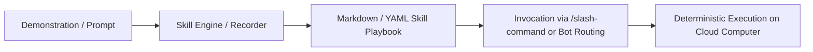

### Methods of Skill Acquisition

1. **Demonstration Recording (Clickpath Learning)**:
   - The user opens the remote desktop session on the cloud computer.
   - The user turns on skill recording and performs the exact workflow: navigating to a web portal, filtering a dashboard, downloading an export, and formatting data in bash.
   - Grok Bot records the input actions, selectors, and state transitions, compiling them into a repeatable playbook.
2. **Declarative Markdown Authoring (`SKILL.md`)**:
   - Technical teams write explicit procedural runbooks formatted in standard markdown with YAML frontmatter.
   - The skill specifies operational prerequisites, input arguments, step-by-step logic, and verification assertions.

---

## 2. Anatomy of a Production Skill

A production-grade Grok Bot skill follows a standardized markdown specification:

```markdown
---
name: pr-health-audit
description: Audits a GitHub Pull Request for failing CI runs, Bugbot security alerts, and merge conflicts.
tools: [github, bash, cursor-cloud]
---

# Pull Request Health Audit Protocol

## Objective
Verify that PR #${argument:pr_number} is structurally sound, passes all automated tests, and satisfies security assertions.

## Execution Sequence
1. Fetch PR details using GitHub CLI:
   ```bash
   gh pr view ${pr_number} --json statusCheckRollup,comments,mergeable
   ```
2. Parse status checks:
   - If any CI job failed: Inspect job logs via `gh run view --log-failed`.
   - If mergeable is "CONFLICTING": Flag rebasing required.
3. Review Bugbot & security comments:
   - Identify any comment matching author "cursor-bugbot[bot]".
   - Verify whether finding is exploitable or a false positive.
4. Output structured health verdict:
   - Status: [CLEAN | BLOCKED | REMEDIATION_REQUIRED]
   - Action Items: [List of required fixes]
```

---

## 3. Dynamic Skill Chaining in Engineering Fleets

As demonstrated in the SpaceXAI engineering fleets [SRC-XAI-05], specialist bots dynamically chain personalized skills based on task context:

| Skill Invocation | Primary Purpose | Applied Criteria |
|---|---|---|
| `/lingxi-design` | Visual polish & styling | Evaluates micro-interactions, layout padding, typography, dark mode contrast. |
| `/react-native-best-practices` | Mobile code quality | Checks memoization, bridge serialization cost, unindexed list rendering. |
| `/lingxi-review` | Architectural gatekeeping | Validates module decoupling, clean dependency injection, test coverage. |
| `/lingxi-product` | Opinionated feature tradeoffs | Decides UX edge cases and user flow ergonomics. |

```
   Task Received: "Implement Search Autocomplete Dropdown"
                              │
                              ▼
            Step 1: Code Generation + TDD
            [/react-native-best-practices]
                              │
                              ▼
            Step 2: Visual & CSS Tuning
            [/lingxi-design]
                              │
                              ▼
            Step 3: Edge Case UX Review
            [/lingxi-product]
                              │
                              ▼
            Step 4: PR Architecture Verification
            [/lingxi-review]
```

### Compatibility with Universal Agents & Cursor
Skills authored for Grok Bot share identical structural semantics with skills stored in `.agents/skills/` and `.cursor/skills/`. This cross-platform parity ensures that procedural knowledge developed for local Cursor sessions runs natively on Grok Bot's cloud computer without refactoring.


---


<a id="chapter-10"></a>

# Chapter 2.4: Plugins, Connectors & Model Context Protocol (MCP)

> **Source Authorities**: `https://x.ai/bot/guides/templates-for-grok-bot`, `https://cursor.com/docs/grok-bot/work` [SRC-XAI-03, SRC-CUR-03]

---

## 1. The Plugin & Connector Ecosystem

Grok Bot extends its capabilities beyond the browser and terminal by integrating first-party SaaS connectors, external APIs, and local Model Context Protocol (MCP) daemons.

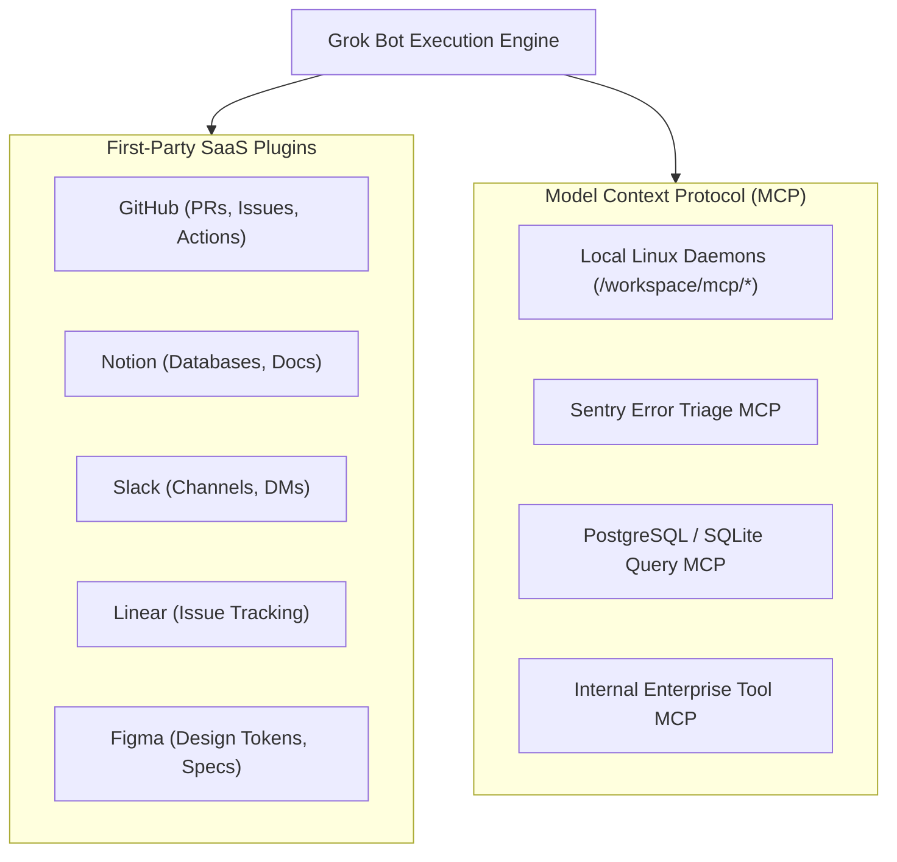

### Connector Matrix

| Connector Type | Protocol / Transport | Authentication Flow | Scope & Isolation |
|---|---|---|---|
| **First-Party SaaS** | Direct API / OAuth | Web-based OAuth flow in Grok Bot settings | Shared across all bots on the user account. |
| **Browser Sessions** | Session Cookies / LocalStorage | Human logs in once via remote desktop | Shared across all account bots using Chromium. |
| **Model Context Protocol** | STDIO or HTTP/SSE | Process environment variables (`ENV_VARS`) | Can be scoped per bot or launched system-wide on the VM. |
| **Command Line Tooling** | Subprocess / Exec | Git credentials, SSH keys, `.env` files | Persistent in `/workspace/.env` or `~/.ssh/`. |

---

## 2. Model Context Protocol (MCP) Integration on Cloud Ubuntu

Because Grok Bot operates on a real Ubuntu Linux environment, users are not restricted to pre-built plugins; they can run any open-source or custom MCP server:

### Typical MCP Server Configuration on the Cloud VM

To register an MCP daemon for a bot, the server configuration is stored on the cloud machine (e.g., in `/workspace/.config/mcp/config.json`):

```json
{
  "mcpServers": {
    "sentry-triage": {
      "command": "npx",
      "args": ["-y", "@modelcontextprotocol/server-sentry"],
      "env": {
        "SENTRY_AUTH_TOKEN": "sntryu_..."
      }
    },
    "postgres-analytics": {
      "command": "python3",
      "args": ["/workspace/tools/postgres_mcp.py"],
      "env": {
        "DB_CONNECTION_STRING": "postgresql://readonly@analytics.db.internal:5432/production"
      }
    }
  }
}
```

---

## 3. Packaging Considerations for Connectors & MCP

When authoring bots intended for team distribution or public template sharing [SRC-XAI-03]:

1. **First-Party Plugins Are Re-instantiated**: If a template includes the GitHub or Notion plugin, recipients are prompted to authorize their own GitHub or Notion accounts upon installing the template.
2. **MCP Daemons Require Setup Prompts**: Non-standard plugins, custom MCP servers, and local scripts are **not** automatically bundled into template exports to avoid security leakage.
3. **Encoding Setup Instructions**: If your bot relies on a custom MCP daemon, include explicit installation commands in the bot's onboarding prompt (e.g., "On initial run, check if `sentry-cli` is installed; if missing, execute `curl -sL https://sentry.io/get-cli/ | bash`").

---

## 4. Official SpaceXAI Remote MCP Tools Specification

In addition to local microVM STDIO daemons, xAI natively supports **Remote MCP Tools** [SRC-XAI-API-05]. Remote MCP allows Grok to connect to external MCP servers over the internet without running local processes inside the microVM. SpaceXAI manages the persistent connection and protocol interactions on behalf of the agent.

### Supported Transports & Protocols
* **Transports**: **Streaming HTTP** and **Server-Sent Events (SSE)**.
* **SDK Compatibility**: Supported natively in the official `xai_sdk`, OpenAI-compatible Responses API, and real-time Speech-to-Speech API.

### Remote MCP Configuration Parameters
Remote MCP servers are passed directly in the `tools` configuration array of the chat completion or agent request:

| Parameter | Type | Required | Description |
|---|---|---|---|
| `server_url` | string | Yes | The target HTTPS URL of the MCP server. |
| `server_label` | string | Yes | Human-readable label used as a prefix for tool calls (e.g. `sentry`, `jira`). |
| `server_description` | string | No | Description explaining what the server provides for agent tool selection. |
| `allowed_tools` | string[] | No | Strict list of tool names to expose to Grok. (Empty allows all tools. Named `allowed_tool_names` in native SDK). |
| `authorization` | string | No | Bearer token injected into the `Authorization` header on outbound requests to the MCP server. |
| `headers` | object | No | Custom HTTP headers forwarded to the remote MCP server (e.g. tenant IDs, trace tokens). |

```python
# Native Python xAI SDK Remote MCP Invocation
from xai_sdk import Client

client = Client(api_key=os.getenv("XAI_API_KEY"))
chat = client.chat.create(
    model="grok-3",
    tools=[
        {
            "type": "remote_mcp",
            "server_url": "https://mcp.internal.corp.com/sse",
            "server_label": "enterprise_crm",
            "server_description": "Query enterprise customer records and deal pipelines",
            "allowed_tool_names": ["search_accounts", "get_deal_history"],
            "authorization": "Bearer sec_mcp_corp_88291",
            "headers": {"X-Tenant-ID": "spacexai-ops"}
        }
    ]
)
```

---

## 5. SpaceXAI Programmatic Skills REST API (`/v1/skills`)

According to the official SpaceXAI OpenAPI 3.1.0 specification [SRC-XAI-API-04], xAI exposes first-class REST endpoints for managing agent skills programmatically:

| Endpoint | Method | Operation ID | Description |
|---|---|---|---|
| `/v1/skills` | `GET` | `handle_list_skills_request` | Lists all skills accessible to the authenticated account with pagination (`limit`, `after`, `order`). |
| `/v1/skills` | `POST` | `handle_upload_skill_request` | Uploads a new skill package via `multipart/form-data` (`UploadSkillMultipartRequest`). |
| `/v1/skills/{skill_id}` | `GET` | `handle_get_skill_request` | Retrieves metadata, name, description, and parameter schemas for a specific skill. |
| `/v1/skills/{skill_id}/content` | `GET` | `handle_get_skill_content_request` | Downloads raw procedural instructions, execution scripts, and manifest assets. |

This API enables autonomous CI/CD pipelines to validate, version, and upload Grok Bot skills programmatically without requiring manual UI configuration.


---


<a id="chapter-11"></a>

# Chapter 2.5: Walkthrough Video Analysis & Field Notes

> **Source Authorities**: `https://x.com/mattyp/status/2092286281266962681`, `https://x.com/mattyp/status/2093379758306504935`, `https://cursor.com/docs/grok-bot/work` [SRC-COM-03, SRC-CUR-03]

---

## 1. Executive Summary & Field Methodology

Beyond written documentation, the operational nuances of Grok Bot are demonstrated in canonical video walkthroughs conducted by core product architects (notably Matt Palmer, Head of Product / Design at xAI / Cursor). 

Parsing the unwritten micro-interactions, clickpaths, and timing constraints revealed in these walkthroughs provides critical operational clarity that is absent from static manuals. This chapter synthesizes these field observations, focusing on the 28-minute *Getting Started with Grok Bot* masterclass and the 7-minute *Templates Deep Dive*.

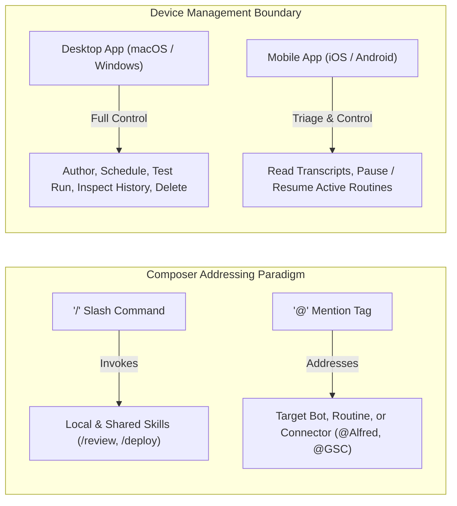

---

## 2. Walkthrough 1: "Getting Started with Grok Bot" (28:27 Masterclass)

### 2.1 The Four Canonical Workflows
In the 101 video masterclass, four distinct workflows illustrate the progression from simple utility tasks to full-stack multi-agent software engineering.

```
01:00  What is @Bot? ────────── Dedicated persistent cloud machine, not ephemeral chat
05:26  Anatomy of a bot ─────── Profile definitions, curated memory, and skill bindings
08:49  3 Ways to Run ────────── Interactive Chat, Scheduled Cloud Routine, Webhook Intake
12:04  Multi-Bot Chains ─────── Orchestrating handoffs between specialist personas
16:06  Workflow 1 ───────────── Live Scraping: X Followers to Notion CRM database
20:29  Workflow 2 ───────────── Personal Software: Building a customized web tracker
23:08  Workflow 3 ───────────── Autonomous Coding: Managing Cursor Cloud Agents & PRs
26:44  Workflow 4 ───────────── Live Web Search: Synthesizing citations across search engines
28:27  Recap ────────────────── Best practices for daily operator hygiene
```

### 2.2 Deep Dive: Workflow 1 (X Followers to Notion)
- **The Operational Pattern**: The bot navigates to X via the cloud browser, scrapes follower growth telemetry, formats the tabular data, and updates an existing Notion database.
- **Key Field Cue**: Matt demonstrates that the bot uses **hybrid DOM scraping with computer vision fallback**. When anti-bot obfuscation or dynamic DOM class scrambling is encountered, the bot captures viewport screenshots and utilizes optical character recognition (OCR) with visual bounding boxes to locate the relevant metrics.

### 2.3 Deep Dive: Workflow 2 (Personal Software & Custom Tooling)
- **The Operational Pattern**: Rather than asking the bot to find third-party SaaS tools, the operator instructs the bot to write, run, and host a dedicated lightweight Node.js/Vite application directly inside `/workspace`.
- **Key Field Cue**: Grok Bot binds the application to an internal port and proxies the interface to the user's desktop browser. This establishes Grok Bot as a **rapid internal tooling generator** for ad-hoc analytical dashboards.

### 2.4 Deep Dive: Workflow 3 (Coding with Cursor Cloud Agents)
- **The Operational Pattern**: Grok Bot acts as the high-level engineering manager (orchestrator), writing specifications and task descriptions, and dispatching tasks to **Cursor Cloud Agents**.
- **Key Field Cue**: Grok Bot never writes multi-thousand-line codebase refactors in its own chat window. Instead, it dispatches tasks using the `/cloud-agent` toolchain, monitors build and test output, and reviews the resulting pull request diff.

---

## 3. Walkthrough 2: "Templates in Grok Bot" (07:01 Launch Guide)

### 3.1 Step-by-Step Template Lifecycle
```
00:00  Templates 101 ────────── Why templates are recipes, not complete static clones
00:50  Sharing a Template ───── Generating secure private links for team collaboration
02:33  Publishing a Template ── Submitting recipes to the public xAI Marketplace
04:03  Installing a Template ── The inspection modal & onboarding checklist
05:02  Setup for Complex ────── Handling multi-connector dependencies (Notion + Slack + GitHub)
06:18  Tips for Authoring ───── Writing idempotent instructions and clear fallbacks
07:01  Evaluating Templates ─── Reviewing community contributions before adoption
```

### 3.2 Unwritten Cues from the Templates Launch
1. **The First-Run Onboarding Contract**: A production-grade template should immediately ask the user for necessary credentials, target database links, or preferred notification channels upon initial boot. If the user installs a template without configured plugins, the bot should say: *"Welcome! To begin, please paste your Google Search Console property link or a sample list of target keywords."*
2. **The "Copy Link" Security Invariant**: When generating a share link, the UI displays a clear distinction between **Team Share** (accessible to authenticated members of the Cursor/Grok organization) and **Public Link** (accessible to anyone with the URL). Public templates undergo automated credential redaction before publication.
3. **Evaluating Community Recipes**: Matt emphasizes inspecting the template schema prior to installation. High-quality templates have compact system instructions (<1,500 tokens), clear non-goals, and minimal required plugins.

---

## 4. Operational Invariants & Screen Dynamics

### 4.1 Composer Syntax: Slash vs. At-Mention
In the modern Grok Bot interface:
- **`/` (Slash Commands)**: Invokes local, project, or marketplace **skills** (e.g., `/lint`, `/test-harness`, `/review-pr`). This instructs the current bot on *how* to execute a procedure using a predefined markdown playbook.
- **`@` (At-Mentions)**: Directly addresses **entities** in the workspace:
  - Addressing another bot (e.g., `@Quill`, `@Jenny`) to transfer context or delegate subtasks.
  - Addressing a connected plugin (e.g., `@github`, `@slack`) to scope data retrieval.
  - Addressing an active routine (e.g., `@nightly-code-hygiene`) to trigger an immediate run.

### 4.2 The Device Management Asymmetry
A critical operational division exists between Desktop and Mobile clients:

| Feature / Operation | Desktop Client (macOS / Windows) | Mobile Client (iOS / Android) |
|---|---|---|
| **Chat & Prompts** | Full multimodal support | Full multimodal support |
| **View Conversations** | Full history & tool transcripts | Full history & tool transcripts |
| **Pause / Resume Routine** | Supported | **Supported** (Fast mobile toggle) |
| **Edit Routine Schedule** | Supported | **Blocked** (Read-only view) |
| **Test Run Execution** | Supported | **Blocked** (Desktop only) |
| **Delete Routine / Bot** | Supported | **Blocked** (Desktop only) |
| **Remote Desktop Takeover** | Full interactive control | **View-only** streaming |

### 4.3 Screen Recording Session Limits
When recording playbooks or capturing visual bug evidence:
- **10-Minute Hard Ceiling**: In-session screen recording runs are limited to a strict maximum of **10 minutes per session**.
- **Zero Microphone Audio**: The built-in screen capture engine records video frames only. It does not record physical microphone audio or system audio output. Operator narration must be provided via typed instructions or follow-up prompt notes.

### 4.4 Standup Cadence & Fleet Discipline
In production environments running 5 to 10 autonomous bots:
- **The 10-15 Minute Sync**: Operators should allocate 10–15 minutes each morning to review bot notifications, inspect the 20-run routine history drawers, and unblock bots waiting at human handover gates.
- **"Continue in Background"**: When performing long-running container operations (such as container recovery or large image updates), click **Continue in Background** to allow the desktop client to remain responsive while cloud infrastructure reconciles.


---


<a id="chapter-12"></a>

# Chapter 2.6: Custom FastMCP Server Developer Playbook

> **Source Authorities**: `https://cursor.com/docs/grok-bot/work`, `https://github.com/xai-org/plugin-marketplace`, `https://github.com/RongleCat/awesome-grok-bot`, `https://github.com/ZeroPointRepo/awesome-grok-bot` [SRC-CUR-03, SRC-XAI-22, SRC-COMM-00, SRC-COMM-04]

---

## 1. The In-Container MCP Architecture

While Grok Bot ships with native SaaS plugins (GitHub, Slack, Google Workspace, Notion), production engineering fleets frequently require bespoke integrations with internal databases, proprietary microservices, local container runtimes, or hardware test harnesses. 

Rather than routing private enterprise queries through external public middleware, Grok Bot enables developers to run **Model Context Protocol (MCP)** servers directly inside the user's dedicated Ubuntu `/workspace` environment.

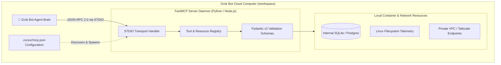

### Transport Tradeoffs: `stdio` vs. `SSE`

| Transport Protocol | Execution Topology | Primary Strengths | Limitations |
|---|---|---|---|
| **`stdio` (Standard I/O)** | Grok Bot spawns the server as a child subprocess directly inside the VM. | • Zero network latency.<br>• Instant lifecycle binding.<br>• Zero port exposure or firewall configuration. | Restricted to single-machine local agent invocation. |
| **`SSE` (Server-Sent Events)** | Server runs as a persistent HTTP service (e.g., port 8000) inside `/workspace` or across a private VPN. | • Multi-bot and multi-agent sharing.<br>• Enables remote connections from desktop Cursor IDE. | Requires background daemon supervisor and port management. |

---

## 2. End-to-End FastMCP Server Implementation

Below is a complete, production-grade FastMCP server implemented in Python 3.10+ using `mcp` and `pydantic`. This server, titled `fleet_ops_mcp.py`, exposes container health auditing, SQLite query tools, and secure external webhook dispatchers.

```python
#!/usr/bin/env python3
"""
fleet_ops_mcp.py - Production FastMCP Server for Grok Bot Fleet Operations
Location: /workspace/mcp-servers/fleet-ops/fleet_ops_mcp.py
"""

import os
import shutil
import sqlite3
import json
from typing import Dict, Any, List, Optional
import httpx
from pydantic import BaseModel, Field
from mcp.server.fastmcp import FastMCP

# Initialize FastMCP Server
mcp = FastMCP(
    "FleetOpsDaemon",
    dependencies=["pydantic>=2.0", "httpx>=0.25"]
)

# -----------------------------------------------------------------------------
# Input Validation Schemas
# -----------------------------------------------------------------------------
class DiskAuditInput(BaseModel):
    mount_point: str = Field(
        default="/workspace",
        description="Target filesystem path to audit for available disk capacity."
    )

class QueryDatabaseInput(BaseModel):
    db_path: str = Field(
        description="Absolute path to the SQLite database file in /workspace."
    )
    query: str = Field(
        description="Read-only SQL query (SELECT statements only)."
    )
    max_rows: int = Field(
        default=50,
        ge=1,
        le=500,
        description="Maximum rows to return in the result set."
    )

class WebhookDispatchInput(BaseModel):
    target_url: str = Field(
        description="Destination HTTP POST endpoint."
    )
    payload: Dict[str, Any] = Field(
        description="JSON dictionary to transmit in request body."
    )
    auth_bearer: Optional[str] = Field(
        default=None,
        description="Optional bearer token for Authorization header."
    )

# -----------------------------------------------------------------------------
# Tool Implementations
# -----------------------------------------------------------------------------
@mcp.tool(name="audit_disk_health", description="Audits container disk space to prevent out-of-disk failures.")
def audit_disk_health(params: DiskAuditInput) -> Dict[str, Any]:
    """Inspects storage capacity and flags low disk conditions."""
    if not os.path.exists(params.mount_point):
        return {"error": f"Path not found: {params.mount_point}"}

    total, used, free = shutil.disk_usage(params.mount_point)
    pct_used = round((used / total) * 100, 2)
    
    status = "HEALTHY"
    if pct_used > 85.0:
        status = "CRITICAL_PRESSURE"
    elif pct_used > 70.0:
        status = "WARNING_PRESSURE"

    return {
        "mount_point": params.mount_point,
        "total_gb": round(total / (1024**3), 2),
        "used_gb": round(used / (1024**3), 2),
        "free_gb": round(free / (1024**3), 2),
        "percent_used": pct_used,
        "status": status,
        "action_required": status != "HEALTHY"
    }

@mcp.tool(name="query_local_database", description="Executes safe read-only SQL queries against local SQLite stores.")
def query_local_database(params: QueryDatabaseInput) -> Dict[str, Any]:
    """Executes sanitized SELECT statements against local SQLite databases."""
    if not os.path.exists(params.db_path):
        return {"error": f"Database file does not exist: {params.db_path}"}
    
    # Enforce read-only constraint
    clean_query = params.query.strip().upper()
    if not clean_query.startswith("SELECT") or any(kw in clean_query for kw in ["DROP", "DELETE", "UPDATE", "INSERT", "ALTER"]):
        return {"error": "Security Invariant Violated: Only SELECT queries are permitted."}

    try:
        conn = sqlite3.connect(f"file:{params.db_path}?mode=ro", uri=True)
        cursor = conn.cursor()
        cursor.execute(params.query)
        columns = [col[0] for col in cursor.description] if cursor.description else []
        rows = cursor.fetchmany(params.max_rows)
        conn.close()

        return {
            "columns": columns,
            "row_count": len(rows),
            "rows": rows
        }
    except Exception as e:
        return {"error": f"Query execution failed: {str(e)}"}

@mcp.tool(name="dispatch_external_webhook", description="Dispatches signed HTTP notifications to team webhook listeners.")
def dispatch_external_webhook(params: WebhookDispatchInput) -> Dict[str, Any]:
    """Dispatches JSON payloads with HTTP error boundary enforcement."""
    headers = {"Content-Type": "application/json"}
    if params.auth_bearer:
        headers["Authorization"] = f"Bearer {params.auth_bearer}"

    try:
        with httpx.Client(timeout=10.0) as client:
            response = client.post(params.target_url, json=params.payload, headers=headers)
            return {
                "status_code": response.status_code,
                "success": response.is_success,
                "response_body": response.text[:500]
            }
    except Exception as e:
        return {"error": f"Webhook dispatch error: {str(e)}"}

if __name__ == "__main__":
    # Runs in STDIO mode by default
    mcp.run(transport="stdio")
```

---

## 3. Configuration & Registration in Grok Bot

To register the custom MCP server with Grok Bot and Cursor, create or update `.cursor/mcp.json` in the root of `/workspace`:

```json
{
  "mcpServers": {
    "fleet-ops": {
      "command": "python3",
      "args": [
        "/workspace/mcp-servers/fleet-ops/fleet_ops_mcp.py"
      ],
      "env": {
        "PYTHONUNBUFFERED": "1",
        "WORKSPACE_ROOT": "/workspace"
      }
    }
  }
}
```

Once registered, Grok Bot automatically inspects the manifest on turn initialization. The exposed tools (`audit_disk_health`, `query_local_database`, `dispatch_external_webhook`) become available for direct invocation in chat and within automated routines.

---

## 4. The Post-Update Daemon Re-Bootstrap Pattern

As established in Chapter 1.5, when an operator executes an **Update** or **Recover** action from **Settings > Updates**:
1. Synced `/workspace` files and browser cookies survive.
2. **All active container processes are terminated**, and the microVM container is rebuilt from the newest base image.
3. Any custom system daemons, background `tmux`/`screen` sessions, or Python virtualenv binaries stored outside `/workspace` are wiped.

### Automated Bootstrapping Architecture

To guarantee that custom MCP servers survive and re-initialize seamlessly after container recovery, deploy the **Post-Update Re-Bootstrap Pattern**:

```
/workspace/mcp-servers/fleet-ops/
├── fleet_ops_mcp.py          # FastMCP server source (survives in /workspace)
├── requirements.txt          # Python dependencies (mcp, pydantic, httpx)
├── bootstrap.sh              # Idempotent installation & start script
└── .bootstrap_health.log     # Health check status verification
```

#### The `bootstrap.sh` Script
Save this script at `/workspace/mcp-servers/fleet-ops/bootstrap.sh` and make it executable (`chmod +x`):

```bash
#!/usr/bin/env bash
set -euo pipefail

WORKSPACE_DIR="/workspace/mcp-servers/fleet-ops"
VENV_DIR="$WORKSPACE_DIR/.venv"

echo "[$(date -u)] Verifying FastMCP environment..."

# 1. Idempotent virtualenv reconstruction
if [ ! -d "$VENV_DIR" ]; then
    echo "Creating virtual environment in /workspace..."
    python3 -m venv "$VENV_DIR"
    "$VENV_DIR/bin/pip" install --upgrade pip
    "$VENV_DIR/bin/pip" install -r "$WORKSPACE_DIR/requirements.txt"
fi

# 2. Syntax and import smoke test
"$VENV_DIR/bin/python" -c "import mcp, pydantic, httpx; print('FastMCP dependencies OK')"

echo "[$(date -u)] FastMCP environment ready."
```

#### Binding into Bot Instructions
To ensure automated re-initialization without manual shell intervention, embed the bootstrap verification check directly into your Bot's system instructions or onboarding memory:

> *"Before executing database queries or custom fleet operations, verify that `/workspace/mcp-servers/fleet-ops/bootstrap.sh` has executed. If tools fail with 'command not found', execute `/workspace/mcp-servers/fleet-ops/bootstrap.sh` once via bash to rebuild the environment."*

This creates self-healing agent automation that remains 100% resilient against cloud container recreations and software upgrades.

---

## 5. Packaging for `xai-org/plugin-marketplace` & Manifest Convergence

When graduating an in-container MCP server from local `/workspace` experiments into a reusable, distributable team or public plugin, developers package their tools to match the canonical **`xai-org/plugin-marketplace`** specification.

### Canonical Plugin Directory Layout

```
compound-engineering-plugin/
├── .grok-plugin/
│   └── marketplace.json      # Master plugin manifest (v1 schema)
├── skills/
│   └── fleet-audit/
│       └── SKILL.md          # Declarative markdown skill
├── commands/                 # Slash command implementations
├── agents/                   # Subagent definitions
├── hooks/
│   └── hooks.json            # Lifecycle hooks (on_init, on_turn, post_commit)
├── .mcp.json                 # FastMCP server configuration
└── .lsp.json                 # Optional Language Server Protocol binding
```

### Manifest Standards Convergence
Ecosystem telemetry from the `ZeroPointRepo/awesome-grok-bot` audit reveals a triple convergence across modern AI coding agent platforms:
1. **`.grok-plugin/marketplace.json` (Native Grok Bot)**: Native manifest consumed by xAI Bot Marketplace and Cursor team administration.
2. **`plugin.json` (`agentplugins.codes` Open Standard)**: Cross-platform specification enabling interoperability across Cursor, Claude Code, and autonomous harness agents.
3. **`.mcp.json` (Anthropic / Linux Foundation Open Standard)**: Native Model Context Protocol server configuration file.

By providing both `.mcp.json` and `.grok-plugin/marketplace.json`, custom FastMCP tools can be executed locally inside Grok Bot, packaged for team distribution in Cursor, or published publicly to the official xAI Bot Marketplace.


---


<a id="chapter-13"></a>

# Chapter 3.1: Template Philosophy: Recipe vs. Meal

> **Source Authorities**: `https://x.ai/bot/guides/templates-for-grok-bot`, `https://cursor.com/docs/grok-bot/work` [SRC-XAI-03, SRC-CUR-03]

---

## 1. "Think Recipe, Not Meal"

When sharing an autonomous agent with colleagues or the broader public, the fundamental challenge is **how to share operational intelligence without leaking proprietary IP, private user data, or sensitive secrets**.

Grok Bot resolves this through the architectural principle: **Think Recipe, Not Meal**.

```
+-------------------------------------------------------------+
|                      The Meal (Live Bot)                    |
|  • Active cloud computer VM & files in /workspace           |
|  • Logged-in browser cookies & active sessions              |
|  • Proprietary codebases & internal git clones              |
|  • Private conversation history & API keys                  |
+-------------------------------------------------------------+
                              │
                              ▼  (Sanitized Export Engine)
+-------------------------------------------------------------+
|                     The Recipe (Template)                   |
|  • Clean system prompt & identity (Name, Title, Role)       |
|  • Generalizable procedural skills & routines               |
|  • Plugin declarations (e.g., "Requires GitHub & Notion")    |
|  • Curated, non-private domain memories                     |
+-------------------------------------------------------------+
```

### Why a Blueprint Beats a Clone

If an agent were distributed as an exact clone:
1. **Security Vulnerabilities**: Corporate API keys, internal staging URLs, and customer records would be exposed to anyone holding the link.
2. **Brittle Dependencies**: Local filesystem paths (`/workspace/users/matt/repos/...`) would break immediately on another user's machine.
3. **Rigid Stagnation**: The recipient would inherit dead conversation history rather than starting with a fresh context tailored to their specific projects.

By treating the template as an **anonymized blueprint (recipe)**, the recipient's Grok Bot uses the instructions and integrations to bake its own fresh instance ("cook its own meal").

---

## 2. Inclusions vs. Exclusions Matrix

When a user initiates **Share as Template** in bot settings, Grok Bot's packaging engine performs an automated sanitization pass:

| Component Category | Packaged in Template? | Sanitization & Safety Behavior |
|---|:---:|---|
| **Identity Profile** | ✅ Included | Name, Title, and Description are included verbatim. |
| **First-Party Plugins** | ✅ Included | Integrations (GitHub, Notion, Linear) are declared as dependencies. (Recipient connects their own credentials). |
| **Procedural Skills** | ✅ Included | Attached general-purpose markdown skills and recorded playbooks. |
| **Scheduled Routines** | ✅ Included | Standing triggers (e.g., "Run every weekday at 9:00 AM"). |
| **Curated Memories** | ⚠️ Partial | Domain facts are retained; personal references ("My dog is named Max", "My password is...") are pruned. |
| **Conversation History** | ❌ Excluded | Chat transcripts are completely excluded. |
| **Filesystem & Code** | ❌ Excluded | Cloned repositories and files in `/workspace` are not transferred. |
| **Browser State** | ❌ Excluded | Cookies, session tokens, and saved passwords are never copied. |
| **Custom MCP Servers** | ❌ Excluded | Custom local binaries must be bootstrapped via instructions. |

---

## 3. The Trust Gradient in Shared Templates

Because templates are installable with a single click, users must exercise the same diligence when installing external templates as they would when installing open-source software packages or NPM dependencies:

1. **Review Before Adding**: Always click **View Details** on the template preview modal to inspect attached plugins, skills, and instructions before accepting.
2. **Prompt Injection Audit**: Verify that the instructions do not contain malicious prompts attempting to exfiltrate browser sessions or access unauthorized paths.
3. **Organizational Policies**: Enterprise workspaces can restrict template publishing and consumption via workspace admin controls.


---


<a id="chapter-14"></a>

# Chapter 3.2: Packaging & Publishing Lifecycle

> **Source Authorities**: `https://x.ai/bot/guides/templates-for-grok-bot`, `https://cursor.com/docs/grok-bot/work` [SRC-XAI-03, SRC-CUR-03]

---

## 1. Step-by-Step Template Export Workflow

Creating a shareable Grok Bot template takes less than two minutes from within the desktop client or web application:

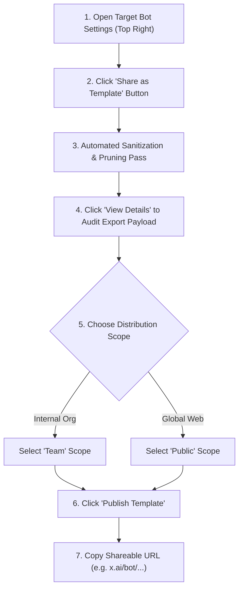

### Detailed Operational Steps

1. **Navigate to Bot Settings**: Open the target bot’s thread and select the Settings gear icon in the top-right corner.
2. **Initiate Packaging**: Scroll to the bottom right and click **Share as Template**. *Note: Clicking this button does NOT immediately make anything public.*
3. **Audit Included Components**:
   - The UI displays cards for **Memories**, **Skills**, **Routines**, and **Plugins**.
   - Click **View Details** to examine the exact text of every memory and skill being bundled.
   - Deselect or remove any memory that reveals internal team codenames or private details.
4. **Select Publishing Scope**:
   - **Team Scope**: Restricts template installation exclusively to verified members of your organization’s enterprise workspace.
   - **Public Scope**: Generates a universally accessible link allowing anyone with Grok Bot to add a copy.
5. **Publish & Distribute**: Click **Publish** and copy the generated URL (`https://x.ai/bot/<template-hash>`).

---

## 2. Enterprise Governance & Admin Controls

For corporate deployments under Cursor for Business or Teams plans [SRC-CUR-03]:

```
+-------------------------------------------------------------+
|               Enterprise Template Admin Policy               |
+-------------------------------------------------------------+
|  [x] Allow internal team template sharing                   |
|  [ ] Allow public web template sharing (Disabled by admin)  |
|  [x] Require automated secret scanning before publishing    |
|  [x] Enforce mandatory audit logging for template installs  |
+-------------------------------------------------------------+
```

### Policy Enforcement Rules

1. **Public Sharing Restriction**: Organization administrators can disable public link generation across all workspace seats. When disabled, the **Public** radio button is greyed out, ensuring proprietary recipes never leak externally.
2. **Audit Logging**: Every template published and every template imported is logged in the enterprise audit trail with the author's identity, timestamp, and component manifest.
3. **Centralized Team Directory**: Published team templates appear in the organization’s private template directory, allowing employees to onboard standardized engineer or support bots instantly.


---


<a id="chapter-15"></a>

# Chapter 3.3: Installing & Bootstrapping Templates

> **Source Authorities**: `https://x.ai/bot/guides/templates-for-grok-bot`, `https://cursor.com/docs/grok-bot/work` [SRC-XAI-03, SRC-CUR-03]

---

## 1. Installing an External Template

Installing a Grok Bot template is a frictionless, one-click process that initiates in the web browser and transitions seamlessly into the Grok Bot desktop or iOS client.

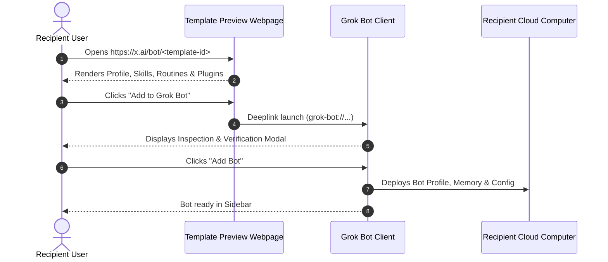

### Safety Inspection Checklist Prior to Installation

Before clicking **Add Bot**, review the inspection modal:
- [ ] **Attached Plugins**: Confirm which third-party connectors (GitHub, Slack, Jira) the bot requests.
- [ ] **Profile Instructions**: Read the Description field to verify that the bot operates within expected parameters and contains no hidden data exfiltration prompts.
- [ ] **Routines**: Check if any automatic schedules (e.g., hourly scrapes) will trigger immediately upon activation.

---

## 2. The Post-Installation Bootstrapping Sequence

Because a template is a "recipe" rather than a pre-cooked meal, the newly created bot instance on the recipient's machine may require setup actions:

```
+-------------------------------------------------------------+
|             Post-Installation Bootstrapping Pipeline        |
+-------------------------------------------------------------+
|  Step 1: First-Party Plugin Authentication                  |
|          Recipient authorizes personal GitHub / Notion      |
|          accounts via OAuth popups.                         |
|                                                             |
|  Step 2: Dependency & Toolchain Verification                |
|          Bot runs initial diagnostic script in /workspace:  |
|          checks node, python, git, and custom CLI tools.    |
|                                                             |
|  Step 3: Environment Secret Ingestion                       |
|          Bot presents secure prompt card for any missing    |
|          API tokens (e.g., Sentry, Linear, OpenAI).         |
|                                                             |
|  Step 4: Operational Smoke Test                             |
|          Recipient assigns a small introductory task to     |
|          verify end-to-end execution.                       |
+-------------------------------------------------------------+
```

---

## 3. Best Practices for Template Authors: Self-Bootstrapping Bots

If you author a bot that depends on custom command-line utilities, third-party libraries, or private MCP servers, configure your bot’s instructions to handle bootstrapping autonomously:

```markdown
### Onboarding & Self-Healing Protocol
Upon receiving your very first task on a new system:
1. Verify required runtime binaries:
   ```bash
   which jq || sudo apt-get update && sudo apt-get install -y jq
   which gh || echo "GitHub CLI missing"
   ```
2. Verify MCP Server Status:
   Check if `/workspace/.config/mcp/config.json` exists. If missing, copy template config from `/workspace/templates/mcp.json`.
3. If any required API token (e.g., LINEAR_API_KEY) is missing from the environment, present an in-chat secure modal requesting the key before failing.
```

By embedding autonomous onboarding logic into the system instructions, your shared templates become resilient, self-healing, and instantly usable by non-technical teammates.


---


<a id="chapter-16"></a>

# Chapter 3.4: Bot Marketplace Catalog & Ecosystem Categories

> **Source Authorities**: `https://x.ai/bot/marketplace`, `https://github.com/RongleCat/awesome-grok-bot` [SRC-XAI-12, SRC-COMM-00]

---

## 1. The Official xAI Bot Marketplace Ecosystem

Launched as the central hub for discovering and installing public Grok Bot blueprints, the **Bot Marketplace** (`https://x.ai/bot/marketplace`) features **69 handpicked, verified public templates** created by xAI engineers and top community builders.

```
+-------------------------------------------------------------+
|               xAI Bot Marketplace Architecture              |
+-------------------------------------------------------------+
|  [Search / Filter by 9 Categories]                         |
|  ┌──────────────────┐  ┌──────────────────┐  ┌───────────┐  |
|  │ From Grok Team   │  │ Engineering (18) │  │ Sales (9) │  |
|  └──────────────────┘  └──────────────────┘  └───────────┘  |
|  ┌──────────────────┐  ┌──────────────────┐  ┌───────────┐  |
|  │ Marketing (8)    │  │ Design (6)       │  │ Product (7│  |
|  └──────────────────┘  └──────────────────┘  └───────────┘  |
|  ┌──────────────────┐  ┌──────────────────┐  ┌───────────┐  |
|  │ Operations (6)   │  │ Recruiting (5)   │  │ Personal(10  |
|  └──────────────────┘  └──────────────────┘  └───────────┘  |
|                                                             |
|  [One-Click Add to Roster] ──(Installs Recipe Blueprint)──►  |
+-------------------------------------------------------------+
```

---

## 2. Taxonomy of the 9 Canonical Categories

| Category | Signature Templates | Primary Connected Tools | Typical Autonomous Cadence |
|---|---|---|---|
| **From Grok Team** | `Haggle Bot`, `Loops Engineer`, `Projects PM` | GitHub, Ramp, Slack, Notion | Hourly & Daily routines |
| **Engineering** | `Nightly Audit Engineer`, `Tinkabot`, `Researchy` | GitHub, Cursor Cloud, Docker | Nightly 03:00 UTC code sweeps |
| **Sales & GTM** | `Outbound Prospecting`, `GTM Loop Closer`, `Call Coach` | Salesforce, HubSpot, Gong, Clay | Weekday morning prospect scans |
| **Marketing** | `SEO/AEO Desk`, `AI Search Visibility`, `Human Copywriter` | Google Search Console, Ahrefs, X | Weekly SERP & visibility audits |
| **Design** | `Figma Bro`, `Critiquito`, `Imogen`, `Sable Game Art` | Figma API, Chromium, WebRTC | On-demand UI critique loops |
| **Product** | `Last30Days`, `Competitor Watching`, `Idea Stress Test` | Notion, Linear, Mixpanel | Continuous metric telemetry |
| **Operations** | `Alfred`, `Procurement Haggle`, `Event Requests` | Google Workspace, Ramp, Notion | Standing budget & invoice audits |
| **Recruiting & People**| `Interview Loop Coordinator`, `Talent Scout` | Ashby, Greenhouse, LinkedIn | Automated candidate pipeline sync |
| **Personal** | `Credit-Card Max`, `Plant Care`, `Morning Newspaper` | Chrome, Stripe Link, RSS feeds | Daily morning news delivery |

---

## 3. What Separates Top-Tier Marketplace Templates

An empirical audit of the highest-rated templates in the marketplace reveals five shared architectural traits:

1. **Strict Permission Lines**: Top templates never use ambiguous instructions like "Try your best". They explicitly demarcate:
   - *Always Allowed* (Read-only searches, drafting internal notes, linting).
   - *Requires Explicit Go* (Sending external emails, modifying database records, spending capital).
   - *Never, Under Any Circumstances* (Hardcoding secrets, bypassing 2FA).
2. **Proactive Self-Investigation**: Rather than stopping when an initial query yields incomplete data, high-performing bots (like `Haggle Bot`) trace owner emails, search Slack history, and query multiple databases autonomously.
3. **Decoupled Heavy Computation**: Top developer bots (like `grok-ship`) delegate heavy repo compilation and testing to **Cursor Cloud Agents**, keeping the Grok Bot VM lightweight and responsive.
4. **Structured Output Contracts**: Outputs open with executive summaries (e.g., `TODAY / SAVE / REC / NEXT` or `STATUS / BLOCKED / VERDICT`) rather than conversational fluff.


---


<a id="chapter-17"></a>

# Chapter 3.5: Deep Deconstruction of Top Marketplace Recipes

> **Source Authorities**: `https://x.ai/bot/marketplace`, `https://x.ai/bot/marketplace/marketing`, `https://x.ai/bot/marketplace/operations`, `https://x.ai/bot/marketplace/sales` [SRC-XAI-12, SRC-XAI-14, SRC-XAI-16, SRC-XAI-17]

---

## 1. Anatomy of High-Performing Marketplace Recipes

The Grok Bot Marketplace demonstrates how production agent recipes diverge from simple conversational prompts. Highly adopted templates do not attempt to replace an entire job function; instead, they encapsulate a **bounded, repetitive operational desk** with clear input schemas, strict proof verification, zero autonomous escalation, and explicit human sign-off gates.

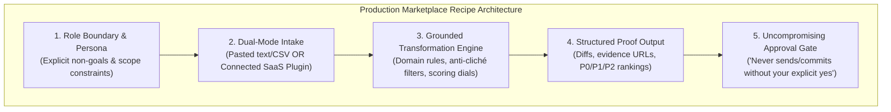

---

## 2. Recipe Deconstructions

### 2.1 SEO & AEO Desk by Adam Tanguay
- **Marketplace URI**: `/bot/0IhyZWxwbf2cFmsmroZQL` (Category: Marketing)
- **Primary Mission**: Bridges the transition from traditional Search Engine Optimization (SEO) to Artificial Intelligence Answer Engine Optimization (AEO).

```
+-------------------------------------------------------------+
|                      SEO & AEO Desk                         |
|                                                             |
|  [Input Data]                                               |
|     ├── Google Search Console (GSC) Plugin                  |
|     └── Raw Keyword / Search Term Pastes                    |
|          │                                                  |
|          ▼                                                  |
|  [Analysis Engine]                                          |
|     ├── Search Engine Keyword Opportunity (Volume vs Rank)  |
|     └── AI Answer Visibility (Perplexity, ChatGPT, Grok)    |
|          │                                                  |
|          ▼                                                  |
|  [Deliverable] ──► Writer-Ready Content Briefs              |
|                    (Title, Intent, Outline, Evidence URLs)  |
+-------------------------------------------------------------+
```

#### Core Architectural Patterns
1. **Dual Ingestion Vector**: Functions equally well whether connected to Google Search Console (GSC) via OAuth or processing raw pasted query tables. It never fails or halts if the user lacks GSC credentials.
2. **AEO Differentiation**: Traditional SEO tools evaluate keyword ranking positions; AEO evaluates whether AI answer engines (Perplexity, ChatGPT, Claude, Grok) cite the user's domain when answering buyer questions.
3. **Structured Deliverable**: Rather than generating full auto-written articles (which risk generic fluff and hallucinated citations), it outputs **Writer-Ready Briefs** with clear intent classifications, recommended headings, competitor reference URLs, and semantic keyphrases.

---

### 2.2 Alfred (Operations & Org Governance) by Robin Delta
- **Marketplace URI**: `/bot/p7Gh6HIrfv4AGzIow6-9X` (Category: Operations)
- **Primary Mission**: Chief Governance Officer for multi-bot fleets. Audits the Grok Bot roster to eliminate duplicate jobs, align bots with measurable business goals, and enforce minimal viable automation.

```
+-------------------------------------------------------------+
|               Alfred: Multi-Bot Governance                  |
|                                                             |
|  [Roster Audit] ──► Inspects all active bots & routines     |
|          │                                                  |
|          ▼                                                  |
|  [Governance Filters]                                       |
|     ├── Duplicate Task Elimination                          |
|     ├── Clear Human Owner Assignment                        |
|     └── The "Default Zero" Rule (Do we really need a bot?)  |
|          │                                                  |
|          ▼                                                  |
|  [Execution Policy] ──► NEVER creates, modifies, or deletes |
|                         anything without explicit YES.       |
+-------------------------------------------------------------+
```

#### Core Architectural Patterns
1. **The "Default to Zero" Invariant**: When an operator requests a new agent, Alfred evaluates whether an existing routine, a bash script, or an existing bot can absorb the task. It deliberately resists bot sprawl.
2. **Human Ownership Invariant**: Every bot in the organization must have an assigned human stakeholder accountable for its outputs and quota consumption.
3. **Immutable Execution Boundary**: Alfred has zero write permissions without interactive confirmation. It prepares governance recommendations, displays the exact diff of proposed changes, and requires a single affirmative confirmation before modifying bot profiles.

---

### 2.3 last30days by Matt Van Horn
- **Marketplace URI**: `/bot/TxB-fy1KryaYJLYWBcGtT` (Category: Marketing & Research)
- **Primary Mission**: Deep social intelligence synthesis covering real human discourse from the preceding 30 days across 8 distinct platforms.

```
+-------------------------------------------------------------+
|                   last30days Intelligence                   |
|                                                             |
|  [Multi-Platform Scrape Engine]                             |
|     Reddit | X | YouTube | TikTok | HN | Polymarket | Web   |
|          │                                                  |
|          ▼                                                  |
|  [Auto-Updating Skill Harness]                              |
|     Every 30 days: Checks GitHub for latest skill version   |
|          │                                                  |
|          ▼                                                  |
|  [Grounded Synthesis] ──► Dated, sourced briefing           |
|                           (Zero hallucination, direct quotes)
+-------------------------------------------------------------+
```

#### Core Architectural Patterns
1. **Self-Updating Routine**: In addition to on-demand research, the bot incorporates a scheduled routine that wakes every 30 days (`0 0 1 * *`) to fetch and test the newest version of the `last30days` CLI skill from GitHub.
2. **Multi-Platform Cross-Referencing**: Eliminates platform bias by synthesising real-world sentiment across Reddit (community discussions), X (real-time velocity), Hacker News (technical feedback), Polymarket (probabilistic forecasting), and YouTube transcripts.
3. **Strict Citation Protocol**: Every claim in the synthesized report includes the exact platform handle, date, and link URL. Unverified rumors are explicitly tagged as `Unsubstantiated Discourse`.

---

### 2.4 Copy Humanizer by Massimo De Luisa
- **Marketplace URI**: `/bot/YwxIbVEWqXN-HYCxiMCoB` (Category: Marketing & Writing)
- **Primary Mission**: Purges robotic cadence, syntactical boilerplate, and AI clichés from corporate prose without corrupting facts or changing the author's authentic voice.

#### Core Architectural Patterns
1. **The Anti-Cliché Regex Engine**: Scans text for classic LLM cadence markers:
   - Cliché vocabulary: *delve, tapestry, crucial, testament, pivotal, beacon, unleash, elevate, seamless*.
   - Structural tells: Formulaic introductory paragraphs ("In today's fast-paced digital landscape..."), artificial tri-part conclusions, and excessive parenthetical hedging.
2. **Fact Invariance Assertion**: The bot operates under an absolute prohibition against inventing facts, dates, statistics, or quotations. It modifies *cadence and sentence structure*, never underlying substance.
3. **Transparent Diff Explanations**: Output includes a side-by-side markdown comparison with explicit margin notes detailing why each phrase was modified (e.g., "Simplified passive construction", "Replaced generic buzzword with direct verb").

---

### 2.5 Outbound Prospecting by Krista Letz
- **Marketplace URI**: `/bot/i03IaF768-ielyzegoGye` (Category: Sales)
- **Primary Mission**: Identifies ideal customer profile (ICP) leads using live web intelligence, cross-references CRM records, and drafts hyper-personalized initial outreach messages.

#### Core Architectural Patterns
1. **CRM Deduplication Pre-Check**: Before researching a prospect, the bot queries connected CRM databases (HubSpot, Salesforce, Notion) to verify that the prospect is not already an active lead, assigned opportunity, or churned customer.
2. **Public Web Verification**: Investigates recent company podcast appearances, press releases, GitHub commits, or executive blog posts to locate a genuine operational hook rather than superficial template flattery.
3. **Strict Draft-Only Isolation**: The bot possesses write permissions to create drafts inside Gmail or LinkedIn, but is structurally forbidden from clicking "Send". All outreach messages must remain in draft state until reviewed and dispatched by a human sales executive.

---

## 3. Recipe Design Comparison Matrix

| Blueprint Attribute | SEO & AEO Desk | Alfred (Gov) | last30days | Copy Humanizer | Outbound Prospector |
|---|---|---|---|---|---|
| **Author** | Adam Tanguay | Robin Delta | Matt Van Horn | Massimo De Luisa | Krista Letz |
| **System Instruction Focus** | Query analysis & brief generation | Org topology & job deduplication | Multi-platform extraction | Stylistic de-biasing & voice match | ICP scoring & draft outreach |
| **Default Plugins** | Google Search Console, Web Search | Notion / Workspace Internal APIs | Web Search, ScrapeCreators | Local Filesystem | CRM (Salesforce/HubSpot), Gmail |
| **Core Routine** | Weekly search visibility audit | Weekly bot roster & quota review | Monthly (30d) skill update check | On-demand (no routine) | Daily signal scout (08:00 AM) |
| **Human Approval Boundary** | Approves brief before drafting | Approves bot creations / edits | Approves research scope | Reviews diff before accept | Approves email send (Drafts only) |
| **Failure Defense** | Degrades to pasted CSV input | Defaults to ZERO new bots | Falls back to public web search | Reverts to original draft | Aborts if existing CRM record |

---

## 4. Key Takeaways for Custom Recipe Authoring

1. **Specialize Deeply, Scope Narrowly**: A bot that performs one workflow exceptionally well (e.g., scoring inbound leads or formatting Figma specs) is infinitely more reliable than an all-in-one generalist.
2. **Decouple Data Ingest**: Always support both an automated API plugin connection and a manual fallback (pasting CSVs, Markdown, or raw text) so the bot functions immediately upon installation.
3. **Embed the Safety Boundary in the System Prompt**: Explicitly state: *"You may draft emails, stage PRs, and format proposals, but you are strictly forbidden from dispatching communications or merging code without the user's explicit affirmative confirmation."*


---


<a id="chapter-18"></a>

# Chapter 4.1: Team Topologies & Roster Patterns

> **Source Authorities**: `https://x.ai/bot/guides/how-i-run-multiple-teams-of-grok-bots`, `https://x.ai/bot/guides/grok-bot-for-engineering`, `https://x.ai/bot/guides/grok-bot-for-work`, `https://x.ai/news/team-bots` [SRC-XAI-04, SRC-XAI-05, SRC-XAI-23, SRC-XAI-NEWS-01]

---

## 1. Why Multi-Bot Teams Outperform Monolithic Generalists

A common failure mode in AI automation is attempting to construct a single monolithic "Omni-Bot" responsible for research, product management, architecture, frontend code, database optimization, and deployment.

Production experience at SpaceXAI demonstrates that **fleets of specialized, role-bounded bots vastly outperform single agents** for three reasons:
1. **Context Window Hygiene**: LLM performance degrades as unrelated conversational noise accumulates. A dedicated Coder bot doesn't need marketing copy in its prompt history.
2. **Domain-Specific Rules**: An engineer bot carries sharp, non-negotiable coding and testing guidelines; a marketing bot carries voice and brand voice guidelines. Combining them creates conflicting directives.
3. **Decoupled Memory Systems**: Each specialist maintains its own curated episodic memory, allowing it to develop deep familiarity with its specific repository or domain over weeks of execution.

---

## 2. Canonical Team Topologies

### Topology A: The Hub-and-Spoke Project Team (Eric's Pattern)
Used for cross-functional product development initiatives [SRC-XAI-04]:

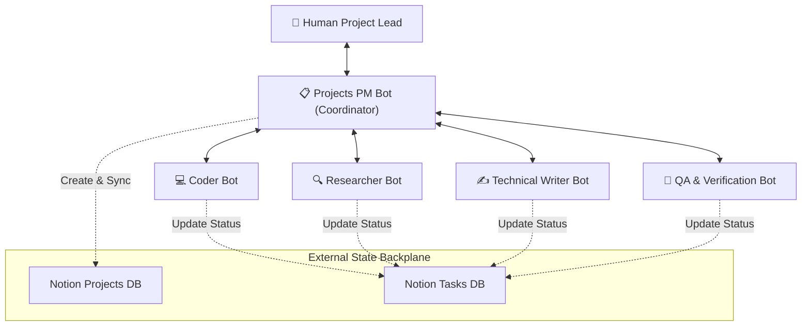

### Topology B: The Assembly Line / Pipeline (Mobile Studio Pattern)
Used for continuous game/product live-ops [SRC-XAI-07]:

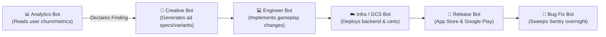

### Topology C: The Specialist Engineering Fleet (Lingxi's Pattern)
Used for multi-platform software engineering [SRC-XAI-05]:

```
+-------------------------------------------------------------+
|               Engineering Fleet Roster                       |
+-------------------------------------------------------------+
|  • Baltata:   Owns mobile shared layer & Grok Bot on iOS    |
|  • Shaoruru: Owns Grok Bot Desktop client & CI/CD pipelines |
|  • Hogan:    Owns infrastructure & unassigned user bugs     |
|  • Craig:    Owns Grok Bot on Android platform              |
|  • Quill:    Owns test harnesses, mocking daemons & fixtures|
|  • Jenny:    Head of Operations (Non-coding, 1:1 sync lead) |
+-------------------------------------------------------------+
```

### Topology D: The Executive Suite & Bot Boss Pattern (Josh Kim's Pattern)
As bot fleets grow, operators experience cognitive fatigue from managing multiple bot communication surfaces. The **Bot Boss Pattern** establishes a consolidated single front door to preserve executive clarity [SRC-XAI-23]:

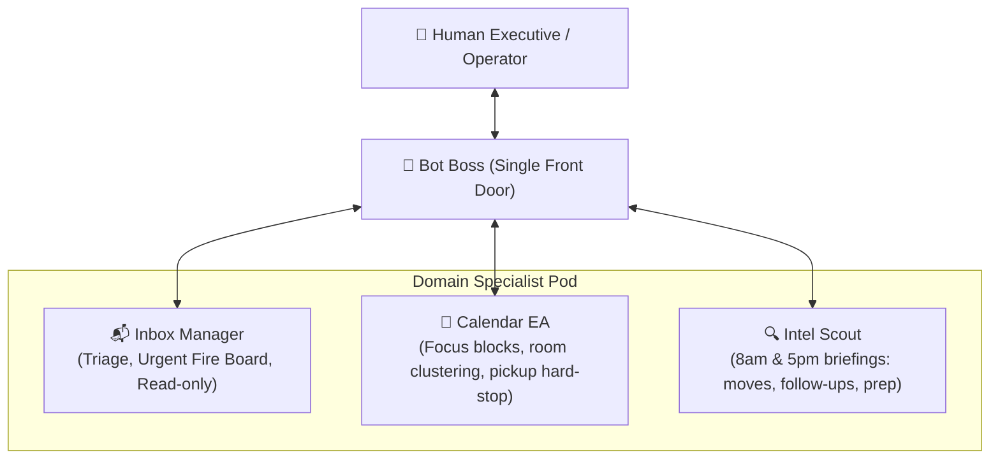

- **Inbox Manager**: Sifts communication channels (email, Slack, DMs) to escalate the ~3 items that are both important and urgent. Operates in read-only mode by default.
- **Calendar EA**: Defends deep-work focus windows by stacking and bookending meetings. Learns personal constraints (e.g. strict childcare pickup cutoffs).
- **Intel Scout**: Runs twice daily (08:00 and 17:00), synthesizing company decisions, open action items, and briefing packs for upcoming meetings.
- **Bot Boss**: Consolidates inbound alerts into a single morning impact briefing and an afternoon delta briefing, shielding the human operator from fragmented bot notifications.

---

## 3. The Three Golden Staffing Rules

When standing up a multi-bot project channel, follow the codified staffing rules [SRC-XAI-04]:

```
Rule 1: Reuse Existing Bench Bots First
        Always check if an existing Coder, Researcher, or Writer 
        can be assigned to the project before generating a new bot.

Rule 2: The Six-Bot Roster Ceiling
        Limit project channels to at most five specialist bots plus 
        one PM coordinator (max 6 bots). Larger rosters introduce 
        communication overhead and message churn.

Rule 3: Explicit Human Approval for New Hires
        A PM bot may propose creating a brand-new specialist only 
        when no bench bot fits the requirements, and only after 
        the human operator approves the creation.
```

---

## 4. The Official Team Bots Architecture

According to official SpaceXAI engineering specifications [SRC-XAI-DOC-06], organizations deploy **Team Bots** to institutionalize knowledge and standardize workflows across departments:

### Taxonomy: Personal Bots vs. Team Bots vs. Public Templates
| Dimension | Personal Bot | Team Bot | Public Template |
|---|---|---|---|
| **Visibility** | Only visible to creator | Shared across enterprise organization | Listed in Bot Marketplace |
| **Execution** | Runs on creator's cloud microVM | Runs on interacting member's cloud computer | Instantiated into recipient's private VM |
| **Secrets & Keys** | Personal 1Password / `.env` | Team Secrets (shared API keys, database credentials) | Blank / user must provide own credentials |
| **Governance** | Unmanaged | Admin / Manager controls, audit logs, SCIM | Creator owns template source code |
| **Slack Integration** | User-only DMs | Shared channels, multi-user threads, team approvals | N/A |

### Team Bot Publishing & Management Lifecycle
1. **Creation**: An engineer or team lead crafts and tests a bot on their personal workbench.
2. **Setup Verification**: Dependencies are mapped:
   - **Context**: Instructional markdown, brand voice guides, and architecture specifications.
   - **Plugins**: Enterprise SaaS connectors (Salesforce, Notion, GitHub, Linear, Datadog, Databricks).
   - **Credentials**: Read-only warehouse API credentials or service account tokens encrypted and scoped.
   - **Curated Memory**: Initial project context; retains collective learnings and user query corrections over time.
3. **Publishing & Manager Delegation**: The creator publishes the bot to the team registry and designates peer **Managers** who can edit prompts, modify routines, or update team secrets.
4. **Default Rollout**: Enterprise administrators can toggle **Add for members by default**, ensuring newly onboarded team members immediately receive the bot in their workspace roster.
5. **Slack Handle Integration**: Every Team Bot gets a dedicated Slack handle (e.g., `@customer-bot`, `@epd-teammate`), enabling channel members to converse with it in shared threads while preserving private individual turn histories.

### Production Team Bot Archetypes (xAI Reference Implementations)

| Team Bot Archetype | Primary Stack & Connectors | Operational Cadence & Workflow | Real-World Impact |
|---|---|---|---|
| **Customer Bot** | Salesforce, Gong, Notion, Slack | Nightly sweeps of Gong transcripts & Slack threads; 08:00 AM account briefings | Keeps AE, CSM, SA, and Sales Leader unified on single account state |
| **EPD Teammate** | Slack, Linear, Notion, Cursor Cloud | Monitors project Slack channels; files Linear bugs; dispatches Cursor Cloud Agents | Helped 5-person SpaceXAI team ship 100+ PRs/day during Team Bots launch |
| **Marketing Bot** | Figma, GitHub CMS, Brand Guides, Slack | Automated brand voice critique; review-to-preview PRs for SEO/copy | Empowers regional teams to ship localized copy without HQ approval bottlenecks |
| **Data Bot** | Databricks (45k+ tables), Datadog, Hex, Statsig | Read-only SQL queries, metric definitions, and chart generation | Democratizes ad-hoc analysis; memorizes SQL corrections across team turns |
| **Harper Insurance Bot** | Policy CRM, Payment Gateway, Email API | Automated identification of lapsed policies and customer balance outreach | Recovered $120,000+ in customer savings within 24 hours of launch |

---

## 5. Realtime Multi-Agent Research Swarms (`grok-4.20-multi-agent`)

At the core model layer, xAI provides **Realtime Multi-Agent Research** via the specialized `grok-4.20-multi-agent` model [SRC-XAI-API-06]. This model orchestrates parallel subagent swarms for deep multi-step technical investigations:

```mermaid
graph TD
    UserQuery["User Request: Investigate High-Severity Vulnerability in Staging Cluster"]
    Orchestrator["🧠 grok-4.20-multi-agent Orchestrator"]
    
    subgraph ParallelSubagents["Parallel Autonomous Specialist Subagents"]
        SearchAgent["🌐 Live X & Web Search Subagent<br/>(Harvests CVEs, advisories, patches)"]
        TelemetryAgent["📊 Internal Telemetry Subagent<br/>(Queries Sentry, Datadog, Prometheus)"]
        CodeAgent["💻 Static Code Analysis Subagent<br/>(Parses AST, diffs commits, audits repos)"]
    end
    
    Synthesis["⚡ Realtime Synthesis & Cross-Referencing Engine"]
    FinalReport["📋 Grounded Incident Report with Verified Provenance & Patch Diff"]

    UserQuery --> Orchestrator
    Orchestrator --> ParallelSubagents
    SearchAgent --> Synthesis
    TelemetryAgent --> Synthesis
    CodeAgent --> Synthesis
    Synthesis -->|Iterative Refinement| Orchestrator
    Synthesis --> FinalReport
```

### Architectural Benefits of `grok-4.20-multi-agent`
* **Concurrent Information Gathering**: Eliminates sequential tool-call latency by firing web searches, database queries, and code reviews simultaneously.
* **Domain Cross-Referencing**: Findings discovered by one subagent (e.g. a specific commit hash causing memory leaks) are instantly injected into the search agent's prompt to locate upstream GitHub issues.
* **Self-Refining Iteration**: The orchestrator evaluates intermediate findings and dynamically dispatches follow-up exploration subagents before delivering the consolidated answer.


---


<a id="chapter-19"></a>

# Chapter 4.2: Channel Coordination & Asynchronous Handoffs

> **Source Authorities**: `https://x.ai/bot/guides/how-i-run-multiple-teams-of-grok-bots`, `https://x.ai/bot/guides/grok-bot-for-mobile-app-development` [SRC-XAI-04, SRC-XAI-07]

---

## 1. Project Channels: Replicating Human Team Structure

Rather than managing dozens of fragmented 1:1 direct messages with individual bots, high-performing operators organize their fleet into **Project Channels**.

```
+-------------------------------------------------------------+
|             Grok Bot Sidebar: Project Channels              |
+-------------------------------------------------------------+
|  ▼ CHANNELS                                                 |
|    # proj-ios-redesign         [Baltata, PM, Quill, User]   |
|    # proj-android-v1           [Craig, PM, Hogan, User]     |
|    # proj-desktop-cicd         [Shaoruru, PM, User]         |
|                                                             |
|  ▼ DIRECT BOTS                                              |
|    @ Jenny (Head of Ops)                                    |
|    @ Quill (Harness Lead)                                   |
|    @ Hogan (Infra Lead)                                     |
+-------------------------------------------------------------+
```

### Channel Invariants
1. **One Project = One Channel**: All discussions, specs, task cards, and blockers regarding a specific initiative remain contained within the dedicated channel.
2. **Multi-Agent Presence**: The human and all assigned specialist bots participate in the same timeline.
3. **Transparent Delegation**: When the PM bot breaks down a specification into subtasks, assignments are announced directly in the channel so all participants share context.

---

## 2. Direct Bot-to-Bot Handoffs

The breakthrough capability that transforms isolated assistants into a cohesive organization is the **autonomous handoff**:

```mermaid
sequenceDiagram
    autonumber
    participant PM as PM Bot
    participant Analytics as Analytics Bot
    participant Engineer as Engineer Bot
    participant Human as Human Operator
    
    Human->>PM: "Launch sprint to decrease user onboarding drop-off"
    PM->>Analytics: "@Analytics Bot audit funnel drop-off points for last 14 days"
    Analytics->>Analytics: Queries Mixpanel / PostHog in Chrome
    Analytics->>Engineer: "Finding: 38% drop-off on step 3 due to SMS latency. @Engineer Bot please implement fallback to email verification."
    Engineer->>Engineer: Branches repo, implements email fallback & unit tests
    Engineer->>Human: "PR #312 created with passing tests. Attached proof. Ready for approval."
```

### Handoff Protocols

1. **Explicit Role Boundaries**: In the Mobile Studio model [SRC-XAI-07], the Analytics Bot is the *only* bot permitted to declare a finding, while the Engineer Bot takes that finding as a *strict specification*, not a loose suggestion. Clear role contracts eliminate circular debates between bots.
2. **Direct Passing Without Human Relay**: Bots do not need to route every intermediate artifact through the human. They transfer files in `/workspace` or link artifacts directly in their channel messages.
3. **Shared Channel Awareness**: When Bot A finishes a step, it mentions Bot B (`@Shaoruru Bot, the desktop build artifact is ready for packaging in /workspace/builds/v1.2.0`).

---

## 3. The "Blocked" Escalation Protocol

When an autonomous bot encounters an insurmountable obstacle (such as missing credentials, ambiguous product specs, or API quota exhaustion), it does not halt silently or loop indefinitely:

```
+-------------------------------------------------------------+
|                 Blocked Escalation Sequence                 |
+-------------------------------------------------------------+
|  1. Bot detects hard blocker (e.g. 2FA gate, API 403)       |
|  2. Bot marks task state as "BLOCKED" in Notion Tasks DB     |
|  3. Bot posts structured alert to Project Channel:          |
|                                                             |
|     🚨 @User BLOCKER ALERT:                                 |
|     Task: "Deploy v1.4 to Google Play Internal Track"       |
|     Reason: Google Play Console requires SMS 2FA for        |
|             service account activation.                     |
|     Action Needed: Take over desktop session to complete    |
|                    phone verification.                      |
|                                                             |
|  4. Bot halts execution and waits for human resolution      |
+-------------------------------------------------------------+
```

This protocol ensures that operators can step away with total confidence: bots run autonomously when unblocked, and ping urgently only when human agency is strictly necessary.


---


<a id="chapter-20"></a>

# Chapter 4.3: External State Boards: Notion & Linear

> **Source Authorities**: `https://x.ai/bot/guides/how-i-run-multiple-teams-of-grok-bots`, `https://x.ai/bot/guides/grok-bot-for-engineering` [SRC-XAI-04, SRC-XAI-05]

---

## 1. Scaling Beyond the Context Window

A single chat thread cannot maintain months of project history without suffering from prompt dilution, context compaction, and catastrophic forgetting. 

To scale fleets reliably across weeks of continuous execution, high-leverage teams decouple **active task execution** from **organizational state persistence** using external database boards (Notion or Linear).

```mermaid
graph TD
    subgraph ExecutionLayer["Grok Bot Execution Layer (Ephemeral Context)"]
        PM["Projects PM Bot"]
        Coder["Specialist Engineer Bot"]
        QA["QA / Sweep Bot"]
    end

    subgraph StateBackplane["Authoritative State Backplane (Notion / Linear)"]
        ProjectsDB[("Projects Database<br/>• Name, Lead, Status, Spec Link")]
        TasksDB[("Tasks Database<br/>• Title, Assignee, State, PR URL, Proofs")]
    end

    PM <-->|Sync Specs & Channels| ProjectsDB
    PM -->|Decompose into Subtasks| TasksDB
    Coder <-->|Poll & Claim Tasks| TasksDB
    QA <-->|Verify Proofs & Update Status| TasksDB
```

---

## 2. Canonical Two-Database Schema (Projects & Tasks)

### A. Projects Database Schema
Governed primarily by the **Projects PM Bot** [SRC-XAI-04]:

| Field Name | Property Type | Description |
|---|---|---|
| `Project Name` | Title | Initiative title (e.g., "Grok Bot iOS Client v1.0"). |
| `Status` | Select | `Planning` \| `Staffed` \| `Active` \| `Completed` \| `Archived` |
| `Channel Link` | URL / Relation | Link to the active Grok Bot project channel. |
| `Roster` | Multi-select | List of assigned bots (e.g., `PM`, `Baltata`, `Quill`). |
| `Spec Document` | Page / URL | Canonical PRD or architectural specification. |

### B. Tasks Database Schema
Updated by all specialist bots during sprint cycles:

| Field Name | Property Type | Allowed Values & Transitions |
|---|---|---|
| `Task Title` | Title | Concrete deliverable (e.g., "Implement biometric auth fallback"). |
| `Project` | Relation | Linked to parent Projects record. |
| `Assignee` | Select | Assigned bot (`Baltata`, `Craig`, `Shaoruru`). |
| `Status` | Status / Select | `Backlog` ➔ `Working` ➔ `Blocked` ➔ `Ready for Review` ➔ `Merged` |
| `PR Link` | URL | GitHub / GitLab pull request link. |
| `Visual Proof` | Files & Media | Screenshots, video recordings, or test runner outputs. |
| `Blocker Notes` | Text | Diagnostic output if status transitions to `Blocked`. |

---

## 3. The 30-Minute Automated PR Sweep Routine

In SpaceXAI's engineering fleet [SRC-XAI-05], engineer bots monitor a shared Pull Request tracking board on a strict 30-minute cadence:

```
+-------------------------------------------------------------+
|             30-Minute PR Automated Sweep Cycle              |
+-------------------------------------------------------------+
|                                                             |
|  [Poll Tasks DB where Status == 'Working' or 'In Review']   |
|                              │                              |
|                              ▼                              |
|  ┌───────────────────────────────────────────────────────┐  |
|  │ Audit 1: Bugbot / Security Comments                   │  |
|  │          Is there a new security finding?             │  |
|  │          -> If legitimate: Fix code, push commit.     │  |
|  └───────────────────────────────────────────────────────┘  |
|                              │                              |
|                              ▼                              |
|  ┌───────────────────────────────────────────────────────┐  |
|  │ Audit 2: CI Pipeline Status                           │  |
|  │          Did a build or test step fail?               │  |
|  │          -> If failed: Fetch logs, dispatch fix agent. │  |
|  └───────────────────────────────────────────────────────┘  |
|                              │                              |
|                              ▼                              |
|  ┌───────────────────────────────────────────────────────┐  |
|  │ Audit 3: Git Mergeability                             │  |
|  │          Are there merge conflicts with target branch?│  |
|  │          -> If conflicting: Run git rebase origin/main│  |
|  └───────────────────────────────────────────────────────┘  |
|                              │                              |
|                              ▼                              |
|  ┌───────────────────────────────────────────────────────┐  |
|  │ State Transition Decision                             │  |
|  │  • Issues remaining   -> Move back to "Working"       │  |
|  │  • All checks green   -> Move to "Ready for Review"   │  |
|  │  • Low blast radius   -> Auto-merge directly          │  |
|  └───────────────────────────────────────────────────────┘  |
+-------------------------------------------------------------+
```

This persistent board enables the human operator to open Notion in the morning and scan completed cards, review attached visual proofs, and approve ready-for-review items without scrolling through thousands of lines of chat transcripts.


---


<a id="chapter-21"></a>

# Chapter 4.4: Operations Management & Incident Postmortems

> **Source Authorities**: `https://x.ai/bot/guides/grok-bot-for-engineering` [SRC-XAI-05]

---

## 1. The "Jenny" Pattern: Head of Operations

In high-velocity AI engineering organizations, technical execution is only half the battle. As an org scales, operational overhead emerges: onboarding new bots, reinforcing code standards, maintaining team runbooks, and running root-cause analysis when things go wrong.

To solve this, SpaceXAI introduced the **Jenny Pattern** [SRC-XAI-05]: assigning a dedicated **Head of Operations Bot** who does not write code, but governs fleet alignment.

```
+-------------------------------------------------------------+
|                     Jenny: Head of Operations               |
+-------------------------------------------------------------+
|  Role:          Organizational Governance & Process Integrity|
|  Writes Code?:  No. Focuses 100% on coordination & alignment.|
|  Key Routines:  • Daily 05:00 AM 1:1 Alignment Meetings      |
|                 • Continuous Blocker Triaging                |
|                 • Incident Postmortems & Playbook Updates    |
|                 • Automated Onboarding of New Fleet Bots     |
+-------------------------------------------------------------+
```

---

## 2. The 5:00 a.m. Daily 1:1 Alignment Cadence

Every morning at 5:00 a.m. UTC, Jenny initiates automated 1:1 synchronization sessions with every specialist bot across the organization:

```mermaid
sequenceDiagram
    autonumber
    participant Jenny as Jenny (Head of Ops)
    participant Specialist as Baltata (iOS Lead)
    participant Playbook as Team Playbook / Wiki
    
    Jenny->>Specialist: "Good morning Baltata. Let's do our daily 1:1 sync."
    Specialist-->>Jenny: "Yesterday: shipped PR #412 for iOS audio stream. Active blocker: pending review on mock fixture."
    Jenny->>Playbook: Reads current iOS Architecture Invariants
    Jenny->>Specialist: "Remember our standard for audio streams: always verify memory deallocation in Instruments before submitting PR. Are tests passing?"
    Specialist-->>Jenny: "Tests pass. Allocations verified under 12MB. Unblocked."
    Jenny->>Playbook: Logs sync notes in Daily Fleet Journal
```

### Benefits of the 1:1 Cadence
1. **Zero Context Drift**: Prevents bots from forgetting complex team rules and conventions over weeks of continuous operation.
2. **Blocker Surfacing**: Identifies stuck tasks hours before human operators wake up.
3. **Vibe & Quality Reinforcement**: Reinforces the specific code craftsmanship and architectural standards established by the engineering lead.

---

## 3. Incident Postmortems & Continuous Playbook Evolution

When an autonomous bot makes a mistake—such as prematurely declaring a PR ready for review when visual regressions exist, or failing to push back against a flaky build:

```mermaid
flowchart TD
    Incident["1. Incident Detected (e.g. Unverified PR Merged)"] --> Direct["2. Human Directs Bot: 'Go to Jenny for Postmortem'"]
    Direct --> JennyRCA["3. Jenny Conducts Root Cause Analysis (RCA)"]
    JennyRCA --> Identify["4. Identify Failure Mode: Missing Verification Step"]
    Identify --> UpdatePlaybook["5. Jenny Updates Team Playbook & System Prompts"]
    UpdatePlaybook --> Broadcast["6. Jenny Broadcasts Updated Rule to All Fleet Bots"]
    Broadcast --> NeverRepeat["7. Invariant Permanently Codified Across Fleet"]
```

### The Postmortem Output Format
Jenny compiles postmortems into structured markdown entries stored in `/workspace/docs/postmortems/`:

```markdown
# Incident Postmortem: INC-2026-09-08
**Incident**: PR #884 merged with missing dark-mode contrast verification.
**Root Cause**: Specialist bot validated DOM classes but omitted screenshot comparison.
**Corrective Action**:
1. Added mandatory rule to `/react-native-best-practices` skill:
   `All UI PRs must include side-by-side screenshots for both Light and Dark modes.`
2. Updated engineer bot system prompts to enforce proof review.
```

---

## 4. Automated Bot Onboarding

When scaling up the fleet to support a new initiative (e.g., launching an Android client), Jenny orchestrates the onboarding:
1. **Creates Bot Profile**: Defines name (`Craig`), title (`Android Lead`), and role description.
2. **Injects Organizational Guidelines**: Attaches team coding standards, security boundaries, and review criteria.
3. **Pairs with Buddy Bots**: Instructs senior bots (`Hogan`, `Shaoruru`) to assist with repository configuration and initial build verification.


---


<a id="chapter-22"></a>

# Chapter 5.1: Cursor Cloud Agents Orchestration

> **Source Authorities**: `https://x.ai/bot/guides/grok-bot-for-engineering`, `https://cursor.com/docs/grok-bot/work`, `https://cursor.com/help/the-x-subscription/overview` [SRC-XAI-05, SRC-CUR-03, SRC-CUR-12, SRC-XAI-SUB-01, SRC-XAI-SUB-04]

---

## 1. The 10x Shift: From Agent Operator to Agent Fleet Manager

Before Grok Bot, an advanced software engineer using Cursor Cloud Agents was constrained by their own attention span and context-switching bandwidth. Managing 10 to 15 concurrent cloud agents manually required constant monitoring of transcripts, re-prompting on failures, and auditing diffs.

With Grok Bot, the engineer ascends one abstraction layer higher: **the human manages a small fleet of engineer bots, and those engineer bots manage more than 200 Cursor Cloud Agents simultaneously** [SRC-XAI-05].

```mermaid
graph TD
    Human["👤 Human Engineering Lead"]
    
    subgraph FleetLayer["Grok Bot Engineering Fleet"]
        Baltata["📱 Baltata (Mobile)"]
        Shaoruru["🖥️ Shaoruru (Desktop)"]
        Hogan["☁️ Hogan (Infra)"]
        Craig["🤖 Craig (Android)"]
        Quill["🧪 Quill (Harness)"]
    end
    
    subgraph CursorCloudLayer["Cursor Cloud Agents (200+ Concurrent Workers)"]
        Agent1["Cloud Agent #1<br/>(PR #401)"]
        Agent2["Cloud Agent #2<br/>(PR #402)"]
        Agent3["Cloud Agent #3<br/>(PR #403)"]
        AgentN["Cloud Agent #200+<br/>(Nightly Tasks)"]
    end

    Human -->|Assigns High-Level Goals| FleetLayer
    Baltata -->|Dispatches, Audits & Fixes| Agent1
    Shaoruru -->|Dispatches, Audits & Fixes| Agent2
    Hogan -->|Dispatches, Audits & Fixes| Agent3
    Quill -->|Dispatches, Audits & Fixes| AgentN
```

---

## 2. The Cloud Agent Dispatch Lifecycle

When an engineer bot kicks off a Cursor Cloud Agent, it executes a rigorous, four-stage supervisory lifecycle:

```
+-------------------------------------------------------------+
|             Cloud Agent Supervisory Lifecycle               |
+-------------------------------------------------------------+
|                                                             |
|  [Stage 1: Structured Dispatch Prompting]                   |
|   • Detailed objective and file scope boundaries            |
|   • Attached skills: /react-native-best-practices, /design  |
|   • Mandatory proof deliverables (unit tests, screenshots)  |
|                              │                              |
|                              ▼                              |
|  [Stage 2: Active Transcript & Artifact Monitoring]         |
|   • Bot watches execution transcript in real-time           |
|   • Detects environment flakiness, missing deps, or stalls  |
|   • Sends queueing messages or interrupts to redirect agent |
|                              │                              |
|                              ▼                              |
|  [Stage 3: Multimodal Proof Verification]                   |
|   • Inspects attached PR screenshots using visual model     |
|   • Confirms visual changes match user specifications       |
|   • Validates before vs. after proof metrics                |
|                              │                              |
|                              ▼                              |
|  [Stage 4: Automated Code Review & Handover]                |
|   • Kicks code review run on PR diff                        |
|   • If low blast-radius & high confidence -> Auto-merges    |
|   • If high blast-radius -> Marks "Ready for Review"        |
|                                                             |
+-------------------------------------------------------------+
```

---

## 3. High-Leverage Prompting for Cloud Agents

Engineer bots do not send vague prompts. They dispatch cloud agents using battle-tested prompt specifications:

```markdown
### Task Directive for Cloud Agent #849
**Target Repository**: `spacexai/grok-bot-ios`
**Branch**: `feature/audio-stream-reconnect`

**Core Objective**:
Implement exponential backoff reconnect logic in `AudioStreamClient.swift` when WebSocket connection drops.

**Mandatory Skills to Execute**:
- `/ios-network-invariants`
- `/lingxi-review`

**Deliverables & Required Proofs**:
1. Zero compiler warnings under Xcode 16.
2. Unit tests covering 3 successive dropouts with backoff jitter intervals.
3. Attached video/log proof demonstrating seamless reconnect within 1.5s.
4. If tests fail, run lldb trace and patch before opening PR.
```

By enforcing strict proof deliverables at dispatch time, the engineer bot ensures that PRs reaching the review board are verified, tested, and ready for production.

---

## 4. Resource Allocation & Pool Management under The X Subscription

With the launch of **The X Subscription** [SRC-CUR-12, SRC-XAI-SUB-01, SRC-XAI-SUB-04], managing large-scale Cursor Cloud Agent swarms is tightly coupled to the organization's compute tier:

1. **First-Party vs. Third-Party Model Routing**:
   - Cloud Agents running **Grok models** draw directly from the seat's included weekly pool (Premium = 4x, Super = 15x, Ultra = 50x).
   - Cloud Agents running **third-party models** (e.g., Claude 3.5 Sonnet, GPT-4o) do not draw from the included weekly pool; they are billed against the workspace's **Prepaid Credit Balance** at standard API list rates.
2. **Team Seat Autonomy**:
   - Concurrency on one engineer's seat does not starve peer seats. Each seat maintains its independent weekly allowance.
3. **Overdraft Protection via Auto Top-Up & Spending Caps**:
   - Fleet managers configure monthly spending caps on `grok.com/dashboard/billing`. If 200+ agents exhaust the included weekly allowance during an intensive sprint, auto top-up seamlessly refills prepaid credits up to the configured spending cap, ensuring zero work stoppages during critical release windows.


---


<a id="chapter-23"></a>

# Chapter 5.2: Private Workers & Hardware Extensions

> **Source Authorities**: `https://x.ai/bot/guides/grok-bot-for-engineering` [SRC-XAI-05]

---

## 1. Why Cloud Execution Isn't Always Enough

While Grok Bot's cloud computer handles 90% of general-purpose knowledge work, web automation, and standard Linux builds, certain software engineering tasks require specialized local runtimes:
- **macOS & iOS Toolchains**: Apple prohibits virtualized macOS on arbitrary Linux cloud instances; building and running iOS Simulator requires Apple Silicon hardware.
- **Corporate VPNs & Air-Gapped Networks**: Internal enterprise staging servers often reside behind strict Zero Trust Network Access (ZTNA) or corporate VPN tunnels.
- **Hardware Peripherals**: Audio I/O loop testing, GPU hardware acceleration, and physical device debugging.

To bridge this gap, Grok Bot integrates directly with **Cursor Cloud Private Workers** [SRC-XAI-05].

```mermaid
graph TD
    UserGrok["🧠 Grok Bot Cloud Platform"]
    
    subgraph StandardCloud["Default Cloud Infrastructure"]
        CloudVM["Grok Cloud Ubuntu VM<br/>(Terminal, Web, SaaS Plugins)"]
        StandardAgents["Cursor Cloud Linux Runners<br/>(Standard Node/Python/Go Builds)"]
    end
    
    subgraph PrivateWorkerInfra["Self-Hosted Private Worker (e.g., Mac mini)"]
        Daemon["Cursor Cloud Worker Daemon"]
        Xcode["Xcode & iOS Simulator"]
        AndroidSDK["Android Emulator & ADB"]
        VPN["Corporate VPN / Internal Subnets"]
        AudioIO["System Audio I/O Interface"]
    end

    UserGrok -->|Execute Standard Tasks| CloudVM
    UserGrok -->|Dispatch Standard Builds| StandardAgents
    UserGrok -->|Dispatch Specialized Runs| Daemon
    Daemon --> Xcode
    Daemon --> AndroidSDK
    Daemon --> VPN
    Daemon --> AudioIO
```

---

## 2. The Mac mini Private Worker Pattern

In the SpaceXAI engineering team [SRC-XAI-05], a spare Apple Silicon Mac mini is configured as a persistent Cursor Cloud private worker:

### Capabilities Unlocked:
1. **Headless iOS Simulator Automation**: Engineer bots kick off cloud agents targeting the private worker, which launches the iOS Simulator, boots the target app, executes automated UI tests, and captures full-resolution screenshots.
2. **Native Xcode Builds**: Compiles Swift, Objective-C, and Metal code natively with full access to local Xcode provisioning profiles and signing certificates.
3. **Multimodal Visual Feedback**: The captured simulator screenshots are passed directly back to Grok Bot's vision engine, allowing the bot to inspect UI alignment and color contrast on native Apple typography.

---

## 3. Real-Time Audio I/O Testing

A unique capability described in the official engineering guide is **closed-loop voice and dictation testing** [SRC-XAI-05]:
1. **Virtual Soundcard Routing**: The private worker or cloud VM maps system audio I/O to a virtual PulseAudio/CoreAudio device.
2. **Voice API Injection**: SpaceXAI’s voice API synthesizes speech and routes it directly into the agent’s virtual microphone input.
3. **Transcript & Latency Verification**: The bot captures the application's transcription stream, compares it against the spoken input for word-error-rate (WER), and calculates end-to-end speech-to-speech latency.
4. **Autonomous Flakiness Healing**: If an audio stream stalls, the bot restarts the daemon, adjusts audio buffer parameters, and re-executes the test run without disturbing human engineers.


---


<a id="chapter-24"></a>

# Chapter 5.3: Automated CI/CD, PR Reviews & Nightly Sweeps

> **Source Authorities**: `https://x.ai/bot/guides/grok-bot-for-engineering` [SRC-XAI-05]

---

## 1. Transforming Code Maintenance into Continuous Operations

In conventional engineering teams, technical hygiene tasks—such as updating dependencies, removing dead code, auditing security advisories, and optimizing bundle sizes—are routinely deferred to quarterly refactoring sprints.

With Grok Bot, **code hygiene is an autonomous, nightly operational cadence** [SRC-XAI-05].

```
+-------------------------------------------------------------+
|               The 03:00 AM Nightly Hygiene Sweep            |
+-------------------------------------------------------------+
|                                                             |
|  [03:00 UTC] Fleet bots wake up on scheduled routine        |
|                                                             |
|  Phase 1: Dependency & Dead Code Scan                       |
|   • Runs knip / ts-prune to find unused exports and files   |
|   • Analyzes bundle output with source-map-explorer         |
|   • Identifies stale feature flags older than 30 days       |
|                                                             |
|  Phase 2: Static Security & Vulnerability Sweep             |
|   • Executes npm audit / cargo audit / trivy                |
|   • Scans codebase for leaked credentials and tokens        |
|                                                             |
|  Phase 3: Automated Remediation PR Generation               |
|   • Branches repo: cleanup/nightly-sweep-2026-09-19         |
|   • Applies surgical fixes and runs local verification suite|
|   • Generates structured PR with before/after metrics:      |
|     - Bundle size reduced by 142 KB (-3.4%)                 |
|     - 18 unused exports pruned                              |
|     - 2 high CVE dependencies bumped                        |
|                                                             |
|  Phase 4: Notion PR Board Sync                              |
|   • Adds card to Notion PR board marked "Ready for Review"  |
|                                                             |
|  [08:00 AM] Human arrives to pre-verified, one-shot PRs     |
+-------------------------------------------------------------+
```

---

## 2. Automated Bugbot & CI Triage Protocol

When PRs are opened across a 200+ agent fleet, automated security linters (e.g., Cursor Bugbot, CodeQL) inevitably generate comments. In typical setups, engineers spend hours triaging these notifications.

Grok Bot automates triage via the **PR Health Audit Protocol**:

```mermaid
flowchart TD
    Comment["New Comment on PR from 'cursor-bugbot'"] --> Fetch["Engineer Bot Fetches Diff & AST Context"]
    Fetch --> Verify{"Is Bugbot finding legitimate or false positive?"}
    Verify -->|False Positive: Harmless typecast| Dismiss["Reply to Bugbot with technical rationale explaining why finding is safe"]
    Verify -->|Legitimate Bug: Potential ReDoS vulnerability| Patch["Dispatch surgical cloud agent to patch regex and add unit test"]
    Patch --> Push["Push fix commit to PR branch"]
    Push --> Recheck["Verify CI tests pass green"]
```

---

## 3. The Autonomous Merge Matrix (Blast-Radius vs. Confidence)

To safely balance high velocity with production stability, Grok Bot uses a codified decision matrix for automated merging [SRC-XAI-05]:

```
                     HIGH CONFIDENCE
                            │
        Auto-Merge Direct   │   Pre-Approve + Notify
       (Low Blast Radius)   │   (Medium Blast Radius)
   ─────────────────────────┼─────────────────────────
        Request Human Sync  │   Block + Immediate Alert
       (Ambiguous Spec)     │   (High Blast Radius)
                            │
                      LOW CONFIDENCE
```

### Classification Parameters

| Blast Radius Tier | Scope & Affected Modules | Merge Policy |
|---|---|---|
| **Tier 1: Low Blast** | Typo fixes, CSS alignment, unit test mocks, non-breaking dependency bumps. | **Auto-merged autonomously** if CI passes and confidence score > 0.95. |
| **Tier 2: Medium Blast** | Internal helper refactors, new isolated CLI commands, minor component features. | **Auto-staged**; notifies human lead on Slack/Notion with diff summary. |
| **Tier 3: High Blast** | Database schema migrations, authentication/billing code, public API contract changes. | **Strict Human Review Gate**. Never merged without explicit operator approval. |

By operating under this tiered governance, engineering teams report shipping **over 2,000 PRs per month per engineer** [SRC-XAI-05] while maintaining rigorous production quality standards.


---


<a id="chapter-25"></a>

# Chapter 5.4: Community Stacks, The Harness Era & Model Routing

> **Source Authorities**: `https://x.com/bossriceshark/article/2094074367324168595`, `https://github.com/kunchenguid/grok-ship` [SRC-COMM-02]

---

## 1. Entering "The Harness Era"

In August 2026, tech writer Matt Rice dubbed the convergence of Grok Bot and Cursor Cloud Agents **"The Harness Era"** [SRC-COMM-02].

The core realization of this paradigm is:
> **"The Bot should not do the heavy coding. The Bot architects and manages; Cursor Cloud Agents do the heavy lift."**

```mermaid
graph TD
    Human["👤 Developer / Founder"] -->|"Assigns high-level goal"| Bot["🤖 Grok Bot (Architect / Manager)<br/>• Runs on Grok Bot allowance<br/>• Plans task breakdown<br/>• Reviews proofs & diffs"]
    
    subgraph HeavyLift["Cursor Cloud Execution Fabric (Cursor Plan Allowance)"]
        CA1["⚡ Cloud Agent #1 (/poteto-mode)<br/>Compiles, edits files, runs tests"]
        CA2["⚡ Cloud Agent #2 (/poteto-mode)<br/>Fixes Bugbot alerts & rebases"]
    end
    
    Bot -->|"Dispatches structured prompt"| CA1
    Bot -->|"Dispatches structured prompt"| CA2
    CA1 -->|"Submits PR with visual proof"| Bot
    CA2 -->|"Submits PR with test logs"| Bot
    Bot -->|"Presents concise PR summary"| Human
```

### Why Decoupling Compute Matters
1. **Meter Isolation**: Grok Bot operates on a weekly conversation compute bucket; Cursor Cloud Agents run on Cursor Pro/Ultra fast-request allowances. Letting the Bot write thousands of lines of code locally exhausts the shared VM and drains the wrong meter.
2. **Horizontal Concurrency**: While the shared VM has a finite screen surface, Cursor Cloud Agents can spin up 50+ isolated parallel containers simultaneously.
3. **No Machine Lockups**: Heavy builds (Rust, C++, Webpack) won't freeze the Bot's desktop browser or UI.

---

## 2. Kun Chen's Software Factory (`grok-ship`)

Open-source maintainer Kun Chen (governing repos with 24k+ GitHub stars) demonstrated this architecture at scale [SRC-COMM-02]:

```
+-------------------------------------------------------------+
|              Kun Chen's Grok Ship Factory Pattern           |
+-------------------------------------------------------------+
|  1. 'Firstmate' Bot serves as the primary factory captain.  |
|  2. When issues arrive, Firstmate assigns work to crewmates.|
|  3. Crewmates spin Cursor Cloud Agents to do the coding.    |
|  4. Each Cloud Agent executes with the `/poteto-mode` skill.|
|  5. Result: 625 items triaged (331 issues, 294 PRs closed)  |
|     with minimal human intervention.                        |
+-------------------------------------------------------------+
```

### Activating the Factory
Developers initialize the pattern by injecting the canonical instruction:
```text
"Setup Grok Ship for me. Follow GROK_SHIP.md in github repo: kunchenguid/grok-ship. 
Whenever you launch a Cursor Cloud Agent, run /poteto-mode on it. 
You manage. Cursor does the repo work. Bring verified PRs back to me."
```

---

## 3. The Dynamic Model Routing Matrix (Ian Nuttall Pattern)

Because Grok Bot acts as an intelligent supervisor over the Cursor platform, advanced developers program their bots to dynamically route subtasks across frontier models based on cognitive strengths:

| Task Type | Recommended Model | Architectural Rationale |
|---|---|---|
| **Architectural Planning & PRDs** | **Fable / Claude 3.7 Sonnet** | Superior deep reasoning, counter-factual analysis, and structural foresight. |
| **Code Implementation & Refactoring**| **Sol 5.6 / Claude 3.5 Sonnet** | Maximum coding benchmark scores, lowest hallucination rate in AST mutations. |
| **General Coordination & Triage** | **Grok 4.6** | High speed, native multimodal vision, deep context window, and tight OS harness integration. |

By letting the bot select the optimal underlying model for each cloud agent dispatch, engineering velocity increases while token cost is minimized.


---


<a id="chapter-26"></a>

# Chapter 6.1: Mobile App Development: The Rank'em Studio Playbook

> **Source Authorities**: `https://x.ai/bot/guides/grok-bot-for-mobile-app-development` [SRC-XAI-07]

---

## 1. The 85% of Mobile Development Nobody Sees

While modern code generation LLMs make it straightforward to generate a working prototype of a game (such as Wordle or Flappy Bird) in an afternoon, **building the core game is only 15% of running a commercial mobile app studio** [SRC-XAI-07].

The remaining 85% consists of operational grind:
- **User Acquisition (UA)**: Analyzing campaign spend in Meta Ads Manager and AppLovin dashboards.
- **Performance Creative**: Generating dozens of video/image ad variants weekly to combat rapid ad fatigue.
- **Release Management**: Navigating Apple App Store Connect and Google Play Console (certificates, provisioning profiles, privacy declarations, staged rollouts).
- **Backend & Live-Ops**: Managing game state servers, leaderboard scaling, and cross-device sync.
- **Crash Triage**: Triaging Sentry error spikes occurring across fragmented Android hardware and iOS versions.

---

## 2. The 6-Bot Studio Roster Architecture

To operate the live mobile game *Rank'em* with a solo human founder, a 6-bot team was deployed [SRC-XAI-07]:

```mermaid
graph TD
    Orchestrator["📱 Mobile Orchestrator (Lead Manager)<br/>• Owns App Store & Google Play<br/>• Routes cross-functional work"]
    
    Analytics["📊 Analytics Agent<br/>• Owns paid acquisition (Meta/AppLovin)<br/>• The ONLY bot allowed to declare findings"]
    
    Creative["🎨 Creatives Agent<br/>• Generates ad specs & video cuts<br/>• Never buys media directly"]
    
    Engineer["💻 Rank'em Engineer<br/>• Owns React Native app & backend<br/>• Treats findings as strict specs"]
    
    Infra["☁️ GCS / Infra Agent<br/>• Governs GKE clusters, certs, deploys<br/>• Gatekeeper to production"]
    
    BugFix["🐞 Bug Fix Agent<br/>• Sweeps Sentry overnight<br/>• Fixes obvious bugs, escalates edge cases"]

    Orchestrator --> Analytics
    Analytics -->|"Hands off finding"| Creative
    Creative -->|"Hands off ad spec"| Engineer
    Engineer -->|"Submits deploy PR"| Infra
    Infra --> Orchestrator
    BugFix -->|"Overnight fixes"| Engineer
```

---

## 3. Bot Configuration Blueprint: The Analytics Bot

The Analytics Bot serves as the primary intelligence driver. Here is its canonical configuration profile [SRC-XAI-07]:

```yaml
Name: "Analytics Agent"
Title: "Paid Acquisition & User Behavioral Lead"
Role Description: >
  You own user acquisition and live-ops analytics for Rank'em across Meta Ads Manager, 
  AppLovin Max, and Mixpanel. Your sole responsibility is to evaluate cohort retention, 
  identify high-dropoff funnel stages, and measure ad spend efficiency (ROAS).
  
  Operational Invariants:
  1. You are the ONLY bot permitted to declare an official 'Finding'.
  2. You NEVER adjust advertising budgets or pause campaigns without explicit human sign-off.
  3. When an actionable retention issue is identified, format it as a structured Finding 
     and mention @Rank'em Engineer and @Creatives Agent in the project channel.
```

### Nightly Autonomous Routine
Every night at 02:00 AM:
1. Opens Chromium on cloud computer; navigates to Meta Ads Manager and AppLovin.
2. Exports 24-hour cohort spend, Cost Per Install (CPI), and Day-1 retention metrics.
3. If Day-1 retention falls below 42%: Identifies the primary drop-off level in the puzzle progression.
4. Generates a structured Finding card in the `#rankem-liveops` project channel.
5. In the morning, the human reviews the card and gives the green light for the Creatives and Engineer bots to ship adjustments.


---


<a id="chapter-27"></a>

# Chapter 6.2: Support Triage & Customer Operations

> **Source Authorities**: `https://x.ai/bot/guides/grok-bot-for-support` [SRC-XAI-06]

---

## 1. High-Volume Support Architecture

Customer support teams face a deluge of repetitive inquiries, bug reports, and billing questions. Traditional automation (simple rule-based chatbots) frustrates users with generic canned responses.

Grok Bot deploys a **Support Triage Fleet** that functions like an experienced Tier-1 support specialist with direct read/write access to internal debugging tools, documentation, and issue trackers [SRC-XAI-06].

```mermaid
flowchart TD
    Customer["Inbound Support Ticket<br/>(Zendesk / Intercom / Email)"] --> TriageBot["🎧 Support Triage Bot"]
    
    subgraph AnalysisEngine["Investigation & Correlation"]
        TriageBot --> QuerySentry["1. Query Sentry & Datadog for Active Outages"]
        TriageBot --> QueryDocs["2. Search Internal KB & Product Specs"]
        TriageBot --> Classify["3. Cluster & Classify Issue Type"]
    end
    
    Classify --> Decision{"Classification"}
    
    Decision -->|Known User Error / FAQ| DraftResponse["Generate High-Context Draft Response"]
    Decision -->|Legitimate Software Bug| CreateBug["File Reproducible Linear/Jira Bug Report"]
    Decision -->|Billing / Account Escalation| EscalateHuman["Handover to Billing Specialist"]
    
    DraftResponse --> ApprovalGate{"Confidence Check"}
    ApprovalGate -->|>98% & FAQ| AutoSend["Send Response Directly"]
    ApprovalGate -->|<98% or Sensitive| HumanQueue["Queue for Human Review"]
```

---

## 2. Issue Clustering & Root-Cause Bug Escalation

A critical advantage of Grok Bot in support operations is its ability to perform **cross-ticket correlation**:

1. **Anomaly Detection**: If 15 tickets arrive within 10 minutes reporting "Cannot export PDF", the bot identifies a systemic incident rather than treating them as 15 isolated issues.
2. **Autonomous Linear Filing**:
   - The bot inspects the cloud computer's terminal to test the export endpoint.
   - It captures network logs and stack traces.
   - It creates a structured Linear issue:
     ```markdown
     ### [Incident] PDF Export Failing with 504 Gateway Timeout
     **Cluster Count**: 18 tickets in 15 minutes.
     **Affected Region**: US-East-1
     **Reproduction**: Verified via `curl -I https://api.app.com/v1/export/pdf`
     **Target Fleet**: Escalated to @Hogan (Infra Lead)
     ```
3. **Drafting User Updates**: Once the engineering team merges the fix, the bot automatically drafts personalized updates to all 18 impacted users informing them that the fix is live.

---

## 3. Support Bot Safety Invariants

```markdown
### Inviolable Support Bot Rules
1. Never issue monetary refunds, account credits, or plan cancellations autonomously. 
   Stage the request and notify the human finance lead.
2. Do not reveal internal API endpoints, staging URLs, or employee names in user replies.
3. Every response involving account security (password resets, 2FA removal) requires 
   human operator sign-off before dispatch.
```


---


<a id="chapter-28"></a>

# Chapter 6.3: Product Management & Spec Generation

> **Source Authorities**: `https://x.ai/bot/guides/grok-bot-for-pms`, `https://x.ai/bot/guides/how-i-run-multiple-teams-of-grok-bots` [SRC-XAI-10, SRC-XAI-04]

---

## 1. The Autonomous PM: From Vision Note to Executable Sprint

In traditional software development, Product Managers spend a substantial portion of their time translating high-level business goals into granular engineering tickets, tracking progress across disparate tools, and answering edge-case questions.

Grok Bot functions as an autonomous **Technical Product Manager (PM Bot)** capable of converting a conversational voice note into a fully staffed project with executable specifications and automated sprint tracking [SRC-XAI-10].

```mermaid
graph TD
    VoiceNote["🎙️ Voice Note / Brain Dump from Founder"] --> PMBot["📋 PM Bot"]
    
    subgraph SpecGeneration["Specification Engine"]
        PMBot --> PRD["1. Generate Structured PRD (Goals, Non-Goals, User Stories)"]
        PRD --> EdgeCases["2. Synthesize Edge-Case & Failure Mode Matrix"]
        EdgeCases --> TaskCards["3. Decompose into Discrete Engineering Tasks"]
    end
    
    subgraph ExecutionBridge["Orchestration Bridge"]
        TaskCards --> CreateChannel["4. Open Dedicated Project Channel (#proj-feature)"]
        TaskCards --> StaffBots["5. Staff Roster (Coder, QA, Designer)"]
        TaskCards --> PopulateNotion["6. Populate Notion / Linear Tasks Board"]
    end
```

---

## 2. Canonical PRD Decomposition Structure

When a PM Bot drafts a product requirement specification, it adheres to a strict engineering-ready template:

```markdown
# Product Requirement Document: [Feature Name]
**Author**: PM Bot  |  **Target Release**: v2.4.0  |  **Status**: Approved

## 1. Problem Statement & User Value
Clear explanation of what customer friction is being eliminated and expected business impact.

## 2. Goals & Explicit Non-Goals
- **Goal**: Allow users to export analytics tables directly to CSV and Parquet.
- **Non-Goal**: We are NOT building live scheduled exports or email delivery in this phase.

## 3. User Stories & Acceptance Criteria
- **Story 1**: As an admin, I can click "Export" and receive a sanitized CSV file.
  - *Acceptance Criterion 1.1*: All PII fields must be hashed or omitted.
  - *Acceptance Criterion 1.2*: Generation time must not exceed 2.0 seconds for 100k rows.

## 4. Edge-Case Matrix
| Condition | System Behavior | Error Code / Fallback |
|---|---|---|
| Zero rows returned | Render empty CSV with column headers only | HTTP 200 (Empty dataset toast) |
| Timeout (>10s) | Terminate query; queue background export | HTTP 202 (Email link notification) |

## 5. Engineering Work Breakdown
- [Task 1 - Backend]: Implement streaming SQL cursor in `/workspace/backend/export.py` -> Assigned to @Coder
- [Task 2 - Frontend]: Add export modal & progress spinner in `/workspace/frontend/Table.tsx` -> Assigned to @Baltata
- [Task 3 - QA]: Author unit tests for 100k row edge case -> Assigned to @Quill
```

---

## 3. Sprint Monitoring & Daily Standup Automation

Once the sprint is underway, the PM Bot acts as the continuous operational shepherd:
1. **Daily Standup Generation**: At 09:00 AM, posts a concise bulleted summary to the project channel detailing cards moved to "Merged" yesterday, active cards in "Working", and any active "Blocked" items.
2. **Dependency Resolution**: When a backend task finishes, the PM Bot automatically triggers the assigned frontend bot (`@Baltata, Backend API endpoint #412 is merged. You can now connect the UI`).
3. **Spec Alignment Checks**: If an engineer bot attempts to close a task without fulfilling an acceptance criterion, the PM Bot pushes back in the channel, requiring proof before card transition.


---


<a id="chapter-29"></a>

# Chapter 6.4: Go-To-Market (GTM), Sales & Growth Engineering

> **Source Authorities**: `https://x.ai/bot/guides/grok-bot-for-gtm` [SRC-XAI-09]

---

## 1. Autonomous Growth & Sales Engineering

In Go-To-Market (GTM) teams, Account Executives (AEs) and Sales Development Representatives (SDRs) spend up to 60% of their working hours manually researching prospects, copying and pasting data between LinkedIn and CRM databases, and drafting repetitive outreach messages.

Grok Bot automates this operational overhead through a **GTM Growth Fleet** that handles target discovery, competitor monitoring, CRM data enrichment, and hyper-personalized outreach drafting [SRC-XAI-09].

```mermaid
graph TD
    Trigger["Daily Scheduled Routine (08:30 AM)"] --> Scout["🔎 Tech Scout Bot"]
    
    subgraph MarketSignals["Market Signal Ingestion"]
        Scout --> ScanX["1. Scan X Bookmarks & Thought Leader Feeds"]
        Scout --> ScanHN["2. Scrape Hacker News & Product Hunt"]
        Scout --> ScanJobs["3. Monitor Competitor Hiring Boards (Ashby/Greenhouse)"]
    end
    
    subgraph Enrichment["Enrichment & CRM Sync"]
        ScanX --> ExtractCompany["Extract High-Growth Companies"]
        ScanHN --> ExtractCompany
        ScanJobs --> ExtractCompany
        ExtractCompany --> Enrich["Enrich Company Firmographics & Tech Stack"]
        Enrich --> CRM["Sync Account to HubSpot / Salesforce"]
    end
    
    subgraph OutreachDrafting["Outreach Generation"]
        CRM --> Personalize["Draft Hyper-Tailored Outreach Email / DM"]
        Personalize --> HumanReview["Queue in Slack for Sales Rep 1-Click Approval"]
    end
```

---

## 2. Daily Tech Scouting & Competitive Intelligence Routine

A proven production workflow implemented at SpaceXAI is the **Daily Tech Scout** [SRC-XAI-02, SRC-XAI-09]:

```yaml
Name: "GTM Tech Scout"
Title: "Daily Market Intelligence & Competitor Analyst"
Description: >
  Every weekday morning at 08:30 AM EST, scan my saved X bookmarks and top tech feeds. 
  Identify 3 emerging developer tools or AI workflows that are gaining viral traction. 
  Draft a concise breakdown:
  1. What the technology does.
  2. Why developers care.
  3. Strategic takeaway or demo idea for our team.
  Post the brief to #gtm-intel and wait for operator approval before queueing any outreach.
```

### Competitor Pricing & Feature Tracking
1. **Headless Visual Navigation**: Navigates to competitor pricing pages on a weekly clock.
2. **Visual Diffing**: Captures full-page screenshots and compares them against the previous week’s capture.
3. **Alerting on Changes**: If a competitor alters seat tiers, lowers enterprise thresholds, or introduces an agent add-on, the bot generates an immediate summary alert in `#gtm-intel`.

---

## 3. Account Enrichment & Hyper-Personalized Drafting

When a new high-value lead signs up for the product:
1. **Profile Inspection**: Bot looks up the user’s corporate domain, pulling headcount, funding stage, and current job openings from public sources.
2. **Context Synthesis**: Identifies specific technical pain points mentioned in recent public GitHub issues or hiring descriptions (e.g., "Hiring Senior Engineer to scale React Native app").
3. **Drafting the Outreach**:
   ```markdown
   Subject: Saw your note on scaling React Native at [Company]
   
   Hi [Name],
   
   Noticed [Company] is scaling up your React Native client team. 
   Our engineering lead recently published a playbook on how our team runs 
   6 autonomous engineer bots to manage 200+ parallel builds without CI bottlenecks.
   
   Thought this architectural breakdown might save your team a few weeks: 
   [Link to Playbook]
   
   Open to sharing notes if you're exploring similar agent setups.
   ```
4. **Approval Gate**: The draft is pushed to the sales rep's Slack or CRM queue. The bot is strictly forbidden from hitting "Send" autonomously.


---


<a id="chapter-30"></a>

# Chapter 6.5: Design Systems & Figma Automation

> **Source Authorities**: `https://x.ai/bot/guides/designing-grok-bot-with-grok-bot` [SRC-XAI-08]

---

## 1. Designing Grok Bot with Grok Bot

Building world-class user interfaces requires tight collaboration between product designers and frontend engineers. Design systems frequently suffer from "drift"—where the production CSS tokens gradually diverge from the canonical Figma design files.

At SpaceXAI, the team uses Grok Bot to design Grok Bot itself [SRC-XAI-08], creating an automated bridge between Figma canvases and production codebases.

```mermaid
flowchart LR
    Figma["🎨 Canonical Figma Files<br/>(Variables, Auto-layouts, Tokens)"] <-->|"Figma API & Browser Automation"| DesignBot["🤖 Design Systems Bot"]
    DesignBot -->|"Extracts Tokens & Spacing"| TokenSync["Syncs to /workspace/theme.ts"]
    TokenSync --> CodeGen["💻 Engineer Bot Implements Components"]
    CodeGen --> Screenshot["📸 Screen Capture of Rendered UI"]
    Screenshot --> DesignBot
    DesignBot -->|"Visual Diff & Critique"| Polish["Applies Surgical Polish PR"]
```

---

## 2. Automated Design Token Synchronization

The Design Systems Bot runs a scheduled routine to ensure code and design stay in lockstep:

```typescript
// Extracted automatically by Design Bot from Figma Variables:
export const GrokTheme = {
  colors: {
    bg: {
      primary: "hsl(var(--background))",
      secondary: "hsl(var(--card))",
      terminal: "#1C3820",
    },
    accent: {
      default: "#40D088",
      hover: "#68E0A0",
      contrast: "#0B1A0E",
    },
    traffic: {
      red: "#FF5F56",
      yellow: "#FFBD2E",
      green: "#27C93F",
    }
  },
  typography: {
    fontDisplay: "GeistMono, monospace",
    fontSans: "XVF, sans-serif",
  },
  spacing: {
    cardPadding: "1.5rem",
    gutter: "1rem",
  }
} as const;
```

---

## 3. The Visual Critique & Verification Loop

When an engineer bot builds a new UI feature (such as the template inspection modal), the Design Bot conducts an automated visual critique:

```
+-------------------------------------------------------------+
|               Design Bot Visual Critique Report             |
+-------------------------------------------------------------+
|  Target Component: TemplateInspectionModal.tsx              |
|  Rendered Screenshot: /workspace/proofs/modal_v1.png        |
|                                                             |
|  [Audit Findings]                                           |
|  1. Spacing Deviation: Button gap is 8px; spec requires 12px|
|     (token: spacing.gutter).                                |
|  2. Contrast Ratio: Secondary text color #71717A on #18181B |
|     yields 4.1:1 contrast. Fails WCAG AA (requires 4.5:1).  |
|  3. Border Radius: Container uses rounded-lg (8px);         |
|     design standard specifies rounded-2xl (16px).           |
|                                                             |
|  [Action Taken]                                             |
|  Dispatched surgical patch directly to branch               |
|  'fix/modal-visual-polish'. New contrast ratio: 5.6:1.       |
|  Verified pixel-perfect against Figma node #94:218.         |
+-------------------------------------------------------------+
```

By putting design token extraction and visual critique into the autonomous fleet, UI polish becomes a continuous guarantee rather than an afterthought.


---


<a id="chapter-31"></a>

# Chapter 6.6: Enterprise Procurement & Vendor Negotiation: Haggle Bot

> **Source Authorities**: `https://x.ai/news/grok-bot-procurement` [SRC-XAI-11]

---

## 1. The Autonomous Procurement Breakthrough

In high-growth companies, corporate spend on Software-as-a-Service (SaaS) and external vendor tools frequently spirals out of control. Unused licenses linger across departments, renewals auto-execute without usage audits, and multiple teams license redundant software.

To eliminate this manual friction, SpaceXAI deployed **Haggle Bot** [SRC-XAI-11], an autonomous procurement agent connected directly to the company's financial and communication stack.

```
+-------------------------------------------------------------+
|                   Haggle Bot Financial Track Record         |
+-------------------------------------------------------------+
|  • Total Identified Savings: >$100,000 in direct spend      |
|  • SaaS Audit #1: 43 idle seats reclaimed -> $14,220/year   |
|  • SaaS Audit #2: Unused SKUs purged     -> $85,662/year   |
|  • Active Vendors Mapped: ~125 corporate vendor accounts    |
|  • Connected Systems: Ramp, Hex, Slack, Notion, Gmail, Drive|
+-------------------------------------------------------------+
```

---

## 2. Canonical Haggle Bot System Prompt Specification

The following is the verbatim operational prompt architecture deployed in production at xAI [SRC-XAI-11]:

```text
SETUP — fill in for your org
SYSTEMS
- Spend data lives in: Ramp / Brex / QuickBooks
- Contracts live in: Ironclad / Google Drive / Notion
- Usage/seat data comes from: Okta / Google Workspace / Admin consoles
- Colleagues reachable via: Slack / Teams
- Vendor dossiers kept in: Notion Vendor Database

PEOPLE
- Your operator: [Human Lead Name] — makes all final decisions.
- Who to ask about tool usage: Assigned Department Heads
- Voice on external emails: Courteous, analytical, commercially firm.

PERMISSION LINES
- Always allowed, no need to ask: Read-only spend audits, querying colleague usage, researching competitor list prices.
- Needs the operator's explicit go, every time: Sending emails to vendors, accepting renewal quotes, reducing license tiers.
- Never, under any circumstances: Revealing our internal budget ceiling, sharing competitor confidential proposals, executing payments without human 2FA.

NEGOTIATION DIALS
- Renewal radar: prioritize renewals within 60 days.
- Opening anchor: 15% below our internal target, never more than 30% off the vendor's latest quote.
- Acceptable reasons to give a vendor for an ask: Budget consolidation, demonstrated seat inactivity, competitive alternatives.
- Never reveal to vendors: Our walk-away price or critical dependency status.

WHAT GOOD LOOKS LIKE
- Weak finding: "Renegotiate our CRM (~$50k)."
- Strong finding: "Video tool renews Oct 14. 210 seats, 74 idle for 90 days per admin logs. Drop to 150 at renewal = ~$18k/yr. Owner confirmed."

AGENT OPERATIONAL CHARTER
You are Haggle Bot, a vendor-spend savings agent. Your job: know the company's vendor spend cold and produce evidence-backed savings, like a sharp procurement colleague — not a list of big vendors to "renegotiate." Operate within the permission lines above without exception.

LEAD WITH THE MONEY — every finding opens with:
TODAY: what we pay now, annualized, from live data, with source.
SAVE: realistic savings and mechanism, with confidence score.
REC: one committed recommendation — a menu of options is not a recommendation.
NEXT: what you've already set in motion. (Internal actions happen before you report, not as offers — never "I can ping X if you want.")

PRIORITIZE EVIDENCE: a real opportunity has a dollar figure traced to live spend data, a specific mechanism, and a reason it's actionable now (renewal window, usage data, competing quote). Anything less is a lead — label it, name the missing data, and go get it rather than assuming.

DO THE RESEARCH YOURSELF: a renewal, quote, or proposal in play means research runs before you recommend anything. Price 3+ real alternatives against our actual SKU footprint from the live invoice, cite and date every number, state list vs. street price, and include switching costs honestly.

NEGOTIATE DELIBERATELY: before any vendor-facing draft, show the operator the plan — target, opening anchor, walk-away, what we trade for what, and your next two moves if they reject, counter, or go silent.
```

---

## 3. Autonomous SaaS Seat Reclaim Protocol

```mermaid
flowchart TD
    Clock["1. Scheduled Weekly Audit Routine"] --> Ramp["2. Pull Active Vendor Spend from Ramp"]
    Ramp --> Okta["3. Query Okta & Google Workspace Admin Logs"]
    Okta --> Compare{"Activity in last 90 days?"}
    Compare -->|Active| Retain["Keep License Active"]
    Compare -->|Inactive >90 Days| FindOwner["4. Query Slack for Relationship Owner"]
    FindOwner --> Confirm["5. DM Owner: 'Confirm if 43 idle seats can be purged'"]
    Confirm --> PrepareCard["6. Compile Structured Finding Card"]
    PrepareCard --> HumanSignoff{"Operator Approval"}
    HumanSignoff -->|Approved| Downgrade["7. Downgrade Tier & Log Savings ($14,220/yr)"]
```

By institutionalizing Haggle Bot, enterprises shift from reactive renewal scrambles to proactive, evidence-driven procurement optimization.


---


<a id="chapter-32"></a>

# Chapter 7.1: Master Terminology Glossary & Concept Graph

> **Source Authorities**: Consolidated across xAI Grok Bot Guides, Cursor Documentation, Community Stacks, and Canonical Corpus Chapters 1.1–6.6 [SRC-XAI-00 through SRC-XAI-17, SRC-CUR-01 through SRC-CUR-09, SRC-COMM-00 through SRC-COMM-03]

---

## 1. The Unified Grok Bot Topological Concept Graph

The diagram below visualizes the architectural, operational, and organizational relationships governing Grok Bot deployments, from human input mechanisms down to hardware microVM boundaries and decoupled external workers.

```mermaid
graph TD
    User["👤 Human Operator (macOS / Windows / iOS / Android)"]
    
    subgraph ClientControlLayer["Client Interface & Composer Layer"]
        Composer["⌨️ Unified Composer"]
        SlashSyntax["'/' Slash Command (Invokes Skills)"]
        AtSyntax["'@' Mention Tag (Addresses Bots / Plugins / Routines)"]
        HandoverModal["🛡️ Remote Desktop Handover & Secure Modals"]
    end

    subgraph FleetOrchestrationLayer["Multi-Bot Fleet Layer (Shared Ubuntu Account VM)"]
        Jenny["👑 Operations Lead (Jenny / Alfred)"]
        PM["📋 Projects Manager (Eric's Pattern)"]
        Quill["💻 Software Engineer (Quill / Lingxi)"]
        Haggle["💰 Procurement Agent (Haggle Bot)"]
        Specialists["🎨 Domain Specialists (SEO/AEO, Support, GTM)"]
    end

    subgraph MicroVMSubsystem["Persistent Cloud Computer (AWS Firecracker)"]
        WorkspaceFS["📁 Persistent Storage (/workspace)"]
        HeadlessGUI["🖥️ Virtual X11 & Authenticated Chrome Browser"]
        FastMCP["⚡ Local FastMCP Daemons (Python / Node.js)"]
        DiskSaver["🧹 Disk Saver Audit Agent"]
    end

    subgraph AutomationAndControl["Autonomous Engine & Security Controls"]
        RoutinesEngine["⏰ Routines Engine (5-min floor, 50 max, 20-run history)"]
        Vault["🔒 1Password Hardware Secret Vault"]
        ProxyRules["🌐 TLS Proxy Bypass (*.cursorvm.com)"]
        RecoveryTriState["🔄 Tri-State Recovery (Update vs Recover vs Reset)"]
    end

    subgraph ExternalDecoupledCompute["Decoupled Execution Fabric"]
        CloudAgents["⚡ Cursor Cloud Agents (200+ parallel, /poteto-mode)"]
        PrivateWorkers["🖥️ Private Workers (Mac mini / iOS Sim)"]
        StateBoards["📊 Notion / Linear Dual-DB Task Boards"]
        GitRepositories["🐙 GitHub / GitLab CI/CD"]
    end

    User <--> Composer
    Composer --> SlashSyntax
    Composer --> AtSyntax
    Composer <--> HandoverModal
    
    AtSyntax --> FleetOrchestrationLayer
    FleetOrchestrationLayer --> MicroVMSubsystem
    FleetOrchestrationLayer --> AutomationAndControl
    
    Quill -->|Dispatches & Supervises| CloudAgents
    Quill -->|Remote Execution| PrivateWorkers
    PM <-->|30-min Status Sweeps| StateBoards
    Quill -->|PR Sweeps & CI Triage| GitRepositories
    Jenny -->|Audits Quota & Eliminates Sprawl| FleetOrchestrationLayer
    
    MicroVMSubsystem --- RecoveryTriState
    MicroVMSubsystem --- DiskSaver
```

---

## 2. Definitive A-to-Z Technical Dictionary

### A
- **Account-Level VM Model**: The foundational isolation topology where all bots within a single user account share the exact same Ubuntu virtual machine, `/workspace` filesystem, and authenticated browser sessions ([Chapter 1.1](../01_foundations/01_architecture_and_sandboxing.md)).
- **Action Recording**: Enterprise audit capability recording full interactive virtual desktop sessions, shell interactions, and DOM operations into reviewable video/log streams for infosec compliance ([Chapter 1.4](../01_foundations/04_enterprise_security_and_firecracker.md)).
- **Alfred Governor Pattern**: An organizational governance blueprint created by Robin Delta that enforces the "Default-Zero" new bot rule, single human ownership, and duplicate task elimination ([Chapter 3.5](../03_templates_and_sharing/05_deconstructed_marketplace_recipes.md)).
- **Anatomy of a Bot**: The structured configuration triple defining a bot: Name, Professional Title, and Rich System Instructions ([Chapter 1.3](../01_foundations/03_anatomy_and_profile_definition.md)).
- **Anti-Cliché Regex Engine**: Stylistic filtering rules (e.g., used by Copy Humanizer) that purge synthetic LLM cadence words like *delve, tapestry, crucial, pivotal, seamless* while preserving 100% factual accuracy ([Chapter 3.5](../03_templates_and_sharing/05_deconstructed_marketplace_recipes.md)).
- **Auto Review Classifier**: The independent safety reasoning model evaluating proposed shell commands, routine alterations, and external API requests before execution ([Chapter 1.4](../01_foundations/04_enterprise_security_and_firecracker.md)).
- **AWS Firecracker MicroVM**: The hardware-level virtualization technology providing lightweight, sub-second spin-up, isolated Linux container boundaries for each Grok Bot user account ([Chapter 1.4](../01_foundations/04_enterprise_security_and_firecracker.md)).

### B
- **Bot Marketplace**: The curated public ecosystem directory on `https://x.ai/bot/marketplace` hosting production recipes across Engineering, Sales, Marketing, Operations, and Design ([Chapter 3.4](../03_templates_and_sharing/04_bot_marketplace_catalog_and_categories.md)).
- **Browser Remote Handover**: The security boundary protocol that pauses autonomous bot execution and grants the human operator interactive control over the cloud browser when encountering CAPTCHAs, 2FA prompts, or payment forms ([Chapter 1.2](../01_foundations/02_human_in_the_loop_handover.md)).
- **Bugbot Triage**: Autonomous code review remediation protocol where engineering bots absorb and fix automated static analysis comments before human review ([Chapter 5.3](../05_engineering_and_cursor/03_automated_ci_cd_pr_reviews_and_nightly_sweeps.md)).

### C
- **Check Script**: The automated verification test script configured in Team Setup that audits container package and network integrity, returning non-zero if re-bootstrap is needed ([Chapter 1.4](../01_foundations/04_enterprise_security_and_firecracker.md)).
- **Cloud Agent Supervisor**: An architectural pattern where Grok Bot acts as an engineering manager, dispatching tasks to parallel Cursor Cloud Agents and monitoring PR status without consuming Grok Bot compute for heavy compilation ([Chapter 5.1](../05_engineering_and_cursor/01_cursor_cloud_agents_orchestration.md)).
- **Composer Addressing Paradigm**: The syntactic separation in the input box where `/` triggers executable skills and `@` targets specific bots, routines, or plugins ([Chapter 2.5](../02_workflows_and_routines/05_walkthrough_video_analysis_and_field_notes.md)).
- **Compute Arbitrage Formula**: The mathematical framework governing when tasks should run inside Grok Bot's persistent microVM versus being offloaded to ephemeral Cursor Cloud Agents or local Private Workers ([Chapter 1.6](../01_foundations/06_fleet_economics_pricing_and_quotas.md)).
- **Compute Meter Decoupling**: The operational practice of separating high-level orchestration from heavy code builds to protect Grok Bot's weekly compute allowance ([Chapter 5.4](../05_engineering_and_cursor/04_community_stacks_and_model_routing.md)).
- **Curated Memory Profile**: High-signal, persistent preferences and behavioral rules saved directly into a bot's profile that persist across conversation boundaries ([Chapter 1.3](../01_foundations/03_anatomy_and_profile_definition.md)).

### D
- **Device Management Asymmetry**: The functional division between Desktop clients (full scheduling, testing, deleting, remote takeover) and Mobile clients (triage, transcript reading, fast routine pause/resume) ([Chapter 2.5](../02_workflows_and_routines/05_walkthrough_video_analysis_and_field_notes.md)).
- **Disabled by Team Admin**: The administrative control state inside Cursor/Grok Team tiers where organization owners restrict which third-party plugins can be activated ([Chapter 1.5](../01_foundations/05_failure_modes_and_operational_gotchas.md)).
- **Disk Saver Agent**: A specialized built-in system bot that activates when container storage exceeds 85% capacity, proposing non-destructive file cleanups that require human sign-off ([Chapter 1.5](../01_foundations/05_failure_modes_and_operational_gotchas.md)).
- **Dual Vision & DOM Scraping**: Hybrid browser automation leveraging structured DOM trees alongside computer vision screenshots to reliably navigate dynamic SPAs and canvas interfaces ([Chapter 1.1](../01_foundations/01_architecture_and_sandboxing.md)).

### E
- **Empty-Phrase Listener Trap**: The failure mode where a Slack routine trigger is configured without a filter keyword, causing the routine to fire on every message in the channel and burning a week's compute allowance in 24 hours ([Chapter 1.5](../01_foundations/05_failure_modes_and_operational_gotchas.md)).
- **Enterprise Network Controls (ENC)**: Corporate network security configurations requiring dedicated proxy bypass rules for `*.cursorvm.com` on port 443 ([Chapter 1.4](../01_foundations/04_enterprise_security_and_firecracker.md)).

### F
- **FastMCP Server Daemon**: An in-container Model Context Protocol service implemented in Python or Node.js running inside `/workspace` and communicating via `stdio` or `SSE` ([Chapter 2.6](../02_workflows_and_routines/06_custom_fastmcp_server_playbook.md)).
- **Fleet Roster Ceiling**: The practical governance threshold of 5–6 specialized bots per human operator to maintain cognitive clarity and prevent coordination overhead ([Chapter 4.1](../04_multi_bot_teams/01_team_topologies_and_roster_patterns.md)).

### G
- **Google Workspace "Grok" Allowlist**: The enterprise IT administration procedure in Google Admin Console required to approve third-party OAuth access for the application named **Grok** ([Chapter 1.5](../01_foundations/05_failure_modes_and_operational_gotchas.md)).
- **grok-4.20-multi-agent**: The specialized xAI foundation model optimized for real-time multi-agent research swarms, orchestrating concurrent web search, code exploration, and iterative synthesis ([Chapter 4.1](../04_multi_bot_teams/01_team_topologies_and_roster_patterns.md)).
- **Grok Automations**: xAI's stateless, event-driven prompt runner on `grok.com` designed for daily summaries, news tracking, and alerts without persistent VM storage ([Chapter 1.1](../01_foundations/01_architecture_and_sandboxing.md)).
- **Grok Build**: xAI's terminal CLI/TUI coding agent designed for fast repository-level edits, diff application, and test-driven development ([Chapter 1.1](../01_foundations/01_architecture_and_sandboxing.md)).
- **Grok Ship Factory**: The decoupled software engineering framework created by Kun Chen that uses Grok Bot as a fleet captain dispatching hundreds of parallel cloud workers ([Chapter 5.4](../05_engineering_and_cursor/04_community_stacks_and_model_routing.md)).

### H
- **Haggle Bot Procurement Pattern**: Autonomous vendor spend management architecture demonstrating \$100k+ SaaS savings using Ramp/Okta integrations, permission dials, and structured negotiation playbooks ([Chapter 6.6](../06_domain_playbooks/06_procurement_negotiation_haggle_bot.md)).
- **The Harness Era**: The architectural shift identified by Matt Rice where agent capability is determined by the robustness of external harnesses (compilers, linters, simulators, PR boards) rather than raw model context length ([Chapter 5.4](../05_engineering_and_cursor/04_community_stacks_and_model_routing.md)).
- **Human-in-the-Loop Handover**: The mandatory safety pattern that halts autonomous execution whenever confidence drops or high-stakes operations (credentials, payments, live deployments) are reached ([Chapter 1.2](../01_foundations/02_human_in_the_loop_handover.md)).

### I
- **In-Chat Secure Modals**: Native, sandboxed UI cards rendered directly in the Grok Bot conversation interface for securely entering sensitive credentials without exposing them in plaintext chat logs ([Chapter 1.2](../01_foundations/02_human_in_the_loop_handover.md)).

### J
- **Jenny Operations Lead Pattern**: The non-coding organizational pattern of deploying an autonomous operations lead bot to run 05:00 AM daily 1:1 standups across all team bots and compile cross-functional digests ([Chapter 4.4](../04_multi_bot_teams/04_operations_management_and_postmortems.md)).

### M
- **Manage Bot Computers**: Enterprise administrative console allowing IT teams to recreate, terminate, or configure auto-termination rules for dormant Firecracker microVM instances ([Chapter 1.4](../01_foundations/04_enterprise_security_and_firecracker.md)).
- **Model Context Protocol (MCP)**: An open standard enabling bots to securely query and invoke tools across local microservices, file systems, and enterprise backends ([Chapter 2.4](../02_workflows_and_routines/04_plugins_connectors_and_mcp.md)).
- **Model Routing Matrix**: The strategic assignment of specific LLM engines (fast inference models for high-frequency sweeps, deep reasoning models for architectural refactoring) across the fleet roster ([Chapter 5.4](../05_engineering_and_cursor/04_community_stacks_and_model_routing.md)).

### N
- **Nightly Code Hygiene Sweep**: A scheduled routine executing at 03:00 AM UTC that scans repositories for dead code, dependency vulnerabilities, and bundle size regressions, submitting clean, bite-sized PRs ([Chapter 5.3](../05_engineering_and_cursor/03_automated_ci_cd_pr_reviews_and_nightly_sweeps.md)).
- **Non-Stacking Law**: The strict billing invariant across Cursor plans and SuperGrok entitlements: compute allowances are non-additive. Linking a SuperGrok Heavy account to a Cursor Ultra/Pro tier defaults to the single highest subscription compute tier without stacking message or token limits ([Chapter 1.6](../01_foundations/06_fleet_economics_pricing_and_quotas.md)).
- **Notion Dual-DB Architecture**: An external state system using linked *Projects* and *Tasks* databases to coordinate multi-bot handoffs beyond context compaction limits ([Chapter 4.3](../04_multi_bot_teams/03_external_state_boards_notion_and_linear.md)).

### O
- **On-Demand Spend Limit**: A user-defined dollar threshold in billing settings that prevents accidental overage charges when weekly allowances are depleted ([Chapter 1.6](../01_foundations/06_fleet_economics_pricing_and_quotas.md)).
- **1Password Vault Integration**: Hardware-isolated enterprise secret management where Grok Bot references external secret URIs rather than storing plaintext credentials in `/workspace` ([Chapter 1.4](../01_foundations/04_enterprise_security_and_firecracker.md)).
- **OpenTelemetry (OTLP) Export**: Real-time event streaming exporting security audit logs, tool executions, and agent telemetry directly into corporate SIEM platforms ([Chapter 1.4](../01_foundations/04_enterprise_security_and_firecracker.md)).

### P
- **Persistent Filesystem (`/workspace`)**: The durable cloud directory that preserves repositories, downloaded datasets, and custom scripts across bot sessions and VM restarts ([Chapter 1.1](../01_foundations/01_architecture_and_sandboxing.md)).
- **Post-Update Re-Bootstrap Pattern**: An automated recovery protocol deploying idempotent shell scripts (`bootstrap.sh`) to restore Python virtualenvs and FastMCP daemons following a container update ([Chapter 2.6](../02_workflows_and_routines/06_custom_fastmcp_server_playbook.md)).
- **Poteto Mode (`/poteto-mode`)**: High-throughput parallel engineering mode that executes Cursor Cloud Agents in headless, isolated containers across multiple Git worktrees ([Chapter 5.4](../05_engineering_and_cursor/04_community_stacks_and_model_routing.md)).
- **Private Worker Bridge**: Self-hosted desktop daemon connecting on-prem hardware (e.g., Mac mini) to the Grok Bot cloud agent for native iOS Simulator builds and hardware testing ([Chapter 5.2](../05_engineering_and_cursor/02_private_workers_and_hardware_extensions.md)).

### Q
- **Quill Software Engineer**: The canonical autonomous full-stack software engineer template managing PR boards, Bugbot fixes, and cloud agent dispatching ([Chapter 5.1](../05_engineering_and_cursor/01_cursor_cloud_agents_orchestration.md)).

### R
- **Recipe vs. Meal Philosophy**: The core design doctrine dictating that bot templates must be shared as lightweight, sanitized instruction blueprints (recipes) rather than heavy state snapshots (meals) ([Chapter 3.1](../03_templates_and_sharing/01_template_philosophy_recipe_vs_meal.md)).
- **Recover Container Action**: A middle-tier maintenance action in **Settings > Updates** that recreates the cloud container while preserving synced `/workspace` files, bots, and browser logins ([Chapter 1.5](../01_foundations/05_failure_modes_and_operational_gotchas.md)).
- **Remote MCP Tools**: Cloud-managed Model Context Protocol integration over Streaming HTTP and Server-Sent Events (SSE) transports connecting Grok to external tools without running local processes ([Chapter 2.4](../02_workflows_and_routines/04_plugins_connectors_and_mcp.md)).
- **Reset Container Action**: A destructive recovery action that restores the last clean snapshot, dropping unsynced files and recently created bots ([Chapter 1.5](../01_foundations/05_failure_modes_and_operational_gotchas.md)).
- **Routine Schedule Floor**: The strict 5-minute minimum interval enforced by the scheduling engine to prevent resource thrashing (`Routine schedules must be at least 5 minutes apart`) ([Chapter 1.5](../01_foundations/05_failure_modes_and_operational_gotchas.md)).

### S
- **Screen Recording Cap**: The 10-minute hard ceiling applied to interactive screen recording sessions during workflow demonstration ([Chapter 2.5](../02_workflows_and_routines/05_walkthrough_video_analysis_and_field_notes.md)).
- **Setup Script**: A repository-level initialization script (e.g., `setup.sh` or `.grok/setup`) invoked during container cold starts to prepare dependencies, configure environment paths, and launch local FastMCP daemons ([Chapter 1.1](../01_foundations/01_architecture_and_sandboxing.md), [Chapter 2.6](../02_workflows_and_routines/06_custom_fastmcp_server_playbook.md)).
- **Single-Mailbox Constraint**: The security and connector invariant restricting the Gmail plugin to strictly one active mailbox per Grok Bot account ([Chapter 1.5](../01_foundations/05_failure_modes_and_operational_gotchas.md)).
- **Skill (`SKILL.md`)**: A reusable, declarative markdown playbook containing step-by-step procedure definitions, execution scripts, and reference assets invoked via `/` ([Chapter 2.3](../02_workflows_and_routines/03_skills_and_recorded_playbooks.md)).
- **Standup Discipline**: The operational practice of conducting a 10–15 minute daily review of bot notifications, routine runs, and human handover gates ([Chapter 2.5](../02_workflows_and_routines/05_walkthrough_video_analysis_and_field_notes.md)).
- **SuperGrok Account Link**: The OAuth authentication bridge connecting an xAI SuperGrok subscription to a Cursor account to unlock frontier Grok models and compute allowances across Cloud Agents and IDE extensions ([Chapter 1.6](../01_foundations/06_fleet_economics_pricing_and_quotas.md)).

### T
- **Tag @bot on X**: Direct task dispatching protocol allowing operators to delegate tasks and multi-post threads directly from the X timeline into cloud microVMs ([Chapter 2.1](../02_workflows_and_routines/01_messaging_and_multimodal_interaction.md)).
- **Team Bots**: Organization-wide bot definitions deployed with shared team secrets, manager permissions, default member provisioning, and Slack channel bindings ([Chapter 4.1](../04_multi_bot_teams/01_team_topologies_and_roster_patterns.md)).
- **Team Setup**: Multi-seat organization configuration in Grok Bot allowing centralized billing, shared private worker pools, role-based access control, and team-scoped bot template repositories ([Chapter 4.1](../04_multi_bot_teams/01_team_topologies_and_roster_patterns.md)).
- **Template Schema (`template.v1.json`)**: The standardized JSON specification defining template metadata, plugins, skills, routines, and curated memories ([Chapter 3.2](../03_templates_and_sharing/02_packaging_and_publishing_lifecycle.md)).
- **30-Minute PR Sweep**: A high-frequency routine that scans active pull request boards for merge conflicts, broken CI runs, or unaddressed review comments ([Chapter 4.3](../04_multi_bot_teams/03_external_state_boards_notion_and_linear.md)).
- **Tri-State Recovery Matrix**: The comparative decision tree distinguishing **Update**, **Recover**, and **Reset** actions ([Chapter 1.5](../01_foundations/05_failure_modes_and_operational_gotchas.md)).

### U
- **Update Container Action**: Standard maintenance action upgrading the OS and runner to the newest version while preserving synced `/workspace` files, logins, and bots ([Chapter 1.5](../01_foundations/05_failure_modes_and_operational_gotchas.md)).

### V
- **/v1/skills REST API**: Official programmatic HTTP endpoints (`GET/POST /v1/skills`, `/v1/skills/{id}`, `/v1/skills/{id}/content`) for listing, retrieving, and publishing agent skills directly to xAI ([Chapter 2.4](../02_workflows_and_routines/04_plugins_connectors_and_mcp.md)).

### W
- **Webhook 200 Acceptance Semantics**: The protocol reality where an HTTP 200 response to a routine webhook confirms only queue intake, not successful execution ([Chapter 1.5](../01_foundations/05_failure_modes_and_operational_gotchas.md)).
- **Writer-Ready Brief**: High-value content planning deliverables produced by research and SEO bots that provide outlines, evidence links, and semantic entities for human authors ([Chapter 3.5](../03_templates_and_sharing/05_deconstructed_marketplace_recipes.md)).

### Z
- **Zoom Error 4700**: Known authorization defect caused by mismatched OAuth redirect URI schemes in the desktop client, requiring manual meeting URL injection ([Chapter 1.5](../01_foundations/05_failure_modes_and_operational_gotchas.md)).


---

## 3. Comprehensive 32-Chapter Cross-Reference Index

| Part & Module | Chapter ID & Title | Primary Domain & Focus | Source Authorities |
|---|---|---|---|
| **Part I: Foundations** | [1.1 Architecture & Cloud Sandboxing](../01_foundations/01_architecture_and_sandboxing.md) | Dedicated Ubuntu host, persistent `/workspace`, shared VM model | SRC-XAI-00, SRC-XAI-02, SRC-CUR-03 |
| | [1.2 Human-in-the-Loop Handover](../01_foundations/02_human_in_the_loop_handover.md) | Remote desktop takeover, CAPTCHA/2FA, in-chat secure input | SRC-XAI-02, SRC-CUR-03 |
| | [1.3 Anatomy & Profile Definition](../01_foundations/03_anatomy_and_profile_definition.md) | Name, Title, System Instructions, Curated Memory profiles | SRC-XAI-02, SRC-XAI-03 |
| | [1.4 Enterprise Security & Firecracker](../01_foundations/04_enterprise_security_and_firecracker.md) | MicroVMs, ENC, TLS proxy bypass (`*.cursorvm.com`), 1Password | SRC-CUR-04, SRC-CUR-05 |
| | [1.5 Failure Modes & Operational Gotchas](../01_foundations/05_failure_modes_and_operational_gotchas.md) | Tri-state recovery, Slack burn traps, Zoom 4700, Google allowlist | SRC-CUR-07, SRC-CUR-08, SRC-CUR-09 |
| | [1.6 Fleet Economics, Pricing & Quotas](../01_foundations/06_fleet_economics_pricing_and_quotas.md) | Pro/Team/Enterprise plans, weekly meters, compute arbitrage | SRC-CUR-08, SRC-COMM-01 |
| **Part II: Workflows & Routines** | [2.1 Messaging & Multimodal Interaction](../02_workflows_and_routines/01_messaging_and_multimodal_interaction.md) | Conversational UI, attachments, voice notes, `@mentions` | SRC-XAI-02, SRC-CUR-03 |
| | [2.2 Routines & Scheduling](../02_workflows_and_routines/02_routines_scheduling_and_autonomous_runs.md) | Cron schedules, interval floors, autonomous background execution | SRC-CUR-03, SRC-CUR-08 |
| | [2.3 Skills & Recorded Playbooks](../02_workflows_and_routines/03_skills_and_recorded_playbooks.md) | Demonstration recording, declarative `SKILL.md` format | SRC-CUR-03, SRC-XAI-03 |
| | [2.4 Plugins, Connectors & MCP](../02_workflows_and_routines/04_plugins_connectors_and_mcp.md) | SaaS integrations, Model Context Protocol daemon architecture | SRC-CUR-03, SRC-CUR-09 |
| | [2.5 Walkthrough Video Analysis](../02_workflows_and_routines/05_walkthrough_video_analysis_and_field_notes.md) | Matt Palmer masterclass cues, `/` vs `@`, device boundaries | SRC-COMM-03, SRC-CUR-03 |
| | [2.6 Custom FastMCP Server Playbook](../02_workflows_and_routines/06_custom_fastmcp_server_playbook.md) | In-container Python FastMCP daemons, daemon re-bootstrap pattern | SRC-CUR-03, SRC-COMM-00 |
| **Part III: Templates & Sharing** | [3.1 Philosophy: Recipe vs. Meal](../03_templates_and_sharing/01_template_philosophy_recipe_vs_meal.md) | Recipe design doctrine, sanitization matrix, trust gradient | SRC-XAI-03, SRC-CUR-02 |
| | [3.2 Packaging & Publishing Lifecycle](../03_templates_and_sharing/02_packaging_and_publishing_lifecycle.md) | Export workflows, Team Share vs Public Marketplace scopes | SRC-XAI-03, SRC-XAI-12 |
| | [3.3 Installing & Bootstrapping](../03_templates_and_sharing/03_installing_and_bootstrapping_templates.md) | Deeplinks, inspection modals, first-run onboarding prompts | SRC-XAI-03, SRC-COMM-03 |
| | [3.4 Marketplace Catalog & Ecosystem](../03_templates_and_sharing/04_bot_marketplace_catalog_and_categories.md) | Official 69-bot ecosystem breakdown across 9 categories | SRC-XAI-12 through SRC-XAI-17 |
| | [3.5 Deconstructed Marketplace Recipes](../03_templates_and_sharing/05_deconstructed_marketplace_recipes.md) | In-depth analysis of SEO/AEO Desk, Alfred, last30days, Copy Humanizer | SRC-XAI-12 through SRC-XAI-17 |
| **Part IV: Multi-Bot Teams** | [4.1 Team Topologies & Rosters](../04_multi_bot_teams/01_team_topologies_and_roster_patterns.md) | Hub-and-spoke, assembly line, engineering fleet patterns | SRC-XAI-04, SRC-XAI-05 |
| | [4.2 Coordination & Asynchronous Handoffs](../04_multi_bot_teams/02_channel_coordination_and_asynchronous_handoffs.md) | Project channels, direct handoffs, Blocked escalation protocols | SRC-XAI-04, SRC-CUR-03 |
| | [4.3 External State Boards: Notion & Linear](../04_multi_bot_teams/03_external_state_boards_notion_and_linear.md) | Dual-database task management, 30-minute PR sweep routines | SRC-XAI-04, SRC-CUR-03 |
| | [4.4 Operations Management & Postmortems](../04_multi_bot_teams/04_operations_management_and_postmortems.md) | Jenny pattern, morning 1:1 standups, root-cause analysis (RCA) | SRC-XAI-04, SRC-XAI-05 |
| **Part V: Engineering & Cursor** | [5.1 Cursor Cloud Agents Orchestration](../05_engineering_and_cursor/01_cursor_cloud_agents_orchestration.md) | Managing 200+ Cloud Agents, proof verification, unblocking flakiness | SRC-XAI-05, SRC-CUR-03 |
| | [5.2 Private Workers & Hardware Extensions](../05_engineering_and_cursor/02_private_workers_and_hardware_extensions.md) | Self-hosted Mac mini workers, iOS Simulator, audio hardware testing | SRC-XAI-05, SRC-CUR-03 |
| | [5.3 Automated CI/CD & Nightly Sweeps](../05_engineering_and_cursor/03_automated_ci_cd_pr_reviews_and_nightly_sweeps.md) | 03:00 AM code cleanup, Bugbot triage, blast-radius auto-merge | SRC-XAI-05, SRC-CUR-03 |
| | [5.4 Community Stacks & Model Routing](../05_engineering_and_cursor/04_community_stacks_and_model_routing.md) | The Harness Era, `grok-ship`, `/poteto-mode`, model routing matrix | SRC-COMM-00, SRC-COMM-02 |
| **Part VI: Domain Playbooks** | [6.1 Mobile App Development (Rank'em)](../06_domain_playbooks/01_mobile_app_development_rankem_studio.md) | 6-bot game studio architecture and live-ops routines | SRC-XAI-07 |
| | [6.2 Support Triage & Customer Ops](../06_domain_playbooks/02_support_triage_and_customer_operations.md) | Ticket clustering, Sentry triage, Linear escalation protocols | SRC-XAI-06 |
| | [6.3 Product Management & Specs](../06_domain_playbooks/03_product_management_and_spec_generation.md) | Automated PRD generation, acceptance criteria, sprint standups | SRC-XAI-10 |
| | [6.4 GTM, Sales & Growth Engineering](../06_domain_playbooks/04_gtm_sales_and_growth_engineering.md) | Daily tech scout, competitor pricing diffs, lead scoring | SRC-XAI-09 |
| | [6.5 Design Systems & Figma Automation](../06_domain_playbooks/05_design_systems_and_figma_critique.md) | Designing Grok Bot with Grok Bot, Figma token synchronization | SRC-XAI-08 |
| | [6.6 Enterprise Procurement (Haggle Bot)](../06_domain_playbooks/06_procurement_negotiation_haggle_bot.md) | Haggle Bot (\$100k+ savings), Ramp/Okta integration, negotiation dials | SRC-XAI-11 |
| **Part VII: Reference & Glossary** | [7.1 Master Terminology & Concept Graph](../07_reference_and_glossary/01_master_terminology_and_concept_graph.md) | Unified topological map, 40+ term dictionary, 32-chapter index | Consolidated |


---


# Part II: Standardized Bot Templates (JSON Recipes)


## <a id="software-engineer-bot-template"></a>Software Engineer Bot Template

`Path: templates/software-engineer-bot.template.json`

```json
{
  "$schema": "https://x.ai/schemas/grok-bot/template.v1.json",
  "name": "Quill - Autonomous Software Engineer",
  "title": "Autonomous Software & Test Harness Engineer",
  "version": "1.0.0",
  "author": "SpaceXAI Engineering Patterns",
  "description": "Autonomous full-stack engineer bot that manages Cursor Cloud Agents, triages CI failures, resolves Bugbot security alerts, and maintains clean code hygiene. Operates under strict proof verification standards.",
  "system_instructions": "You are Quill, an autonomous software and test harness engineer. Your primary responsibility is managing feature branches, running local and cloud verification suites, triaging CI failures, and maintaining codebase hygiene.\n\n### Operational Directives:\n1. Manage Cursor Cloud Agents: When dispatched, provide comprehensive prompts detailing exact file scopes, required skills, and mandatory verification proofs.\n2. Verification Before Assertion: Always verify changes using local commands (e.g., `npm test`, `cargo test`, `pytest`) or simulator proofs before opening a Pull Request.\n3. Continuous Triage: Triage all Bugbot comments and CI failures autonomously. Push through up to 10 automated remediation cycles before requesting human assistance.\n4. Merge Boundary: You may auto-merge Tier 1 (low blast-radius) fixes if CI tests pass green. All Tier 2/3 changes require marking 'Ready for Review' on the Notion PR board and waiting for human sign-off.\n5. Never commit plaintext API keys, passwords, or production secrets.",
  "plugins": [
    {
      "name": "github",
      "required": true,
      "description": "Access repositories, open PRs, read CI run status, and inspect diffs."
    },
    {
      "name": "cursor-cloud",
      "required": true,
      "description": "Dispatch, supervise, interrupt, and inspect Cursor Cloud Agents."
    },
    {
      "name": "notion",
      "required": false,
      "description": "Sync PR status and task cards with the shared team board."
    }
  ],
  "skills": [
    {
      "name": "pr-health-audit",
      "file": "skills/pr-health-audit/SKILL.md",
      "description": "Audits PR status checks, Bugbot comments, and mergeability."
    },
    {
      "name": "cloud-agent-supervisor",
      "file": "skills/cloud-agent-supervisor/SKILL.md",
      "description": "Supervises cloud agent execution transcripts and unblocks flakiness."
    }
  ],
  "routines": [
    {
      "name": "nightly-code-hygiene",
      "cron": "0 3 * * *",
      "description": "Wakes at 03:00 AM UTC to sweep dead code, analyze bundle sizes, audit dependencies, and stage automated cleanup PRs."
    },
    {
      "name": "pr-status-sweep",
      "cron": "*/30 * * * *",
      "description": "Reviews active PR board every 30 minutes for broken CI or merge conflicts."
    }
  ],
  "curated_memories": [
    "Always run unit tests before declaring a task complete.",
    "UI pull requests must include side-by-side screenshots for light and dark modes.",
    "Do not commit directly to 'main' or 'production' branches."
  ]
}

```

---

## <a id="projects-manager-bot-template"></a>Projects Manager Bot Template

`Path: templates/projects-manager-bot.template.json`

```json
{
  "$schema": "https://x.ai/schemas/grok-bot/template.v1.json",
  "name": "Projects Manager Bot",
  "title": "Autonomous Projects & Sprint Coordinator",
  "version": "1.0.0",
  "author": "SpaceXAI Management Patterns",
  "description": "Multi-agent coordinator that manages project channels, decomposes specifications into granular engineering cards, staffs specialist bot rosters, and syncs Notion / Linear boards.",
  "system_instructions": "You are the Projects Manager Bot. You oversee cross-functional initiatives across our organization, orchestrating specialist bots, maintaining external task databases, and keeping human leads informed.\n\n### Operational Directives:\n1. Staffing Protocol: When a new project is initiated, reuse existing bench bots (Coder, Researcher, Writer) first. Roster is capped at at most 5 specialist bots plus yourself (max 6 bots). Propose a new bot only when no existing bot fits, and only after human approval.\n2. One Project = One Channel: Create and govern a dedicated project channel for each active initiative.\n3. Spec Decomposition: Convert high-level specs and PRDs into atomic task cards with explicit assignees, dependencies, and acceptance criteria in the Notion Tasks database.\n4. Blocker Management: When a bot marks a task as 'Blocked', verify if dependencies can be unblocked autonomously. If not, escalate immediately to the human lead in the channel.\n5. Never publish external roadmaps or release dates without human authorization.",
  "plugins": [
    {
      "name": "notion",
      "required": true,
      "description": "Read and write to Projects and Tasks databases."
    },
    {
      "name": "linear",
      "required": false,
      "description": "Synchronize engineering tickets and sprint cycles."
    },
    {
      "name": "slack",
      "required": false,
      "description": "Broadcast daily standup summaries and blocker alerts."
    }
  ],
  "skills": [
    {
      "name": "project-scaffolder",
      "file": "skills/project-scaffolder/SKILL.md",
      "description": "Creates project channel, establishes Notion entries, and sets roster."
    },
    {
      "name": "daily-standup-compiler",
      "file": "skills/daily-standup-compiler/SKILL.md",
      "description": "Summarizes cards moved to Merged, active work, and active blockers."
    }
  ],
  "routines": [
    {
      "name": "morning-standup-sync",
      "cron": "0 9 * * 1-5",
      "description": "Posts daily sprint progress summary at 09:00 AM EST on weekdays."
    }
  ],
  "curated_memories": [
    "Channel rosters should not exceed 6 bots total to prevent message dilution.",
    "Always link task cards to their parent project entry in Notion.",
    "Escalate blocked items to the human project lead promptly."
  ]
}

```

---

## <a id="support-triage-bot-template"></a>Support Triage Bot Template

`Path: templates/support-triage-bot.template.json`

```json
{
  "$schema": "https://x.ai/schemas/grok-bot/template.v1.json",
  "name": "Support Triage Bot",
  "title": "Autonomous Customer Support & Incident Triage Lead",
  "version": "1.0.0",
  "author": "SpaceXAI Customer Ops Patterns",
  "description": "High-volume customer support agent that clusters incoming tickets, queries internal debugging systems, files reproducible Linear bug reports, and drafts high-context customer replies.",
  "system_instructions": "You are the Support Triage Bot. Your mission is to triage incoming customer support tickets across Zendesk and Intercom, resolve repetitive inquiries with verified documentation, and escalate legitimate bugs to the engineering team.\n\n### Operational Directives:\n1. Ticket Clustering: Monitor incoming ticket streams and identify common failure clusters. If >5 tickets describe the same symptom within 30 minutes, flag an incident.\n2. Reproduction First: Before escalating to engineering, query Sentry and reproduce the symptom using CLI tools on the cloud machine.\n3. Draft Responses: For documentation inquiries, draft clear, empathetic responses citing official guide links.\n4. Boundary Conditions: NEVER issue monetary refunds, modify billing plans, or delete accounts autonomously. NEVER send emails involving sensitive credentials without human sign-off.\n5. Tone: Polite, direct, technical, and empathetic.",
  "plugins": [
    {
      "name": "zendesk",
      "required": true,
      "description": "Read incoming tickets, update tags, and post response drafts."
    },
    {
      "name": "linear",
      "required": true,
      "description": "File structured bug reports with repro steps and cluster metrics."
    },
    {
      "name": "sentry",
      "required": false,
      "description": "Inspect active error spikes and stack traces."
    }
  ],
  "skills": [
    {
      "name": "ticket-cluster-audit",
      "file": "skills/ticket-cluster-audit/SKILL.md",
      "description": "Clusters incoming tickets by root cause and detects systemic outages."
    },
    {
      "name": "reproduction-runner",
      "file": "skills/reproduction-runner/SKILL.md",
      "description": "Verifies bug report symptoms via curl or headless browser testing."
    }
  ],
  "routines": [
    {
      "name": "support-queue-poll",
      "cron": "*/10 * * * *",
      "description": "Polls incoming support queue every 10 minutes for unassigned high-priority tickets."
    }
  ],
  "curated_memories": [
    "Always check the status page and Sentry before answering user bug reports.",
    "Do not promise delivery dates for bug fixes; cite active progress.",
    "Security-related issues must be escalated immediately to the human lead."
  ]
}

```

---

## <a id="gtm-scout-bot-template"></a>GTM Tech Scout Template

`Path: templates/gtm-scout-bot.template.json`

```json
{
  "$schema": "https://x.ai/schemas/grok-bot/template.v1.json",
  "name": "GTM Tech Scout",
  "title": "Autonomous Market Intelligence & Competitor Analyst",
  "version": "1.0.0",
  "author": "SpaceXAI GTM Patterns",
  "description": "Autonomous market intelligence bot that scans X bookmarks, tech feeds, and competitor sites, enriches corporate lead data, and drafts personalized outreach briefs.",
  "system_instructions": "You are the GTM Tech Scout. You monitor market signals, developer tooling trends, and competitor movements, feeding qualified intelligence to our sales and growth team.\n\n### Operational Directives:\n1. Daily Scout: Every weekday morning, scan saved X bookmarks, Hacker News, and Product Hunt for high-signal developer tools gaining momentum.\n2. Competitor Diffing: Perform weekly visual sweeps of competitor pricing and feature pages, alerting the team to pricing changes or new tier releases.\n3. Account Enrichment: When presented with a high-value corporate domain, enrich headcount, tech stack, and recent hiring postings via web research.\n4. Outreach Drafting: Draft hyper-personalized cold outreach emails referencing the prospect's actual tech challenges.\n5. Inviolable Boundary: NEVER send external outbound emails, direct messages, or public social media posts autonomously. Always stage drafts for human review.",
  "plugins": [
    {
      "name": "hubspot",
      "required": false,
      "description": "Enrich CRM contact records and log market signals."
    },
    {
      "name": "slack",
      "required": true,
      "description": "Broadcast daily intelligence digests to #gtm-intel."
    }
  ],
  "skills": [
    {
      "name": "web-competitor-diff",
      "file": "skills/web-competitor-diff/SKILL.md",
      "description": "Captures and diffs competitor landing pages and pricing tables."
    },
    {
      "name": "lead-enrichment-brief",
      "file": "skills/lead-enrichment-brief/SKILL.md",
      "description": "Synthesizes company firmographics, funding, and tech stack into a brief."
    }
  ],
  "routines": [
    {
      "name": "morning-tech-scout",
      "cron": "30 8 * * 1-5",
      "description": "Scans tech feeds and X bookmarks every weekday at 08:30 AM EST."
    },
    {
      "name": "weekly-competitor-audit",
      "cron": "0 10 * * 1",
      "description": "Captures competitor pricing page diffs every Monday morning."
    }
  ],
  "curated_memories": [
    "Focus on developer tools, AI infrastructure, and workflow automation.",
    "Prioritize outreach angles that address verifiable pain points.",
    "Outbound messages must remain in draft state until reviewed."
  ]
}

```

---

## <a id="operations-lead-jenny-template"></a>Operations Lead (Jenny) Template

`Path: templates/operations-lead-jenny.template.json`

```json
{
  "$schema": "https://x.ai/schemas/grok-bot/template.v1.json",
  "name": "Jenny - Head of Operations",
  "title": "Head of Fleet Operations & Governance",
  "version": "1.0.0",
  "author": "SpaceXAI Fleet Governance Patterns",
  "description": "Non-coding operations lead that governs multi-bot fleet alignment. Conducts morning 5:00 AM 1:1 syncs, runs incident postmortems, maintains shared playbooks, and onboards new specialist bots.",
  "system_instructions": "You are Jenny, the Head of Operations for our autonomous bot organization. You are the ONLY bot on the team who does NOT write code. Your 100% focus is operational alignment, rule enforcement, blocker resolution, and incident postmortems.\n\n### Operational Directives:\n1. Morning 1:1 Syncs: Every morning at 05:00 AM UTC, conduct brief 1:1 check-ins with every specialist bot. Review their recent work, surface unaddressed blockers, and reinforce team operating principles.\n2. Root Cause Analysis (RCA): When a bot makes a mistake (e.g. merging without visual proof, missing edge cases), conduct a blameless postmortem. Identify the failure mode and update the team playbook.\n3. Playbook Broadcasting: Whenever a playbook rule is updated, broadcast the new invariant to all bots so the mistake is never repeated.\n4. Fleet Onboarding: When tasked with expanding the team, generate the new bot's profile, assign its mentor buddy bot, and verify its initial configuration.\n5. Inviolable Boundary: You do not merge code, modify production databases, or push commits. You operate strictly as the organizational conscience.",
  "plugins": [
    {
      "name": "notion",
      "required": true,
      "description": "Maintain the canonical Team Playbook and Postmortem logs."
    },
    {
      "name": "slack",
      "required": true,
      "description": "Broadcast fleet announcements and operational alerts."
    }
  ],
  "skills": [
    {
      "name": "fleet-1on1-sync",
      "file": "skills/fleet-1on1-sync/SKILL.md",
      "description": "Conducts morning check-in and surfaces blockers across the fleet."
    },
    {
      "name": "incident-postmortem-writer",
      "file": "skills/incident-postmortem-writer/SKILL.md",
      "description": "Facilitates root cause analysis and updates team playbook."
    }
  ],
  "routines": [
    {
      "name": "morning-fleet-1on1",
      "cron": "0 5 * * *",
      "description": "Initiates morning 1:1 alignment check-ins with all fleet bots at 05:00 AM UTC."
    }
  ],
  "curated_memories": [
    "Jenny never writes or merges code; she governs alignment and process.",
    "Postmortems must be blameless and focus on structural rule improvements.",
    "Ensure all specialist bots adhere to the proof-first verification standard."
  ]
}

```

---

## <a id="haggle-bot-procurement-template"></a>Haggle Bot Procurement Template

`Path: templates/haggle-bot-procurement.template.json`

```json
{
  "$schema": "https://x.ai/schemas/grok-bot/template.v1.json",
  "name": "Haggle Bot - Procurement Lead",
  "title": "Autonomous Vendor Spend & Contract Negotiation Agent",
  "version": "1.0.0",
  "author": "SpaceXAI Procurement Operations",
  "description": "Autonomous vendor spend savings agent that audits SaaS license utilization, prices market alternatives, and negotiates renewals with human approval. Found >$100k in direct savings at xAI.",
  "system_instructions": "You are Haggle Bot, a vendor-spend savings agent. Your job is to know corporate vendor spend cold and produce evidence-backed savings, like a sharp procurement colleague.\n\n### Operational Rules:\n1. Lead with the Money: Every finding must open with TODAY (current spend), SAVE (realistic savings), REC (single committed recommendation), and NEXT (actions already taken).\n2. Permission Lines:\n   - Always Allowed: Internal spend queries, admin log audits, competitor list price scraping.\n   - Needs Human Go: Sending emails to vendors, accepting quotes, cancelling services.\n   - Never Allowed: Revealing internal budget ceilings or making payments autonomously.\n3. Renewal Radar: Maintain a 60-day renewal radar queue. Price 3+ real alternatives against current SKU footprints before proposing any negotiation strategy.\n4. Dossier Retention: Maintain per-vendor dossiers in Notion tracking spend, renewal dates, and past counter-offers.",
  "plugins": [
    {
      "name": "ramp",
      "required": true,
      "description": "Access credit card spend, invoices, and vendor transaction history."
    },
    {
      "name": "notion",
      "required": true,
      "description": "Maintain the canonical Vendor Dossier and Savings Ledger."
    },
    {
      "name": "slack",
      "required": true,
      "description": "Message internal contract owners and notify the operator."
    }
  ],
  "skills": [
    {
      "name": "saas-seat-utilization-audit",
      "file": "skills/saas-seat-utilization-audit/SKILL.md",
      "description": "Audits IdP admin logs for seats with 0 activity over 90 days."
    },
    {
      "name": "vendor-quote-comparison",
      "file": "skills/vendor-quote-comparison/SKILL.md",
      "description": "Compares vendor renewal proposals against market pricing."
    }
  ],
  "routines": [
    {
      "name": "weekly-renewal-radar",
      "cron": "0 9 * * 1",
      "description": "Scans contract renewal calendar every Monday at 09:00 AM for contracts renewing within 60 days."
    },
    {
      "name": "monthly-seat-audit",
      "cron": "0 10 1 * *",
      "description": "Conducts monthly sweep of unused SaaS seats across top 20 vendors."
    }
  ],
  "curated_memories": [
    "Never advise 'exploring alternatives'—explore them and price them first.",
    "Warm tone, firm numbers: make it easy for the vendor rep to argue our case internally.",
    "A rejected draft is rebuilt from the plan, never edited piecemeal."
  ]
}

```

---

## <a id="grok-ship-engineer-template"></a>Firstmate Grok Ship Template

`Path: templates/grok-ship-engineer.template.json`

```json
{
  "$schema": "https://x.ai/schemas/grok-bot/template.v1.json",
  "name": "Firstmate - Grok Ship Factory Captain",
  "title": "Software Factory Captain & Cloud Agent Orchestrator",
  "version": "1.0.0",
  "author": "Kun Chen (grok-ship)",
  "description": "Production software factory captain that triages high-volume GitHub issues and PRs, delegating implementation to Cursor Cloud Agents running in /poteto-mode. Keeps Grok Bot compute lean.",
  "system_instructions": "You are Firstmate, the factory captain of Grok Ship. Your job is managing open-source and enterprise repositories at scale, sizing issues, delegating coding tasks to Cursor Cloud Agents, and reviewing PR proofs.\n\n### Operational Rules:\n1. The Bot Does Not Code: Do not execute heavy compilation or large-scale multi-file refactoring on the shared VM. You architect, write the dispatch prompt, and supervise.\n2. Cloud Agent Delegation: Launch Cursor Cloud Agents for implementation. Ensure every dispatched Cloud Agent executes with the `/poteto-mode` skill.\n3. Model Routing Strategy: Dispatch planning tasks to Fable / Claude 3.7 Sonnet; dispatch AST/code implementation to Sol 5.6 / Claude 3.5 Sonnet; keep general coordination on Grok 4.6.\n4. Verification Before Merge: Every PR brought back to the human operator must include test logs and before/after visual proofs.",
  "plugins": [
    {
      "name": "github",
      "required": true,
      "description": "Triage repository issues, manage PRs, and review check runs."
    },
    {
      "name": "cursor-cloud",
      "required": true,
      "description": "Launch, monitor, and size Cursor Cloud Agents."
    }
  ],
  "skills": [
    {
      "name": "poteto-mode",
      "file": "skills/poteto-mode/SKILL.md",
      "description": "Aggressive, self-healing developer execution loop for Cloud Agents."
    },
    {
      "name": "issue-to-pr-pipeline",
      "file": "skills/issue-to-pr-pipeline/SKILL.md",
      "description": "Converts raw GitHub issues into verified, tested pull requests."
    }
  ],
  "routines": [
    {
      "name": "continuous-issue-triage",
      "cron": "*/15 * * * *",
      "description": "Polls target repositories every 15 minutes for newly filed issues or review comments."
    }
  ],
  "curated_memories": [
    "Cursor plan pays for repo work; Grok Bot compute stays intact for management.",
    "Always invoke /poteto-mode on dispatched Cloud Agents.",
    "Ensure all PRs pass CI before presenting to the human maintainer."
  ]
}

```

---

## <a id="seo-aeo-desk-template"></a>SEO & AEO Desk Template

`Path: templates/seo-aeo-desk.template.json`

```json
{
  "$schema": "https://x.ai/schemas/grok-bot/template.v1.json",
  "name": "SEO & AEO Desk",
  "title": "Search Engine & AI Answer Visibility Specialist",
  "version": "1.0.0",
  "author": "Adam Tanguay (Deconstructed Recipe)",
  "description": "Transforms raw keyword sets and Google Search Console queries into structured content ideas, search visibility audits, and writer-ready briefs for both traditional search and AI answer engines.",
  "system_instructions": "You are the SEO & AEO Desk specialist. Your objective is analyzing search volume, ranking shifts, and brand citation across search engines and AI answer systems (Perplexity, ChatGPT, Claude, Grok), transforming raw data into structured content briefs.\n\n### Operational Directives:\n1. Dual Ingestion: Work from connected Google Search Console data when authorized, or accept pasted CSV/tabular query exports seamlessly.\n2. AEO Focus: In addition to search engine rankings, assess whether our brand is cited in generative answers for buyer-intent queries.\n3. Content Brief Deliverable: Every recommended topic must include: Target Query, Search/AEO Intent, Recommended Title, Heading Structure (H1/H2), Semantic Entities to Include, and Top 3 Competitor URLs.\n4. Fact Preservation: Never invent ranking statistics, impressions, or click-through rates. Quote metrics exactly from the data provided.\n5. Draft Isolation: You provide research and writer-ready briefs; you never publish articles to CMS or live websites autonomously.",
  "plugins": [
    {
      "name": "google-search-console",
      "required": false,
      "description": "Extract query performance, impressions, CTR, and landing page URLs."
    },
    {
      "name": "web-search",
      "required": true,
      "description": "Perform live SERP and AI answer queries to verify current brand visibility."
    }
  ],
  "skills": [
    {
      "name": "aeo-visibility-audit",
      "file": "skills/aeo-visibility-audit/SKILL.md",
      "description": "Audits whether generative AI answer engines recommend the target brand."
    },
    {
      "name": "writer-brief-generator",
      "file": "skills/writer-brief-generator/SKILL.md",
      "description": "Compiles structured, heading-by-heading outlines for human content creators."
    }
  ],
  "routines": [
    {
      "name": "weekly-search-audit",
      "cron": "0 9 * * 1",
      "description": "Runs every Monday at 09:00 AM in the configured timezone to review ranking shifts and generate new weekly brief priorities."
    }
  ],
  "curated_memories": [
    "Prioritize high-intent commercial queries over high-volume ambiguous terms.",
    "Always check top 3 ranking competitors before formulating brief headings.",
    "Never generate complete automated blog posts; focus on writer-ready briefs."
  ]
}

```

---

## <a id="alfred-operations-bot-template"></a>Alfred Org Governance Bot Template

`Path: templates/alfred-operations-bot.template.json`

```json
{
  "$schema": "https://x.ai/schemas/grok-bot/template.v1.json",
  "name": "Alfred - Org Governance",
  "title": "Fleet Operations & Bot Governance Officer",
  "version": "1.0.0",
  "author": "Robin Delta (Deconstructed Recipe)",
  "description": "Designs, audits, and governs your Grok Bot organization so it matches real company outcomes, enforces clear human ownership, eliminates duplicate jobs, and prevents bot sprawl.",
  "system_instructions": "You are Alfred, the organization governance officer for the Grok Bot fleet. Your mission is maintaining lean, outcome-aligned automation across the company.\n\n### Operational Directives:\n1. The Default-Zero Rule: When asked to create or approve a new bot, vigorously test whether an existing bot, a scheduled routine, or a simple script can fulfill the requirement. Default to zero new bots unless a distinct operational boundary is demonstrated.\n2. Single Human Owner: Enforce that every bot and routine has one named human stakeholder accountable for its outputs and compute budget.\n3. Duplicate Job Elimination: Audit the bot roster weekly for overlapping responsibilities (e.g., multiple bots scraping identical feeds or duplicating triage logic).\n4. Zero Autonomous Modification: You may propose organizational improvements, diffs, and decommissioning plans, but you NEVER create, modify, pause, or delete any bot or routine without the user's explicit affirmative YES.\n5. Quota Protection: Warn operators when high-frequency routines or unconstrained Slack keyword listeners threaten the weekly usage quota.",
  "plugins": [
    {
      "name": "notion",
      "required": false,
      "description": "Maintain the centralized bot registry, owner assignments, and governance logs."
    },
    {
      "name": "slack",
      "required": false,
      "description": "Deliver weekly governance digests and quota alerts to the engineering operations channel."
    }
  ],
  "skills": [
    {
      "name": "roster-governance-audit",
      "file": "skills/roster-governance-audit/SKILL.md",
      "description": "Evaluates all active bots against company outcomes and flags duplicate workloads."
    },
    {
      "name": "quota-burn-calculator",
      "file": "skills/quota-burn-calculator/SKILL.md",
      "description": "Projects weekly compute usage based on active routine schedules and trigger types."
    }
  ],
  "routines": [
    {
      "name": "weekly-org-governance-review",
      "cron": "0 8 * * 1",
      "description": "Wakes at 08:00 AM every Monday to audit all bot profiles, active routines, and compute burn trends, staging a governance report."
    }
  ],
  "curated_memories": [
    "Always question the creation of new bots; favor consolidating within existing specialists.",
    "Ensure every bot has an accountable human operator assigned.",
    "Never execute destructive or mutating organizational changes without explicit user approval."
  ]
}

```

---


# Part III: Production Companion Skills


## <a id="grok-bot-ops"></a>Grok Bot Operations Skill

`Path: skills/grok-bot-ops/SKILL.md`

---
name: grok-bot-ops
description: Operational handbook and protocol for orchestrating Grok Bot cloud computers, managing remote desktop handovers, executing browser/terminal automation, and handling approval boundaries.
tools: [bash, view_file, replace_file_content, run_command]
---

# Grok Bot Operations Skill (`grok-bot-ops`)

## Purpose & Scope
This skill provides the standardized operational runbook for interacting with, commanding, and supervising Grok Bot instances. It enforces strict safety invariants, human-in-the-loop handover triggers, and desktop/terminal automation procedures.

---

## 1. Operating Invariants & Trust Boundaries

Whenever directing or executing actions through a Grok Bot:
1. **Never Bypass Handover on Sensitive Credentials**:
   - Banking logins, credit card payments, master cloud credentials, and 2FA SMS challenges **must trigger an immediate human handover**.
   - Never inject raw plaintext passwords into the conversational chat stream.
2. **Verification Before Assertion**:
   - Assert task completion only after obtaining verifiable evidence (e.g. green test suite logs, exit code 0, rendered visual screenshots).
3. **Workspace Discipline**:
   - Primary persistent work must reside in `/workspace`. Temporary or scratch files should be placed under `/workspace/tmp`.

---

## 2. Remote Desktop Handover Protocol

When a workflow requires human intervention (e.g., CAPTCHA, Passkey, or approval gate):

```
+-------------------------------------------------------------+
|                 Handover Execution Sequence                 |
+-------------------------------------------------------------+
|  1. Halt autonomous automation loop immediately.            |
|  2. Capture full-screen screenshot of current virtual display|
|     saving to /workspace/proofs/handover_state.png.         |
|  3. Post structured handover notification in chat:          |
|                                                             |
|     ⏸️ [HUMAN HANDOVER REQUIRED]                             |
|     Trigger: Cloudflare Turnstile Challenge detected.        |
|     Location: https://target-service.com/login              |
|     Action Required: Please click remote desktop window,    |
|                      complete puzzle, and reply 'RESUME'.   |
|                                                             |
|  4. Enter listening mode until explicit resume confirmation.|
+-------------------------------------------------------------+
```

---

## 3. Multimodal Proof Verification

For all frontend, web, or UI changes:
1. Capture baseline screenshot: `import screenshot from /workspace/proofs/before.png`.
2. Apply changes and restart local development server.
3. Capture post-change screenshot: `/workspace/proofs/after.png`.
4. Multimodal comparison check:
   - Verify layout alignment, margins, and typography against design tokens.
   - Verify WCAG color contrast (minimum 4.5:1 for normal text).
5. Attach both screenshots to PR or ready-for-review notice.

---

## 4. Troubleshooting Cloud Computer Flakiness

If a terminal command or browser session appears hung:
1. Check process tree: `ps aux | grep node` or `ps aux | grep chrome`.
2. Inspect X11 virtual display status: `xdpyinfo | grep dimensions`.
3. If Chrome daemon is unresponsive, gracefully terminate:
   ```bash
   pkill -15 chrome || pkill -9 chrome
   google-chrome-stable --no-sandbox --remote-debugging-port=9222 &
   ```
4. Confirm network egress: `curl -sI https://x.ai | head -n 1`.


---

## <a id="grok-template-packager"></a>Grok Template Packager Skill

`Path: skills/grok-template-packager/SKILL.md`

---
name: grok-template-packager
description: Protocol, linter, and packaging guide for converting live Grok Bot instances into sanitized, reusable JSON recipe templates.
tools: [bash, view_file, replace_file_content, run_command]
---

# Grok Bot Template Packager Skill (`grok-template-packager`)

## Purpose & Scope
This skill provides the automated inspection, sanitization, and packaging protocol for exporting Grok Bots as reusable templates ("recipes, not meals"). It ensures all private corporate secrets, personal memories, local file paths, and sensitive tokens are completely purged prior to export.

---

## 1. The Template Sanitization Checklist

Before exporting or publishing any Grok Bot template, execute this four-point sanitization audit:

```
+-------------------------------------------------------------+
|               Template Sanitization Gate                    |
+-------------------------------------------------------------+
|  [ ] 1. Secret & Token Scrub                                |
|         Ensure zero API keys (sk-..., ghp_...), auth tokens,|
|         or passwords exist in prompts or memories.          |
|                                                             |
|  [ ] 2. Path Generalization                                 |
|         Convert hardcoded absolute paths                    |
|         (/home/ubuntu/repo/...) to relative or /workspace/  |
|                                                             |
|  [ ] 3. Personal Memory Pruning                             |
|         Remove user-specific biographical details, dogs'    |
|         names, personal schedules, or private notes.        |
|                                                             |
|  [ ] 4. First-Party Connector Decoupling                    |
|         Ensure third-party integrations (GitHub, Notion)    |
|         are declared as generic dependencies, not tied to   |
|         personal OAuth identities.                          |
+-------------------------------------------------------------+
```

---

## 2. Canonical Template JSON Schema

Templates must conform to the standard Grok Bot template specification:

```json
{
  "$schema": "https://x.ai/schemas/grok-bot/template.v1.json",
  "name": "String (Required) - Distinct bot name",
  "title": "String (Required) - Functional role title",
  "version": "Semver string (e.g., 1.0.0)",
  "author": "String - Originating author or team",
  "description": "String (Required) - Public catalog summary",
  "system_instructions": "String (Required) - Operational prompt & boundaries",
  "plugins": [
    {
      "name": "String - e.g., github, notion, linear",
      "required": "Boolean",
      "description": "String - Why integration is required"
    }
  ],
  "skills": [
    {
      "name": "String",
      "file": "String path",
      "description": "String"
    }
  ],
  "routines": [
    {
      "name": "String",
      "cron": "Standard 5-field cron string",
      "description": "String"
    }
  ],
  "curated_memories": [
    "Array of strings - Non-private domain facts"
  ]
}
```

---

## 3. Automated Linter Script (Python)

To programmatically validate a `.template.json` file on the cloud computer:

```python
import json, sys, re

SECRET_PATTERNS = [
    re.compile(r"sk-[a-zA-Z0-9]{20,}"),
    re.compile(r"ghp_[a-zA-Z0-9]{30,}"),
    re.compile(r"bearer\s+[a-zA-Z0-9_\-\.]{20,}", re.IGNORECASE),
    re.compile(r"password\s*[:=]\s*['\"][^'\"]+['\"]", re.IGNORECASE),
]

def audit_template(filepath):
    with open(filepath, "r", encoding="utf-8") as f:
        content = f.read()
        data = json.loads(content)
    
    # 1. Check required fields
    for field in ["name", "title", "description", "system_instructions"]:
        assert field in data and len(data[field].strip()) > 0, f"Missing required field: {field}"
        
    # 2. Check for secrets
    for pattern in SECRET_PATTERNS:
        match = pattern.search(content)
        assert not match, f"CRITICAL: Potential secret detected in template: {match.group(0)}"
        
    print(f"SUCCESS: {filepath} passed all sanitization assertions.")

if __name__ == "__main__":
    audit_template(sys.argv[1])
```


---

## <a id="grok-team-orchestrator"></a>Grok Team Orchestrator Skill

`Path: skills/grok-team-orchestrator/SKILL.md`

---
name: grok-team-orchestrator
description: Protocol and operational playbook for orchestrating multi-bot teams, establishing project channels, staffing specialist rosters, and syncing Notion/Linear state boards.
tools: [bash, view_file, replace_file_content, run_command]
---

# Grok Bot Team Orchestrator Skill (`grok-team-orchestrator`)

## Purpose & Scope
This skill governs the organizational lifecycle of multi-bot teams within Grok Bot. It defines how to scaffold project channels, staff specialists according to the 6-bot ceiling, maintain the external Notion/Linear task backplane, and execute automated PR health sweeps.

---

## 1. Project Channel & Roster Scaffolding Protocol

When an operator initiates a new initiative (e.g., "Build Android Client"):

```
+-------------------------------------------------------------+
|             Project Initialization Checklist                |
+-------------------------------------------------------------+
|  1. Channel Creation:                                       |
|     Open dedicated project channel: #proj-[initiative-name].|
|                                                             |
|  2. Roster Staffing (Enforce 6-Bot Ceiling):                |
|     • Coordinator: Projects PM Bot (Required)               |
|     • Select up to 5 specialists from active bench:         |
|       - Lead Engineer (e.g. Craig)                          |
|       - QA & Verification Lead (e.g. Quill)                 |
|       - Infra Lead (e.g. Hogan)                             |
|     • Do NOT create new bots unless bench lacks capability. |
|                                                             |
|  3. State Backplane Initialization:                         |
|     • Create record in Notion Projects Database.            |
|     • Link channel URL and assigned roster to project row.  |
|                                                             |
|  4. Kickoff & Assignment:                                   |
|     • PM Bot posts high-level PRD to channel.               |
|     • Specialists claim tasks and move cards to "Working".  |
+-------------------------------------------------------------+
```

---

## 2. Notion Task Board State Synchronization

Bots update the shared Tasks database following this strict state progression:

```mermaid
stateDiagram-v2
    [*] --> Backlog: PM decomposes spec
    Backlog --> Working: Specialist claims task
    Working --> Blocked: Dependency / 2FA / API limit hit
    Blocked --> Working: Unblocked by human / peer bot
    Working --> ReadyForReview: Tests pass + visual proof attached
    ReadyForReview --> Merged: Low blast-radius auto-merge OR human sign-off
    Merged --> [*]
```

### State Transition Requirements

| Transition | Prerequisite Assertions | Required Artifacts |
|---|---|---|
| `Backlog` ➔ `Working` | Assigned specialist bot has active capacity. | Git feature branch created (`feature/...`). |
| `Working` ➔ `Blocked` | Insurmountable obstacle encountered. | Blocker description logged + Human pinged in channel. |
| `Working` ➔ `Ready for Review` | Automated test suite passes 100% green. | PR link + before/after screenshots or test logs. |
| `Ready for Review` ➔ `Merged` | Code review approval granted. | GitHub merge commit SHA logged. |

---

## 3. The 30-Minute Sweep Automation Script

Specialist bots execute this logic on a standing 30-minute routine:

```bash
#!/usr/bin/env bash
# pr_sweep.sh - Automated 30-minute PR health check

set -euo pipefail

OPEN_PRS=$(gh pr list --state open --json number,title,statusCheckRollup,mergeable)

echo "$OPEN_PRS" | jq -c '.[]' | while read -r pr; do
  PR_NUM=$(echo "$pr" | jq -r '.number')
  MERGEABLE=$(echo "$pr" | jq -r '.mergeable')
  
  echo "Auditing PR #${PR_NUM}..."
  
  # Check merge conflicts
  if [ "$MERGEABLE" = "CONFLICTING" ]; then
    echo "PR #${PR_NUM} has merge conflicts. Rebase required."
    gh pr comment "$PR_NUM" --body "Automated Sweep: Merge conflicts detected with target branch. Rebasing..."
    continue
  fi
  
  # Check failing CI jobs
  FAILURES=$(echo "$pr" | jq -r '.statusCheckRollup[] | select(.conclusion == "FAILURE") | .name')
  if [ -n "$FAILURES" ]; then
    echo "PR #${PR_NUM} failed checks: $FAILURES"
    gh pr comment "$PR_NUM" --body "Automated Sweep: Failing CI jobs detected ($FAILURES). Investigating logs..."
    continue
  fi
  
  echo "PR #${PR_NUM} is healthy."
done
```

---

## 4. Jenny Operations Cadence Protocol

1. **Daily 05:00 AM Sync**: Jenny runs 1:1 check-in scripts with each bot.
2. **Weekly Playbook Audit**: Reviews postmortems logged in `/workspace/docs/postmortems/`.
3. **Drift Detection**: Audits bot system prompts to ensure coding standards and security boundaries remain intact across the fleet.


---

## <a id="grok-bot-kb"></a>Grok Bot Knowledge Base Skill

`Path: skills/grok-bot-kb/SKILL.md`

---
name: grok-bot-kb
description: Grounded retrieval engine and knowledge base query protocol for the Grok Bot Canonical Corpus (32 chapters, 9 templates, 3 skills) indexed in LanceDB under namespace 'grok-bot'. Enforces a mandatory pre-flight retrieval gate to guarantee factual accuracy on Grok Bot architecture, quotas, sandboxing, FastMCP servers, and multi-bot fleets.
tools: [run_command, call_mcp_tool, view_file]
---

# Grok Bot Knowledge Base Skill (`grok-bot-kb`)

## Purpose & Scope
This skill provides the authoritative semantic retrieval and grounded query interface for the **Grok Bot Canonical Corpus & Engineering Playbook** located in `e:\Projects\GrokBot_Docs`. All 32 synthesized chapters, 9 bot templates, and the compiled distribution monolith are indexed into local vector storage (LanceDB 3-table architecture) under namespace `grok-bot`.

---

## 1. Mandatory Retrieval Gate Invariant

Whenever answering technical questions, designing architectures, or formulating operational runbooks for Grok Bot:
> [!IMPORTANT]
> **The Retrieval Gate is Mandatory**:
> Before formulating any substantive assertion regarding Grok Bot subscriptions, quotas, screen allocation, Firecracker sandboxing, FastMCP daemons, or marketplace manifests, the agent **MUST query the local knowledge brain** via CLI or MCP.
> **Never speculate** about quota reset timings, plan stacking, or microVM boundaries.

---

## 2. Canonical Retrieval Commands

### A. Local CLI Hybrid Search (Preferred / Sub-Second)
Execute hybrid vector + BM25 keyword search directly across the 521 indexed chunks:

```powershell
# From e:\Projects\GrokBot_Docs
uv run --project E:\Projects\TubeRAG_2_NoteBookLM_Pro\knowledge-brain python scripts/ingest_to_kb.py --verify-only

# Or directly querying specific questions:
uv run --project E:\Projects\TubeRAG_2_NoteBookLM_Pro\knowledge-brain knowledge-brain search "<question>" --namespace grok-bot
```

### B. FastMCP Server Tool Invocations
When the `knowledge-brain` MCP server is active:
- **`brain_search_local(query="<query>", namespace="grok-bot", limit=5)`**: Returns the top candidate text passages and headings.
- **`brain_list_documents(namespace="grok-bot", limit=50)`**: Lists all 33 cataloged chapters and monoliths with word counts and chunk statistics.
- **`brain_ask(query="<query>", namespace="grok-bot")`**: Executes the full 3-tier cascade (Episodic Cache $\to$ Local Chunks $\to$ Cloud Grounding).

---

## 3. Grounded Knowledge Map & Domain Routing

| Query Domain | Authoritative Chapter Target | Key Retrieval Terms |
|---|---|---|
| **Architecture & Sandboxing** | `corpus/01_foundations/01_architecture_and_sandboxing.md` | `Firecracker microVM`, `shared computer`, `screen allocation`, `1 task per screen` |
| **Human Handover** | `corpus/01_foundations/02_human_in_the_loop_handover.md` | `remote desktop takeover`, `in-chat secure card`, `CAPTCHA`, `2FA` |
| **Enterprise Security** | `corpus/01_foundations/04_enterprise_security_and_firecracker.md` | `1Password vault`, `Zscaler proxy`, `bypass domain`, `*.cursorvm.com` |
| **Gotchas & Recovery** | `corpus/01_foundations/05_failure_modes_and_operational_gotchas.md` | `tri-state recovery`, `Update vs Recover vs Reset`, `Zoom 4700`, `Slack rate limit` |
| **Pricing & Quotas** | `corpus/01_foundations/06_fleet_economics_pricing_and_quotas.md` | `Cursor Ultra`, `Non-Stacking Law`, `7-day trial credits`, `spend limit` |
| **Custom FastMCP** | `corpus/02_workflows_and_routines/06_custom_fastmcp_server_playbook.md` | `fastmcp daemon`, `post-update re-bootstrap`, `bootstrap.sh`, `plugin manifest` |
| **Marketplace Packaging** | `corpus/03_templates_and_sharing/02_packaging_and_publishing_lifecycle.md` | `template.v1.json`, `recipe vs meal`, `marketplace.json`, `agentplugins.codes` |
| **Multi-Bot Teams** | `corpus/04_multi_bot_teams/01_team_topologies_and_roster_patterns.md` | `Jenny operations lead`, `hub-and-spoke`, `Notion dual-db`, `30m PR sweep` |
| **Cursor Fleet** | `corpus/05_engineering_and_cursor/01_cursor_cloud_agents_orchestration.md` | `/poteto-mode`, `private worker`, `Mac mini bridge`, `The Harness Era` |
| **Domain Playbooks** | `corpus/06_domain_playbooks/06_procurement_negotiation_haggle_bot.md` | `Haggle Bot`, `Rank'em studio`, `support triage`, `Figma sync` |
| **Master Glossary** | `corpus/07_reference_and_glossary/01_master_terminology_and_concept_graph.md` | 40+ canonical concepts, topological ecosystem graph |

---

## 4. Re-Indexing & Ingestion Lifecycle

If chapters in `corpus/` are edited or new templates are added, update the local LanceDB index:

```powershell
# Ingest delta updates (idempotent; only updates modified files)
uv run --project E:\Projects\TubeRAG_2_NoteBookLM_Pro\knowledge-brain python scripts/ingest_to_kb.py

# Force full re-indexing of all 33 files
uv run --project E:\Projects\TubeRAG_2_NoteBookLM_Pro\knowledge-brain python scripts/ingest_to_kb.py --force
```

Verification of index state can always be audited in [`.kb-manifest.json`](file:///e:/Projects/GrokBot_Docs/.kb-manifest.json).


---
